<h3 align="center">&nbsp;&nbsp;Conky</h3>

<p align="center"><picture><source media="(prefers-color-scheme: dark)" srcset="docs/assets/figures/slogan.dark.svg"></picture></p>


```bash
uvx --from git+https://github.com/drksci/conky conky demo
```

<p align="center">
  
</p>
<p align="center"><sub><a href="https://www.youtube.com/watch?v=vcsm6QO-MWE">Trailer Park Boys: Conky</a></sub></p>

<h3 align="center">A folder that runs itself.</h3>

<p align="center">An open-source agent harness where the whole AI system is Markdown pages in a Git repository.<br>People, teams, tools and rules, as pages you can read. Every change signed. Every rule enforced.<br>Most of the work done by nobody in particular.</p>

<p align="center"><a href="docs/guide/concepts.md">Concepts</a> &nbsp;·&nbsp; <a href="docs/guide/getting-started.md">Getting started</a> &nbsp;·&nbsp; <a href="docs/reference/vault-format.md">Reference</a> &nbsp;·&nbsp; <a href="docs/project/roadmap.md">Roadmap</a></p>

<p align="center"></p>

<p align="center"><sub>Needs <a href="https://docs.astral.sh/uv/">uv</a>, Git and ssh-keygen. Builds a tiny market in a folder and leaves it to get on with things.</sub></p>

<br>


### tl;dr

Every AI agent project turns into the same thing eventually: a pile of prompts, some glue code and a database nobody wants to touch. Six months in, nobody can tell you why it did what it did, and moving it anywhere is a project of its own.

Conky does it backwards. The whole system is a folder of Markdown files in Git. Every change is a signed commit. The rules get checked on every write, so they hold whether or not anyone remembers them. Pages react to each other without calling a model, and the model only gets asked when the files cannot answer.

That's it. Files and Git. If you ever hate it, clone the folder and leave.

<p align="center"><picture><source media="(prefers-color-scheme: dark)" srcset="docs/assets/figures/fig-1-one-change.dark.svg"></picture></p>

<p align="center"><sub><i>Stock runs low. The change is signed, recorded and checked, and the depot reorders. Nobody decided to.</i></sub></p>

<br>


### Why it is not another harness

You have seen the bug. The prompt says one thing, the config says another, the database remembers a third, and the agent does a fourth. Everyone asks which one is right. Conky asks why there were four.

So there is one. The state, the rules and the instructions are the same living pages, and nothing else gets a vote.

<details>
<summary>The ten parts, with what works today</summary>
<br>

<sub>● works today &nbsp;&nbsp; ○ on the way</sub>

<p><picture><source media="(prefers-color-scheme: dark)" srcset="docs/assets/figures/ico-page.dark.svg"></picture>&nbsp;&nbsp;<b>Pages</b> &nbsp;<sub>●</sub><br>Everything is one: a person, a team, a tool, a rule, a pile of data. If it exists, you can open it and read it.</p>

<p><picture><source media="(prefers-color-scheme: dark)" srcset="docs/assets/figures/ico-space.dark.svg"></picture>&nbsp;&nbsp;<b>Spaces</b> &nbsp;<sub>●</sub><br>Pages live in spaces, and spaces hand their rules down. Structure, without buying a tool to draw the org chart.</p>

<p><picture><source media="(prefers-color-scheme: dark)" srcset="docs/assets/figures/ico-rule.dark.svg"></picture>&nbsp;&nbsp;<b>Rules that hold</b> &nbsp;<sub>●</sub><br>Checked on every change, not politely requested in a prompt. A refused change goes on the record too.</p>

<p><picture><source media="(prefers-color-scheme: dark)" srcset="docs/assets/figures/ico-reaction.dark.svg"></picture>&nbsp;&nbsp;<b>Things that just happen</b> &nbsp;<sub>●</sub><br>Pages notice each other and respond. Stock runs low, the depot reorders. Nobody held a meeting.</p>

<p><picture><source media="(prefers-color-scheme: dark)" srcset="docs/assets/figures/ico-measure.dark.svg"></picture>&nbsp;&nbsp;<b>Pages that feel their weight</b> &nbsp;<sub>● &nbsp;tidying up ○</sub><br>A page can watch itself. Pressure builds as it grows, and things get noticed before they rot.</p>

<p><picture><source media="(prefers-color-scheme: dark)" srcset="docs/assets/figures/ico-history.dark.svg"></picture>&nbsp;&nbsp;<b>A signed history</b> &nbsp;<sub>●</sub><br>Every change says who made it and what caused it. "Why did it do that" has an answer. Undo is a checkout.</p>

<p><picture><source media="(prefers-color-scheme: dark)" srcset="docs/assets/figures/ico-model.dark.svg"></picture>&nbsp;&nbsp;<b>Models, on request</b> &nbsp;<sub>● &nbsp;background minds ○</sub><br>A page asks a model only when the pages run out of answers. The provider is a page too, so switching is one edit.</p>

<p><picture><source media="(prefers-color-scheme: dark)" srcset="docs/assets/figures/ico-pattern.dark.svg"></picture>&nbsp;&nbsp;<b>Patterns, not features</b> &nbsp;<sub>○</sub><br>No built-in ledger, CRM or workflow engine. Recipes compose the same few parts into whatever the job needs.</p>

<p><picture><source media="(prefers-color-scheme: dark)" srcset="docs/assets/figures/ico-direction.dark.svg"></picture>&nbsp;&nbsp;<b>A sense of direction</b> &nbsp;<sub>○</sub><br>A goal is a page. Drifting from it shows up as a quiet reading and a small correction, not an alarm.</p>

<p><picture><source media="(prefers-color-scheme: dark)" srcset="docs/assets/figures/ico-leave.dark.svg"></picture>&nbsp;&nbsp;<b>Leave any time</b> &nbsp;<sub>●</sub><br>It is a Git repository. Clone it, bundle it, take it somewhere better. No export wizard.</p>

</details>

<br>

### The whale and the door

<p align="center"><picture><source media="(prefers-color-scheme: dark)" srcset="docs/assets/figures/fig-5-stay-or-go.dark.svg"></picture></p>

Every system ends up as one of these two.

**Where the truth lives.** Usually in code, prompts, a database, and Dave. Here, in pages.

**"Why did it do that."** Usually you grep the logs and pray. Here there is a signed history, with causes.

**What leaving costs.** Usually a migration project and a quarter. Here, `git clone`.

<br>


[Concepts](docs/guide/concepts.md) &nbsp;·&nbsp; [Getting started](docs/guide/getting-started.md) &nbsp;·&nbsp; [Reference](docs/reference/vault-format.md) &nbsp;·&nbsp; [Design](docs/design.md) &nbsp;·&nbsp; [Decisions](docs/decisions/0001-objective.md) &nbsp;·&nbsp; [Research](docs/research/harnesses.md) &nbsp;·&nbsp; [Contributing](CONTRIBUTING.md)

<sub>Early days: the [roadmap](docs/project/roadmap.md) says what works and what is still to come. &nbsp; [MIT](LICENSE-MIT) or [Apache-2.0](LICENSE-APACHE), your pick. The puppet pictures belong to other people. &nbsp; [](https://github.com/drksci/conky/actions/workflows/ci.yml)</sub>

<br>

<p align="center"><picture><source media="(prefers-color-scheme: dark)" srcset="docs/assets/figures/mark-tri.dark.svg"></picture></p>

<p align="center"><sub>Brought to you by</sub><br><a href="https://drksci.com"><picture><source media="(prefers-color-scheme: dark)" srcset="docs/assets/figures/mark-drksci.dark.svg"></picture></a></p>
