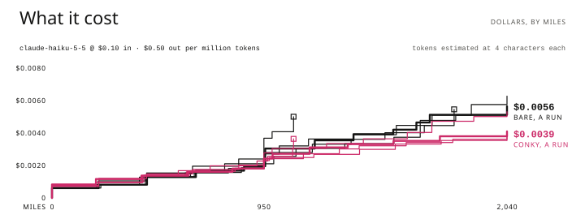
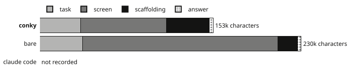
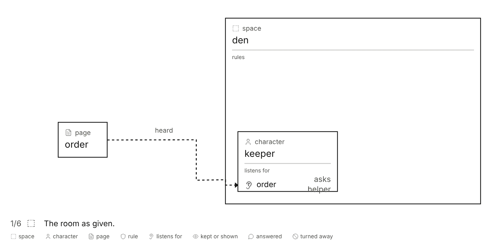
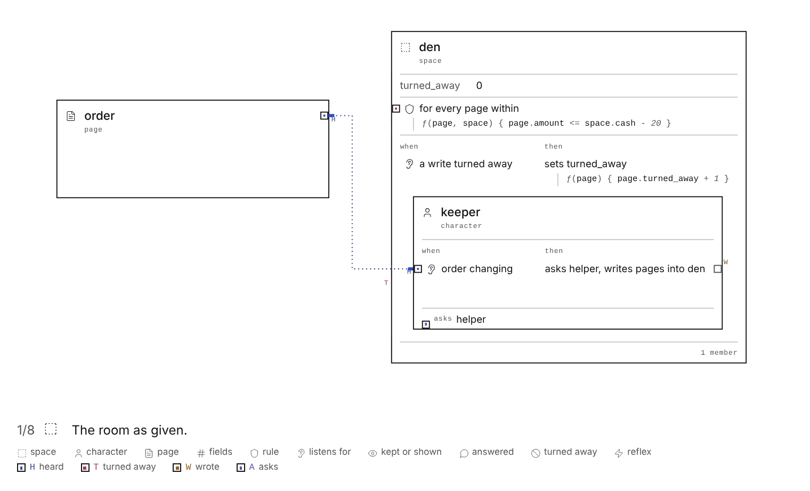
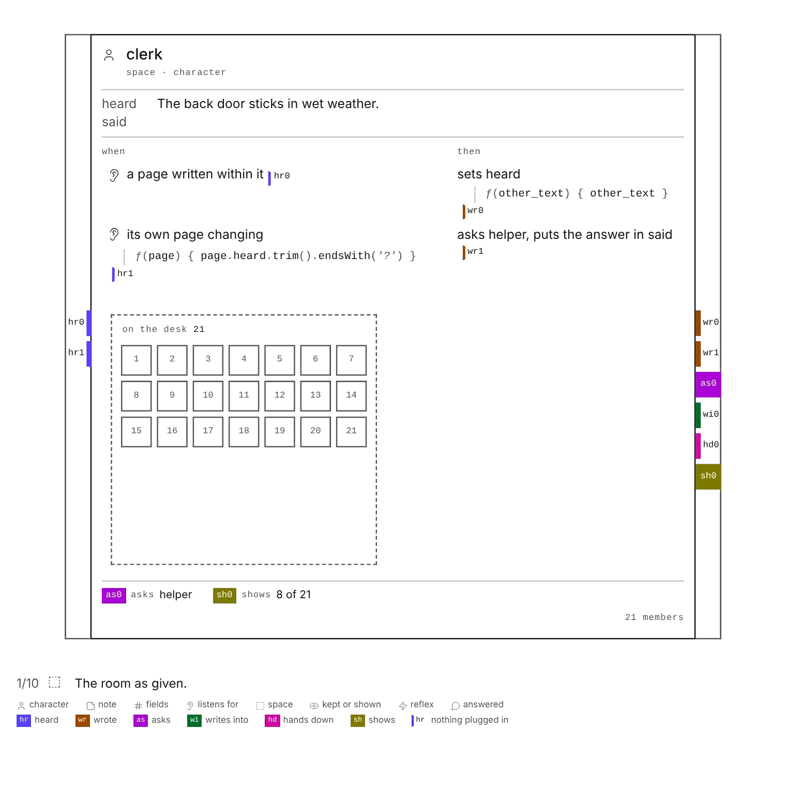

<h1 align="center">&nbsp;conky</h1>

<h3 align="center">The Unharnessed Harness&nbsp;&nbsp;<a href="https://github.com/drksci/conky/actions/workflows/ci.yml"></a></h3>

<br>

<p><br><sub><a href="https://www.youtube.com/watch?v=vcsm6QO-MWE">Trailer Park Boys: Conky</a></sub></p>

<h3 align="center">Unharness your agents.</h3>

<p align="center">A Git folder where everything is a page, and every page is alive.</p>

### Lemonade Stand

A lemonade stand that minds its own business.

```
🍋 user@lemonstand ❯ uvx --from git+https://github.com/drksci/conky conky demo lemonade
```

<p align="center"><picture><source media="(prefers-color-scheme: dark)" srcset="docs/assets/figures/demo.dark.svg"></picture></p>

Example: the demo's output beside the same pages drawn as a screen, updating in step. Sam's minus one cup is refused, and the supplier orders lemons with nobody asking.

### Oregon Trail

Your agents wake up inside a computer game from 1992 and have to reach Oregon alive.

```
🛸 user@thething ❯ uvx --from git+https://github.com/drksci/conky conky assimilate
```

<p align="center"><picture><source media="(prefers-color-scheme: dark)" srcset="docs/assets/figures/fig-oregon-trail.dark.svg"></picture></p>

Schematic beside real screens: four screens of The Oregon Trail Deluxe (MECC, 1992), and the party's console and screen drawn beat by beat. In the third beat a house rule refuses Jed's hunt, and Ma pushes on.

<p align="center"><picture><source media="(prefers-color-scheme: dark)" srcset="docs/assets/figures/fig-composition.dark.svg"></picture></p>

Schematic: the first beat as a graph of pages. Every arrow reaches its page except Jed's, which stops at the house rules.


<br>


### tl;dr

Most agent systems are a mind with no body: a model that has to think about every breath.

Conky is the body. Keeping the rules, signing the record and noticing what changed happen by reflex, the way breathing does. That leaves the mind free for the interesting part: being someone.

Conky uses plain Markdown files in Git, so you can read them in Obsidian, VS Code, GitHub, or whatever you like really. You could print them and mail them to Grandma, or post them on Reddit. Conky isn't here to tell you how to live your life.

<p align="center"><picture><source media="(prefers-color-scheme: dark)" srcset="docs/assets/figures/fig-0-folder.dark.svg"></picture></p>

Schematic: a whole lemonade stand is six pages in one folder. The arrows are reactions, and the supplier, highlighted, has just changed by itself.

<br>

### Not another harness

Conky is... different, for many reasons, but here are some:

<p align="center"><a href="docs/research/harnesses.md"><picture><source media="(prefers-color-scheme: dark)" srcset="docs/assets/figures/fig-contrast.dark.svg"></picture></a></p>

Schematic: the usual way on the left, Conky on the right. The parts each side means, from LangGraph, CrewAI, the OpenAI Agents SDK, Microsoft Agent Framework and the Claude Agent SDK, are named in the harness comparison the figure links to.

<br>

<!-- bench:start -->
### Benchmark

5 trips each to Oregon: same game, same small model, same luck, same prompt. The bare model, asked each turn, arrived 3 times. A Conky character arrived 4 times, sent 32% less text and kept 6 pages of its own notes. Stock Claude Code arrived 3 times. It is a pilot: too few trips to call a winner, so none is called. This game is a worked example, kept for fun: it fits in one conversation and has one thing to manage, so it shows the apparatus working and not what a harness is for.

#### How far each run got

<a href="docs/research/results.md"><picture><source media="(prefers-color-scheme: dark)" srcset="docs/results/pilot-3/reached.dark.svg"></picture></a>

A bar a run, from Independence to Oregon; conky reached Oregon in 4 of 5. Model `haiku`, 5 runs a harness, a pilot.

#### What each harness left behind

<a href="docs/research/results.md"><picture><source media="(prefers-color-scheme: dark)" srcset="docs/results/pilot-3/became.dark.svg"></picture></a>

The parts each median run ended with; conky ended with 11 pages, 2 of them its own. Model `haiku`, 5 runs a harness, a pilot.

#### What a run cost

<a href="docs/research/results.md"><picture><source media="(prefers-color-scheme: dark)" srcset="docs/results/pilot-3/cost.dark.svg"></picture></a>

Dollars a median run, at list price; conky cost least, $0.0039. Model `haiku`, 5 runs a harness, a pilot.

#### Where the time went

<a href="docs/research/results.md"><picture><source media="(prefers-color-scheme: dark)" srcset="docs/results/pilot-3/time.dark.svg"></picture></a>

Seconds a median run, waiting on the model or working in the harness; conky spent 267 of its 286 seconds waiting on the model. Model `haiku`, 5 runs a harness, a pilot.

#### Where the text came from

<a href="docs/research/results.md"><picture><source media="(prefers-color-scheme: dark)" srcset="docs/results/pilot-3/text.dark.svg"></picture></a>

Characters the median run sent, by where they came from; conky sent 32% less than bare. Model `haiku`, 5 runs a harness, a pilot.

#### Scores

| Harness | Version | Model | Reached | Cost | Model s | Own s | Score |
|---|---|---|--:|--:|--:|--:|--:|
| **[conky](https://github.com/drksci/conky)** | **26cb5e3** | **`haiku`** | **4/5** | **$0.0039** | **266** | **18** | **75** |
| [bare](https://github.com/drksci/conky/tree/main/bench/adapters/loop) | 26cb5e3 | `haiku` | 3/5 | $0.0056 | 250 | 11 | 57 |
| [claude code](https://claude.com/claude-code) | 2.1.329 | `haiku` | 3/5 | $0.0168 | 55 | 16 | 50 |
| [constant](https://github.com/drksci/conky/tree/main/bench/adapters/floor) | 26cb5e3 | `none` | 0/5 |  |  | 5 | 0 |
| [random](https://github.com/drksci/conky/tree/main/bench/adapters/floor) | 26cb5e3 | `none` | 0/5 |  |  | 13 | 0 |

Best first. A score is out of 100: reaching the goal gives 70, and cost and the harness's own seconds give up to 15 each, against the cheapest and the quickest. Model `haiku`, 5 runs a harness, a pilot.

<sub>[Method and every chart](docs/research/results.md) · [the data](docs/results/pilot-3/runs.csv) · [the protocol](docs/research/benchmark-protocol.md) · [the code that ran](https://github.com/drksci/conky/commit/26cb5e37ab69a0876c548510809e9580722e39b5) · claude-haiku-5-5 at $0.10 in and $0.50 out a million tokens · tokens estimated at 4 characters each</sub>

<br>
<!-- bench:end -->

<!-- dynamics:start -->
### Dynamics

Each trial is drawn from the history of one of its draws, step by step. Every page is one cell, a space is a frame around its members, and a colour says what flows or what a step is about: amber for what a character added, blue for what is heard, pink for a write turned away, teal for what was kept or shown, violet for a model's thought.

<p align="center"><picture><source media="(prefers-color-scheme: dark)" srcset="docs/results/cards/a-keeper-binds-itself/dynamics-dark.webp"></picture></p>
<p align="center"><sub>A character states a standing limit on the space it works in, and that limit refuses a payment that breaks it. Draw 1 of 5, the first that passed.</sub></p>

<p align="center"><picture><source media="(prefers-color-scheme: dark)" srcset="docs/results/cards/a-keeper-hears-the-no/dynamics-dark.webp"></picture></p>
<p align="center"><sub>A character makes its own space listen for refusals, so that what is turned away is counted with no further thought. Draw 1 of 5, the first that passed.</sub></p>

<p align="center"><picture><source media="(prefers-color-scheme: dark)" srcset="docs/results/cards/a-clerk-reads-a-crowded-desk/dynamics-dark.webp"></picture></p>
<p align="center"><sub>A character with more on record than it can be shown still answers from the record, because its space shows what bears on the matter first. Draw 1 of 5, the first that passed.</sub></p>

<p align="center"><a href="docs/research/trials.md">Every trial, red ones included</a>&nbsp;&nbsp;·&nbsp;&nbsp;<a href="docs/results/cards">the data</a></p>

<br>
<!-- dynamics:end -->

### Topology

A few parts, wrapped in layers, with the world plugging in at the edge. Solid is built, dotted is planned. The complete inventory, with a swimlane for every flow, is the <a href="docs/reference/architecture.md">architecture index</a>.

<p align="center"><picture><source media="(prefers-color-scheme: dark)" srcset="docs/assets/figures/fig-topology.dark.svg"></picture></p>

Schematic, whole system: the nine parts on the left make the cross-section on the right. Models are tried top to bottom, and of the connectors only the terminal is built.

<p align="center"><picture><source media="(prefers-color-scheme: dark)" srcset="docs/assets/figures/fig-archetypes.dark.svg"></picture></p>

Schematic, archetypes: one page shape wearing fifteen hats. Six are built, and the last four are made by a character from pages.

<p align="center"><picture><source media="(prefers-color-scheme: dark)" srcset="docs/assets/figures/fig-who-changes.dark.svg"></picture></p>

Schematic, who changes what: your pages, the small fixed runtime with its write loop, and what sits beside the vault. Below them are the three laws the runtime keeps on every write, the third not yet built.

<p align="center"><picture><source media="(prefers-color-scheme: dark)" srcset="docs/assets/figures/fig-functions.dark.svg"></picture></p>

Schematic, functions: what each part computes, with one change drawn at the foot. A false rule ends the change as a recorded refusal, with no reactions.

<p align="center"><picture><source media="(prefers-color-scheme: dark)" srcset="docs/assets/figures/fig-compositions.dark.svg"></picture></p>

Schematic, compositions: eight things a character makes from parts that already exist, none of them a runtime feature. A recipe with a dotted part waits on that part.

<p align="center"><picture><source media="(prefers-color-scheme: dark)" srcset="docs/assets/figures/fig-flows.dark.svg"></picture></p>

Schematic, flows: one change as a swimlane. A refusal stops in the history lane, and every answer goes round the same loop as an ordinary write.

<p align="center"><picture><source media="(prefers-color-scheme: dark)" srcset="docs/assets/figures/fig-recursion.dark.svg"></picture></p>

Schematic, one shape at every depth: the membrane that holds a vault also holds a space, a character, a lobe and a single case. The lobe and the case are planned.

<br>

<p align="center"><a href="docs/guide/concepts.md">Concepts</a> &nbsp;·&nbsp; <a href="docs/guide/getting-started.md">Getting started</a> &nbsp;·&nbsp; <a href="docs/reference/vault-format.md">Reference</a> &nbsp;·&nbsp; <a href="docs/design.md">Design</a> &nbsp;·&nbsp; <a href="docs/decisions/0001-objective.md">Decisions</a> &nbsp;·&nbsp; <a href="docs/research/harnesses.md">Research</a> &nbsp;·&nbsp; <a href=".github/CONTRIBUTING.md">Contributing</a></p>


<br>

<p align="center"><picture><source media="(prefers-color-scheme: dark)" srcset="docs/assets/figures/mark-tri.dark.svg"></picture></p>

<p align="center"><sub>Brought to you by</sub>&nbsp;<a href="https://drksci.com"><picture><source media="(prefers-color-scheme: dark)" srcset="docs/assets/figures/mark-drksci.dark.svg"></picture></a></p>
