<h3 align="center">&nbsp;<picture><source media="(prefers-color-scheme: dark)" srcset="docs/assets/figures/name.dark.svg"></picture></h3>

<h3 align="center">The Unharnessed Harness&nbsp;&nbsp;<a href="https://github.com/drksci/conky/actions/workflows/ci.yml"></a></h3>

<br>

<p><br><sub><a href="https://www.youtube.com/watch?v=vcsm6QO-MWE">Trailer Park Boys: Conky</a></sub></p>

<h3 align="center">Unharness your agents.</h3>

<p align="center">A Git folder where everything is a page, and every page is alive.</p>

### Lemonade Stand

A lemonade stand that minds its own business.

```
🍋 user@lemonstand ❯ uvx --from git+https://github.com/drksci/conky conky demo lemonade
```

<p align="center"><picture><source media="(prefers-color-scheme: dark)" srcset="docs/assets/figures/demo.dark.svg"></picture></p>

### Oregon Trail

Your agents wake up inside a computer game from 1992 and have to reach Oregon alive.

```
🛸 user@thething ❯ uvx --from git+https://github.com/drksci/conky conky assimilate
```

<p align="center"><picture><source media="(prefers-color-scheme: dark)" srcset="docs/assets/figures/fig-oregon-trail.dark.svg"></picture></p>

<p align="center"><picture><source media="(prefers-color-scheme: dark)" srcset="docs/assets/figures/fig-composition.dark.svg"></picture></p>


<br>


### tl;dr

Most agent systems are a mind with no body: a model that has to think about every breath.

Conky is the body. Keeping the rules, signing the record and noticing what changed happen by reflex, the way breathing does. That leaves the mind free for the interesting part: being someone.

Conky uses plain Markdown files in Git, so you can read them in Obsidian, VS Code, GitHub, or whatever you like really. You could print them and mail them to Grandma, or post them on Reddit. Conky isn't here to tell you how to live your life.

<p align="center"><picture><source media="(prefers-color-scheme: dark)" srcset="docs/assets/figures/fig-0-folder.dark.svg"></picture></p>

<br>

### Not another harness

Conky is... different, for many reasons, but here are some:

<p align="center"><a href="docs/research/harnesses.md"><picture><source media="(prefers-color-scheme: dark)" srcset="docs/assets/figures/fig-contrast.dark.svg"></picture></a></p>


<br>

<p align="center"><a href="docs/guide/concepts.md">Concepts</a> &nbsp;·&nbsp; <a href="docs/guide/getting-started.md">Getting started</a> &nbsp;·&nbsp; <a href="docs/reference/vault-format.md">Reference</a> &nbsp;·&nbsp; <a href="docs/design.md">Design</a> &nbsp;·&nbsp; <a href="docs/decisions/0001-objective.md">Decisions</a> &nbsp;·&nbsp; <a href="docs/research/harnesses.md">Research</a> &nbsp;·&nbsp; <a href="CONTRIBUTING.md">Contributing</a></p>


<br>

<p align="center"><picture><source media="(prefers-color-scheme: dark)" srcset="docs/assets/figures/mark-tri.dark.svg"></picture></p>

<p align="center"><sub>Brought to you by</sub>&nbsp;<a href="https://drksci.com"><picture><source media="(prefers-color-scheme: dark)" srcset="docs/assets/figures/mark-drksci.dark.svg"></picture></a></p>
