# Topology

Six plates of the same system, drawn with the same marks. Solid is built and dotted is planned. Each is a schematic, and the complete inventory behind them is the [architecture index](../reference/architecture.md).

## 1. The whole

The parts on the left are the whole alphabet. The cross-section on the right is made of nothing else. Deeper is more fundamental, and the outside docks at the edge.

<picture><source media="(prefers-color-scheme: dark)" srcset="../../docs/assets/figures/fig-topology.dark.svg"></picture>

## 2. The flows

One change, followed all the way round. A refusal is recorded and nothing else happens. An answer is a write, so it goes round the same loop, twelve deep at most.

<picture><source media="(prefers-color-scheme: dark)" srcset="../../docs/assets/figures/fig-flows.dark.svg"></picture>

## 3. The functions

What each part computes. Rules and measures are pure. The model call is the only step that is not.

<picture><source media="(prefers-color-scheme: dark)" srcset="../../docs/assets/figures/fig-functions.dark.svg"></picture>

## 4. Archetypes

Everything is a page. The kinds differ only in what they carry and who makes them.

<picture><source media="(prefers-color-scheme: dark)" srcset="../../docs/assets/figures/fig-archetypes.dark.svg"></picture>

## 5. Who changes what

Behaviour is added by writing pages, never by changing the runtime. Three laws hold on every write: reach flows down, rules only tighten, spending is conserved. The third is not built.

<picture><source media="(prefers-color-scheme: dark)" srcset="../../docs/assets/figures/fig-who-changes.dark.svg"></picture>

## 6. Compositions

Bigger things are sums of the same parts, made by characters. None of these is machinery in the runtime.

<picture><source media="(prefers-color-scheme: dark)" srcset="../../docs/assets/figures/fig-compositions.dark.svg"></picture>

