<!-- Generated by scripts/gen_architecture.py. Do not edit by hand. -->

# Architecture index

This page is the complete inventory of Conky's architecture, generated from markers in the code (what is built) and from the frontmatter of the ideas and decisions (what is planned). Every law, part, layer, kind of page, slot, kind of data, change of state, stage of attention and flow is a row. A figure or a document that shows something this page does not list is incomplete, and the fix is to mark the code, or add to the document's `arch`, and run `python scripts/gen_architecture.py`. The words are in [vocabulary](vocabulary.md), and the model in short is [design](../design.md).

`scripts/check_docs.py` fails when this page differs from what the generator makes. Nobody edits it by hand.

Every entry has a dotted name of the form `kind.subject.aspect`, and an anchor equal to that name, so a link never depends on a heading. A step of a flow is the name of the flow, then `#` and its number, as in `flow.write.accept#3`. The generator fails when a backticked name that starts with one of these kinds appears anywhere under `docs/` and names no entry.

## States

| State | Means |
|---|---|
| built | Marked in the code, and the roadmap step, when there is one, is `done`. |
| building | The roadmap step is `next`. |
| planned | A document holds it and a roadmap step is `later`. |
| idea | A document holds it with no step. |

## 1. Laws

The capability and the three laws of [decision 0029](../decisions/0029-autonomy-inside-limits-that-hold.md), and each law of CLAUDE.md's "The model" section. A test of `review` is a gap to close.

| Law | Statement | Defined | Code | Test | Step | State |
|---|---|---|---|---|---|---|
| <a id="law.answer.pages"></a>`law.answer.pages` | An answer is pages, so a character can make notes, characters, spaces and rules. | [rules-and-reactions.md#an-answer-that-is-pages](rules-and-reactions.md#an-answer-that-is-pages) | `conky.vault.Vault._land` | `tests/test_laws.py::test_a_character_gives_its_space_a_reflex_that_counts_later_refusals`<br>`tests/test_laws.py::test_an_answer_cannot_remove_or_replace_what_its_space_has`<br>`tests/test_pages.py::test_an_answer_with_two_pages_writes_both_as_the_asker_caused_by_the_answer` | R29 | built |
| <a id="law.data.three"></a>`law.data.three` | Data is a document, a table or a stream, and a change of shape is a forward re-projection. | [0010-no-debt-no-down-migrations.md](../decisions/0010-no-debt-no-down-migrations.md) | `conky.page.serialize` | `tests/test_laws.py::test_golden_vault_still_reads` | - | built |
| <a id="law.debt.none"></a>`law.debt.none` | No fix-later notes, shims or dead code. | [0010-no-debt-no-down-migrations.md](../decisions/0010-no-debt-no-down-migrations.md) | `tests/test_house.py` | `tests/test_house.py::test_no_fix_later_notes` | - | built |
| <a id="law.docs.check"></a>`law.docs.check` | Ideas climb rungs, and the documents, links and this index are checked. | [0015-ideas-climb-rungs.md](../decisions/0015-ideas-climb-rungs.md) | `scripts/check_docs.py` | `tests/test_docs.py::test_docs_pass_the_check` | - | built |
| <a id="law.embed.anonymous"></a>`law.embed.anonymous` | An embed shows a page's words and nothing about who wrote them. | [vault-format.md#pages](vault-format.md#pages) | `conky.page.resolve_text` | `tests/test_laws.py::test_nothing_a_model_is_shown_says_whether_a_page_was_written_by_a_person_or_a_model` | - | built |
| <a id="law.embed.context"></a>`law.embed.context` | A prompt that embeds a page's context is told what its spaces say, so joining a space changes what a character is told and leaving it takes that away. | [vault-format.md#pages](vault-format.md#pages) | `conky.page.resolve_text` | `tests/test_context.py::test_joining_a_space_changes_what_is_asked_and_leaving_takes_it_away` | - | built |
| <a id="law.embed.shows"></a>`law.embed.shows` | A space says how its members are shown, and the order is worked out on reading, never stored. | [vault-format.md#pages](vault-format.md#pages) | `conky.page._members_text` | `tests/test_shows.py::test_a_space_that_shows_orders_by_first_and_cuts_to_most`<br>`tests/test_shows.py::test_reading_a_space_that_shows_writes_nothing` | R40 | built |
| <a id="law.event.notice"></a>`law.event.notice` | Every recorded event can be noticed by the pages in relation to it, and the entry says what picks it up: a reflex, a faculty or the character. | [0039-an-event-can-be-noticed.md](../decisions/0039-an-event-can-be-noticed.md) | `conky.vault.Vault._tell` | `tests/test_laws.py::test_a_refusal_can_be_noticed_and_stays_a_refusal`<br>`tests/test_laws.py::test_a_character_gives_its_space_a_reflex_that_counts_later_refusals` | R38 | built |
| <a id="law.event.seal"></a>`law.event.seal` | Every change is signed and says what caused it. | [vault-format.md#a-write](vault-format.md#a-write) | `conky.vault.Vault._record` | `tests/test_laws.py::test_write_is_a_signed_commit_with_trailers_and_dates`<br>`tests/test_laws.py::test_reaction_is_caused_by_and_signed_by_the_reacting_page` | - | built |
| <a id="law.fallback.always"></a>`law.fallback.always` | Everything works with nothing configured, and rules stay strict. | [0026-it-always-works.md](../decisions/0026-it-always-works.md) | `conky.model.detect` | `tests/test_command.py::test_detection_lists_anthropic_then_openai_then_claude_then_codex`<br>`tests/test_command.py::test_a_failing_detected_model_falls_to_the_next_and_then_to_a_sentence`<br>`tests/test_command.py::test_with_no_model_an_ask_writes_a_sentence_that_names_the_question` | R26 | built |
| <a id="law.link.known"></a>`law.link.known` | A page is known by the phrases it lists, and text that uses one counts as linking to it. | [0044-a-page-is-known-by-its-phrases.md](../decisions/0044-a-page-is-known-by-its-phrases.md) | `conky.page.Terms` | `tests/test_terms.py::test_a_vault_with_no_phrases_links_only_by_brackets`<br>`tests/test_terms.py::test_a_write_that_uses_a_phrase_tells_its_watchers_and_the_vault_verifies` | R41 | built |
| <a id="law.measure.watch"></a>`law.measure.watch` | A measure is a page watching itself, and its value is a recorded event. | [0008-measures-are-self-watches.md](../decisions/0008-measures-are-self-watches.md) | `conky.vault.Vault._react` | `tests/test_laws.py::test_other_size_is_visible_to_a_watcher`<br>`tests/test_laws.py::test_history_needs_no_expressions` | R2 | built |
| <a id="law.output.out"></a>`law.output.out` | Runtime output never enters the repository, except the golden vault. | [CLAUDE.md](../../CLAUDE.md) | `.gitignore` | review | - | built |
| <a id="law.page.commit"></a>`law.page.commit` | Pages are the committed files, and a stray edit is refused or discarded. | [vault-format.md#what-verify-checks](vault-format.md#what-verify-checks) | `conky.vault.Vault.verify` | `tests/test_laws.py::test_hand_edited_page_fails_verify_and_blocks_writes`<br>`tests/test_laws.py::test_rebuild_discards_stray_files` | - | built |
| <a id="law.pressure.notice"></a>`law.pressure.notice` | Anything to be noticed is a pressure that triggers a reaction, not a wall. | [rules-and-reactions.md#measures](rules-and-reactions.md#measures) | `conky.vault.Vault._react` | `tests/test_laws.py::test_page_without_a_size_rule_accepts_a_large_body`<br>`tests/test_laws.py::test_pressure_rises_without_refusing_work`<br>`tests/test_laws.py::test_threshold_fires_a_reaction_and_the_sequence_settles` | R2 | built |
| <a id="law.provider.page"></a>`law.provider.page` | A provider is a page, and a secret is never written to a vault. | [0019-providers-are-pages.md](../decisions/0019-providers-are-pages.md) | `conky.model.provider` | `tests/test_model.py::test_changing_provider_is_editing_one_page`<br>`tests/test_model.py::test_a_secret_appears_nowhere_in_the_vault` | R4 | built |
| <a id="law.reach.down"></a>`law.reach.down` | A character writes only inside the space it was given, and creates nothing wider. | [0029-autonomy-inside-limits-that-hold.md](../decisions/0029-autonomy-inside-limits-that-hold.md) | `conky.vault.Vault._breach` | `tests/test_pages.py::test_a_page_outside_the_space_is_refused_and_recorded_and_the_others_land`<br>`tests/test_pages.py::test_a_watch_entry_cannot_widen_where_a_character_may_write` | R29 | built |
| <a id="law.reflex.free"></a>`law.reflex.free` | Whatever follows from state is a reflex with no model call. | [0007-inference-for-real-thinking.md](../decisions/0007-inference-for-real-thinking.md) | `conky.vault.Vault._react` | `tests/test_laws.py::test_reaction_is_caused_by_and_signed_by_the_reacting_page`<br>`tests/test_model.py::test_every_failure_is_a_model_refusal_and_nothing_else_is_affected` | - | built |
| <a id="law.refusal.record"></a>`law.refusal.record` | A refused write is recorded as an empty commit, never dropped. | [vault-format.md#a-refusal](vault-format.md#a-refusal) | `conky.vault.Vault._refuse` | `tests/test_laws.py::test_refused_write_is_an_empty_signed_commit`<br>`tests/test_laws.py::test_a_refusal_can_be_noticed_and_stays_a_refusal` | - | built |
| <a id="law.rule.never"></a>`law.rule.never` | Anything that must never happen is a rule the runtime evaluates. | [rules-and-reactions.md#expressions](rules-and-reactions.md#expressions) | `conky.rules.holds` | `tests/test_laws.py::test_rule_error_refuses`<br>`tests/test_laws.py::test_rule_inherited_through_two_level_chain`<br>`tests/test_laws.py::test_size_rule_in_a_space_refuses_an_oversized_member` | - | built |
| <a id="law.rule.proven"></a>`law.rule.proven` | An `each` rule is tried on the pages already within when it is written, so it lands only if it can be evaluated and holds for them. | [rules-and-reactions.md#rules-and-spaces](rules-and-reactions.md#rules-and-spaces) | `conky.vault.Vault._each_reason` | review | - | built |
| <a id="law.rule.pure"></a>`law.rule.pure` | Rules and measures are pure: no clock, randomness or input and output. | [rules-and-reactions.md#expressions](rules-and-reactions.md#expressions) | `conky.rules.evaluate` | review | - | built |
| <a id="law.rule.tighten"></a>`law.rule.tighten` | A member adds a rule and cannot remove one or leave one behind. | [0022-leaving-a-space-is-a-write-the-space-can-refuse.md](../decisions/0022-leaving-a-space-is-a-write-the-space-can-refuse.md) | `conky.vault.Vault._rule_reason` | `tests/test_laws.py::test_leaving_a_space_is_judged_by_the_rules_of_the_space_it_leaves`<br>`tests/test_laws.py::test_a_changed_space_field_refuses_the_next_member_write`<br>`tests/test_laws.py::test_an_answer_cannot_remove_or_replace_what_its_space_has`<br>`tests/test_pages.py::test_a_rule_of_a_space_refuses_a_page_that_breaks_it`<br>`tests/test_pages.py::test_a_character_can_add_a_rule_to_a_space_it_made_and_the_rule_binds_a_later_write`<br>`tests/test_pages.py::test_an_answer_adds_a_rule_to_its_space_signed_by_the_asker`<br>`tests/test_spaces.py::test_joining_is_refused_by_the_space_joined`<br>`tests/test_spaces.py::test_leaving_is_refused_by_the_space_left_and_a_move_by_both` | R29 | built |
| <a id="law.runtime.fixed"></a>`law.runtime.fixed` | The runtime is not a page, so no character can change it. | [0029-autonomy-inside-limits-that-hold.md](../decisions/0029-autonomy-inside-limits-that-hold.md) | `conky.vault.Vault._breach` | `tests/test_pages.py::test_a_character_cannot_write_a_secret_or_a_command_into_a_page` | - | built |
| <a id="law.scope.out"></a>`law.scope.out` | No batching to hide, no second authority, no hidden state, no control by instruction. | [0018-not-doing.md](../decisions/0018-not-doing.md) | `docs/decisions/0018-not-doing.md` | review | - | built |
| <a id="law.vault.golden"></a>`law.vault.golden` | The vault format is held stable by a golden vault that every version reads. | [0012-rust-core-planned.md](../decisions/0012-rust-core-planned.md) | `conky.page.parse` | `tests/test_laws.py::test_golden_vault_still_reads` | - | built |
| <a id="law.vault.travel"></a>`law.vault.travel` | A vault travels alone, verifies anywhere and holds no private key. | [vault-format.md#reading-with-plain-git](vault-format.md#reading-with-plain-git) | `conky.git.init` | `tests/test_laws.py::test_init_sets_the_repository_up_for_plain_git`<br>`tests/test_laws.py::test_vault_travels_alone_by_clone_and_by_bundle`<br>`tests/test_laws.py::test_no_private_key_material_under_the_vault` | - | built |
| <a id="law.word.exist"></a>`law.word.exist` | The vocabulary is what exists, checked against the code both ways. | [0027-the-vocabulary-is-what-exists.md](../decisions/0027-the-vocabulary-is-what-exists.md) | `conky.cli.main` | `tests/test_house.py::test_vocabulary_agrees_with_the_code` | - | built |
| <a id="law.write.only"></a>`law.write.only` | State changes only through a write committed to the history. | [0002-git-is-the-store.md](../decisions/0002-git-is-the-store.md) | `conky.vault.Vault.write` | `tests/test_laws.py::test_write_is_a_signed_commit_with_trailers_and_dates` | - | built |
| <a id="law.context.down"></a>`law.context.down` | A space hands its fields down: the nearest space wins, the first listed wins a tie, and a rule reads them as `space`. | [rules-and-reactions.md#context-from-spaces](rules-and-reactions.md#context-from-spaces) | `conky.vault.Vault._context` | `tests/test_laws.py::test_a_changed_space_field_refuses_the_next_member_write`<br>`tests/test_spaces.py::test_the_space_listed_first_wins_among_a_pages_own_spaces`<br>`tests/test_spaces.py::test_a_nearer_space_beats_a_farther_one_whatever_the_order`<br>`tests/test_spaces.py::test_a_space_reached_by_two_paths_counts_at_its_nearest_distance` | R22 | building |
| <a id="law.data.derived"></a>`law.data.derived` | Derived data is optional, outside the history, rebuildable and safe to delete. | [0017-derived-data.md](../decisions/0017-derived-data.md) | - | - | R11 | planned |
| <a id="law.spend.conserve"></a>`law.spend.conserve` | What a space may spend is shared among what is inside it, so making more characters divides a budget. | [0029-autonomy-inside-limits-that-hold.md](../decisions/0029-autonomy-inside-limits-that-hold.md) | - | - | R17 | planned |
| <a id="law.spend.meter"></a>`law.spend.meter` | Anything that runs in the background declares a budget and is metered. | [background-minds.md](../ideas/background-minds.md) | - | - | R17 | planned |
| <a id="law.vault.hold"></a>`law.vault.hold` | A person can hold a vault and step it. | [stepping.md](../ideas/stepping.md) | - | - | R28 | planned |

## 2. Parts

Every concept word and verb of the [vocabulary](vocabulary.md), and each named part of the runtime. The vocabulary page lists the names the code exposes, and `tests/test_house.py` compares it with the code.

| Part | Layer | What | Defined | Code | Step | State |
|---|---|---|---|---|---|---|
| <a id="part.key"></a>`part.key` | [`layer.git`](#layer.git) | A signing key of one actor, kept outside the vault. | [vault-format.md#identity-and-signing](vault-format.md#identity-and-signing) | `conky.git.register` | - | built |
| <a id="part.seal"></a>`part.seal` | [`layer.git`](#layer.git) | The signature on an event, made with Git's SSH signing. | [vault-format.md#identity-and-signing](vault-format.md#identity-and-signing) | `conky.git.commit` | - | built |
| <a id="part.core.rust"></a>`part.core.rust` | [`layer.git`](#layer.git) | A core in Rust, compiled natively and to WebAssembly, passing the same golden vault. | [0012-rust-core-planned.md](../decisions/0012-rust-core-planned.md) | - | R19 | planned |
| <a id="part.key.rotate"></a>`part.key.rotate` | [`layer.git`](#layer.git) | Adding, retiring and revoking a signer as recorded events, with each event judged against the signers in force when it was made. | [keys.md](../ideas/keys.md) | - | R32 | idea |
| <a id="part.embed"></a>`part.embed` | [`layer.history`](#layer.history) | `![[page]]`, `![[page#field]]`, `![[space#members]]` or `![[page#context]]`, resolved on read and in prompts. | [vault-format.md#pages](vault-format.md#pages) | `conky.page.resolve_text` | - | built |
| <a id="part.error"></a>`part.error` | [`layer.history`](#layer.history) | A message that says what went wrong and what to do next. | [cli.md#errors](cli.md#errors) | `conky.errors.BadInput` | - | built |
| <a id="part.event"></a>`part.event` | [`layer.history`](#layer.history) | A commit: one write or one refusal. | [vault-format.md#commits](vault-format.md#commits) | `conky.vault.Vault._record` | - | built |
| <a id="part.page"></a>`part.page` | [`layer.history`](#layer.history) | Markdown with frontmatter, serialised the same way every time. | [vault-format.md#pages](vault-format.md#pages) | `conky.page.Page` | - | built |
| <a id="part.read"></a>`part.read` | [`layer.history`](#layer.history) | Return a page with its embeds resolved. | [cli.md#read](cli.md#read) | `conky.vault.Vault.read` | - | built |
| <a id="part.vault"></a>`part.vault` | [`layer.history`](#layer.history) | A Git repository whose commits are the history. | [vault-format.md#layout](vault-format.md#layout) | `conky.vault.Vault` | - | built |
| <a id="part.write"></a>`part.write` | [`layer.history`](#layer.history) | Commit a change to a page, or commit its refusal. | [cli.md#write](cli.md#write) | `conky.vault.Vault.write` | - | built |
| <a id="part.write.group"></a>`part.write.group` | [`layer.history`](#layer.history) | Several pages changed in one commit, with rules that see the whole group. | [patterns.md](../ideas/patterns.md) | - | R24 | planned |
| <a id="part.link"></a>`part.link` | [`layer.history`](#layer.history) | A page name written in a page so that one page points at another. No runtime code reads one, so it stays a convention. | [auto-linking.md](../ideas/auto-linking.md) | - | R15 | idea |
| <a id="part.rename"></a>`part.rename` | [`layer.history`](#layer.history) | One change that also rewrites every link and embed that points at a page. | [rename.md](../ideas/rename.md) | - | R15 | idea |
| <a id="part.write.serial"></a>`part.write.serial` | [`layer.history`](#layer.history) | Writes from several processes to one vault taken one at a time, each judged against the state the one before it left. | [writers.md](../ideas/writers.md) | - | R33 | idea |
| <a id="part.rule"></a>`part.rule` | [`layer.reflex`](#layer.reflex) | A CEL expression judged before a write is kept. | [rules-and-reactions.md#expressions](rules-and-reactions.md#expressions) | `conky.rules.holds` | - | built |
| <a id="part.rule.captures"></a>`part.rule.captures` | [`layer.reflex`](#layer.reflex) | The groups of the first match of a pattern, else an empty list. | [rules-and-reactions.md#text-functions](rules-and-reactions.md#text-functions) | `conky.rules._captures` | - | built |
| <a id="part.rule.capturesall"></a>`part.rule.capturesall` | [`layer.reflex`](#layer.reflex) | The first group of every match of a pattern, else an empty list. | [rules-and-reactions.md#text-functions](rules-and-reactions.md#text-functions) | `conky.rules._captures_all` | - | built |
| <a id="part.rule.indexof"></a>`part.rule.indexof` | [`layer.reflex`](#layer.reflex) | The position of a substring from an optional start, or -1. | [rules-and-reactions.md#text-functions](rules-and-reactions.md#text-functions) | `conky.rules._index_of` | - | built |
| <a id="part.rule.join"></a>`part.rule.join` | [`layer.reflex`](#layer.reflex) | Join a list of text with an optional separator. | [rules-and-reactions.md#text-functions](rules-and-reactions.md#text-functions) | `conky.rules._join` | - | built |
| <a id="part.rule.lowerascii"></a>`part.rule.lowerascii` | [`layer.reflex`](#layer.reflex) | Lower-case the ASCII letters only. | [rules-and-reactions.md#text-functions](rules-and-reactions.md#text-functions) | `conky.rules._lower_ascii` | - | built |
| <a id="part.rule.replace"></a>`part.rule.replace` | [`layer.reflex`](#layer.reflex) | Replace occurrences of a substring, with an optional limit. | [rules-and-reactions.md#text-functions](rules-and-reactions.md#text-functions) | `conky.rules._replace` | - | built |
| <a id="part.rule.split"></a>`part.rule.split` | [`layer.reflex`](#layer.reflex) | Split text on a separator, with an optional limit on the pieces. | [rules-and-reactions.md#text-functions](rules-and-reactions.md#text-functions) | `conky.rules._split` | - | built |
| <a id="part.rule.substring"></a>`part.rule.substring` | [`layer.reflex`](#layer.reflex) | Take the characters from a start to an optional end position. | [rules-and-reactions.md#text-functions](rules-and-reactions.md#text-functions) | `conky.rules._substring` | - | built |
| <a id="part.rule.trim"></a>`part.rule.trim` | [`layer.reflex`](#layer.reflex) | Remove leading and trailing whitespace. | [rules-and-reactions.md#text-functions](rules-and-reactions.md#text-functions) | `conky.rules._trim` | - | built |
| <a id="part.watch"></a>`part.watch` | [`layer.reflex`](#layer.reflex) | Name a page whose writes make this page react. | [rules-and-reactions.md#reactions](rules-and-reactions.md#reactions) | `conky.vault.Vault._react` | - | built |
| <a id="part.seal.signer"></a>`part.seal.signer` | [`layer.reflex`](#layer.reflex) | Rules that can see who signed a change and how it arose. | [approvals.md](../ideas/approvals.md) | - | R14 | planned |
| <a id="part.rule.origin"></a>`part.rule.origin` | [`layer.reflex`](#layer.reflex) | Rules that can see where a page's content came from: a person, a character, a model or a connector, and what a model read. | [provenance.md](../ideas/provenance.md) | - | R31 | idea |
| <a id="part.space"></a>`part.space` | [`layer.space`](#layer.space) | A page that others lie within, handing down its rules, with leaving judged. | [rules-and-reactions.md#rules-and-spaces](rules-and-reactions.md#rules-and-spaces) | `conky.vault.Vault._walk` | R29 | built |
| <a id="part.space.context"></a>`part.space.context` | [`layer.space`](#layer.space) | A space handing down its context and its reactions, and a page within several spaces. | [inheritance.md](../ideas/inheritance.md) | - | R22 | building |
| <a id="part.answer.cache"></a>`part.answer.cache` | [`layer.character`](#layer.character) | Model answers kept outside the history, keyed to the moment. | [providers.md#cache](providers.md#cache) | `conky.cache.Cache` | R30 | built |
| <a id="part.answer.format"></a>`part.answer.format` | [`layer.character`](#layer.character) | The reply cut into plain text and page blocks. | [rules-and-reactions.md#an-answer-that-is-pages](rules-and-reactions.md#an-answer-that-is-pages) | `conky.answer.split` | R29 | built |
| <a id="part.provider.detect"></a>`part.provider.detect` | [`layer.character`](#layer.character) | The models the environment offers, in the order to try them. | [providers.md#detection](providers.md#detection) | `conky.model.detect` | R26 | built |
| <a id="part.character.face"></a>`part.character.face` | [`layer.character`](#layer.character) | A fixed phrase per page, a stable identifier and a drawn face. | [seeds-and-faces.md](../ideas/seeds-and-faces.md) | - | R23 | planned |
| <a id="part.character.self"></a>`part.character.self` | [`layer.character`](#layer.character) | A seed, a face, a temperament and a voice for every page. | [character.md](../ideas/character.md) | - | R23 | planned |
| <a id="part.pattern.make"></a>`part.pattern.make` | [`layer.character`](#layer.character) | Domain structures are never built in. A pattern maker makes them on demand from worked examples. | [0009-patterns-not-features.md](../decisions/0009-patterns-not-features.md) | - | R6 | planned |
| <a id="part.character.habit"></a>`part.character.habit` | [`layer.character`](#layer.character) | A kept conclusion on a page: when a guard holds, then a response, because of a source, expecting what should follow. | [habit.md](../ideas/habit.md) | - | - | idea |
| <a id="part.cli.command"></a>`part.cli.command` | [`layer.edge`](#layer.edge) | `init write ask model read log verify rebuild connect demo assimilate cache export`. | [cli.md#commands](cli.md#commands) | `conky.cli.main` | - | built |
| <a id="part.cli.demo"></a>`part.cli.demo` | [`layer.edge`](#layer.edge) | A narrated example vault built with the real write path. | [cli.md#demo](cli.md#demo) | `conky.demo.build` | R20 | built |
| <a id="part.cli.present"></a>`part.cli.present` | [`layer.edge`](#layer.edge) | One result, two presenters: plain for scripts, styled for people. | [cli.md#colour-and-styled-output](cli.md#colour-and-styled-output) | `conky.present.choose` | - | built |
| <a id="part.connect.terminal"></a>`part.connect.terminal` | [`layer.edge`](#layer.edge) | The terminal connector, eyes and hands on a program. | [connectors.md#the-terminal-connector](connectors.md#the-terminal-connector) | `conky.connect.terminal` | - | built |
| <a id="part.export.notion"></a>`part.export.notion` | [`layer.edge`](#layer.edge) | The committed pages as Markdown notes for Notion's import, as a folder and a zip. | [connectors.md#showing-a-vault-elsewhere](connectors.md#showing-a-vault-elsewhere) | `conky.export.notion` | - | built |
| <a id="part.export.obsidian"></a>`part.export.obsidian` | [`layer.edge`](#layer.edge) | The committed pages as an Obsidian folder of notes, two JSON Canvas files and who.md. | [connectors.md#showing-a-vault-elsewhere](connectors.md#showing-a-vault-elsewhere) | `conky.export.obsidian` | - | built |
| <a id="part.vault.assimilate"></a>`part.vault.assimilate` | [`layer.edge`](#layer.edge) | Take over a stopped vault from its folder alone. | [cli.md#assimilate](cli.md#assimilate) | `conky.assimilate.run` | R21 | built |
| <a id="part.connect.protocol"></a>`part.connect.protocol` | [`layer.edge`](#layer.edge) | Connectors for the protocols people already use, each a door and not a room. | [connectors.md](../ideas/connectors.md) | - | R25 | planned |
| <a id="part.screen"></a>`part.screen` | [`layer.edge`](#layer.edge) | A screen derived from the pages as A2UI messages, drawn by a renderer. | [a2ui.md](../ideas/a2ui.md) | - | R11b | planned |
| <a id="part.screen.page"></a>`part.screen.page` | [`layer.edge`](#layer.edge) | One static page that renders the messages, with no server. | [a2ui.md](../ideas/a2ui.md) | - | R11c | planned |
| <a id="part.screen.update"></a>`part.screen.update` | [`layer.edge`](#layer.edge) | The screen updated as the history grows. | [a2ui.md](../ideas/a2ui.md) | - | R11d | planned |
| <a id="part.test.bench"></a>`part.test.bench` | [`layer.edge`](#layer.edge) | Scenarios, adapters and raw traces, with the trail trial first. Results come only from unscripted runs. | [0013-evidence-not-scripts.md](../decisions/0013-evidence-not-scripts.md) | - | R8 | planned |
| <a id="part.test.resume"></a>`part.test.resume` | [`layer.edge`](#layer.edge) | The model-backed resume test: a fresh model-driven consumer handed only a stopped vault, with behavioural continuity scored apart from state continuity. | [assimilation-test.md](../ideas/assimilation-test.md) | - | R7 | planned |
| <a id="part.test.trial"></a>`part.test.trial` | [`layer.edge`](#layer.edge) | The exploratory trail trial: a party plays a text Oregon Trail through the terminal connector, run by Conky and by a plain single-loop baseline. | [0025-the-screen-is-built-in-small-steps.md](../decisions/0025-the-screen-is-built-in-small-steps.md) | - | R27 | planned |
| <a id="part.screen.live"></a>`part.screen.live` | [`layer.edge`](#layer.edge) | A model's answer shown to a person while it arrives, as derived data, with only the finished answer written. | [streaming.md](../ideas/streaming.md) | - | R36 | idea |

## 3. Layers

From the store upwards. Each layer sits on the one before.

| Layer, from the store upwards | Holds | Built parts | Planned parts |
|---|---|---|---|
| Git (<a id="layer.git"></a>`layer.git`) | The repository, signed commits, clone, bundle, `ssh-keygen`, `git fsck`. | [`part.key`](#part.key), [`part.seal`](#part.seal) | [`part.core.rust`](#part.core.rust), [`part.key.rotate`](#part.key.rotate) |
| Pages and history (<a id="layer.history"></a>`layer.history`) | The page format, the write path, trailers, refusals. | [`part.embed`](#part.embed), [`part.error`](#part.error), [`part.event`](#part.event), [`part.page`](#part.page), [`part.read`](#part.read), [`part.vault`](#part.vault), [`part.write`](#part.write) | [`part.write.group`](#part.write.group), [`part.link`](#part.link), [`part.rename`](#part.rename), [`part.write.serial`](#part.write.serial) |
| Reflexes (<a id="layer.reflex"></a>`layer.reflex`) | CEL rules, reactions, the depth bound, measures, pressure. | [`part.rule`](#part.rule), [`part.rule.captures`](#part.rule.captures), [`part.rule.capturesall`](#part.rule.capturesall), [`part.rule.indexof`](#part.rule.indexof), [`part.rule.join`](#part.rule.join), [`part.rule.lowerascii`](#part.rule.lowerascii), [`part.rule.replace`](#part.rule.replace), [`part.rule.split`](#part.rule.split), [`part.rule.substring`](#part.rule.substring), [`part.rule.trim`](#part.rule.trim), [`part.watch`](#part.watch) | [`part.seal.signer`](#part.seal.signer), [`part.rule.origin`](#part.rule.origin) |
| Spaces (<a id="layer.space"></a>`layer.space`) | `within`, rules handed down, leaving judged. | [`part.space`](#part.space), [`part.space.context`](#part.space.context) | - |
| Characters (<a id="layer.character"></a>`layer.character`) | Pages that ask a model, providers, answers that are pages. | [`part.answer.cache`](#part.answer.cache), [`part.answer.format`](#part.answer.format), [`part.provider.detect`](#part.provider.detect) | [`part.character.face`](#part.character.face), [`part.character.self`](#part.character.self), [`part.pattern.make`](#part.pattern.make), [`part.character.habit`](#part.character.habit) |
| The edge (<a id="layer.edge"></a>`layer.edge`) | The command line, presenters, connectors, `demo`, `assimilate`. | [`part.cli.command`](#part.cli.command), [`part.cli.demo`](#part.cli.demo), [`part.cli.present`](#part.cli.present), [`part.connect.terminal`](#part.connect.terminal), [`part.export.notion`](#part.export.notion), [`part.export.obsidian`](#part.export.obsidian), [`part.vault.assimilate`](#part.vault.assimilate) | [`part.connect.protocol`](#part.connect.protocol), [`part.screen`](#part.screen), [`part.screen.page`](#part.screen.page), [`part.screen.update`](#part.screen.update), [`part.test.bench`](#part.test.bench), [`part.test.resume`](#part.test.resume), [`part.test.trial`](#part.test.trial), [`part.screen.live`](#part.screen.live) |

## 4. Archetypes

A kind of page is a way pages are used and never a type the runtime knows. Who makes it is a person, a character, a connector or the runtime, and the runtime makes no page.

| Kind of page | Made by | What | Defined | Code | Step | State |
|---|---|---|---|---|---|---|
| <a id="kind.character"></a>`kind.character` | a person or a character | Any page with `watch` entries or an `ask`. | [0020-everything-is-somebody.md](../decisions/0020-everything-is-somebody.md) | `conky.vault.Vault._react` | R4 | built |
| <a id="kind.hands"></a>`kind.hands` | a person or a character writes it, the connector creates it | `keys`, `turn` and `enter`: what to type. | [connectors.md#the-hands-page](connectors.md#the-hands-page) | `conky.connect._typed` | - | built |
| <a id="kind.measure"></a>`kind.measure` | a person or a character | A diary, a counter or any page with a self-watch. | [rules-and-reactions.md#measures](rules-and-reactions.md#measures) | `conky.vault.Vault._react` | R2 | built |
| <a id="kind.provider"></a>`kind.provider` | a person, or a character without a secret or a command | A page naming `api`, `url`, `model`, `secret` or `command`. | [providers.md#the-provider-page](providers.md#the-provider-page) | `conky.model.provider` | R4 | built |
| <a id="kind.screen"></a>`kind.screen` | a connector | What a program shows, with `turn` and `ended`. | [connectors.md#the-screen-page](connectors.md#the-screen-page) | `conky.connect._prepare` | - | built |
| <a id="kind.space"></a>`kind.space` | a person or a character | A page others name in `within`, with `rules`. | [rules-and-reactions.md#rules-and-spaces](rules-and-reactions.md#rules-and-spaces) | `conky.vault.Vault._walk` | R29 | built |
| <a id="kind.clock"></a>`kind.clock` | undecided, a connector is the shape the documents give it | A page written as time passes, watched by anything that depends on time. | [clock.md](../ideas/clock.md) | - | R12 | planned |
| <a id="kind.gatekeeper"></a>`kind.gatekeeper` | a person or a character | A page a space names to answer a request for permission. | [gatekeeper.md](../ideas/gatekeeper.md) | - | R14 | planned |
| <a id="kind.goal"></a>`kind.goal` | a person | What a page's activity is read against. | [direction-and-drift.md](../ideas/direction-and-drift.md) | - | R18 | planned |
| <a id="kind.hold"></a>`kind.hold` | a person | A field held on a page named hold. | [stepping.md](../ideas/stepping.md) | - | R28 | planned |
| <a id="kind.layout"></a>`kind.layout` | a character | How the screen is composed, asked for once. | [compositor.md](../ideas/compositor.md) | - | R11g | planned |
| <a id="kind.mind"></a>`kind.mind` | a character | Doubt, curiosity, tidying and orientation, each a budgeted model page. | [background-minds.md](../ideas/background-minds.md) | - | R17 | planned |
| <a id="kind.pattern"></a>`kind.pattern` | a character, through the pattern maker | A space made on demand from goldens, private at first and rising by use. | [patterns.md](../ideas/patterns.md) | - | R6 | planned |
| <a id="kind.proposal"></a>`kind.proposal` | a character or a person | A page that gathers approvals, with a reaction that applies the change. | [approvals.md](../ideas/approvals.md) | - | R14 | planned |
| <a id="kind.shelf"></a>`kind.shelf` | a connector or a character | A space of tool pages or of patterns. | [tools.md](../ideas/tools.md) | - | R25 | planned |
| <a id="kind.taste"></a>`kind.taste` | a person, or inferred by a model page | How a vault looks and sounds, kept at the top space. | [house-style.md](../ideas/house-style.md) | - | R23 | planned |
| <a id="kind.tool"></a>`kind.tool` | a connector | One page per tool of a tool server. A call is a write to it. | [tools.md](../ideas/tools.md) | - | R25 | planned |
| <a id="kind.archive"></a>`kind.archive` | a character | An archived page stays readable and drops out of attention. Whether it is a field or a space is open. | [staleness.md](../ideas/staleness.md) | - | R3 | idea |
| <a id="kind.codec"></a>`kind.codec` | a character | A page of bindings from one tree to another, written once by thought and applied by reflex. | [codec.md](../ideas/codec.md) | - | R11g | idea |
| <a id="kind.feed"></a>`kind.feed` | a connector | A page for each outside source a vault follows, read on the clock by a connector that writes each new item as a page. | [outside-reading.md](../ideas/outside-reading.md) | - | R37 | idea |
| <a id="kind.reviewer"></a>`kind.reviewer` | a person or a character | A model page that reads a proposed change and writes a signed verdict page, which a rule counts. | [reviewer.md](../ideas/reviewer.md) | - | R35 | idea |
| <a id="kind.router"></a>`kind.router` | a person or a character | A page that orders the providers a space may use from cheapest up, with the recorded outcome that sends a question to the next. | [model-choice.md](../ideas/model-choice.md) | - | R34 | idea |

## 5. Slots

A slot is a named place that something plugs into. Where a constant is the list, its members are read from it.

| Slot | Kind | Members | Defined | Code |
|---|---|---|---|---|
| <a id="slot.ask"></a>`slot.ask` | ask key | <a id="slot.ask.prompt"></a>`prompt`, <a id="slot.ask.into"></a>`into`, <a id="slot.ask.provider"></a>`provider`, <a id="slot.ask.otherwise"></a>`otherwise`, <a id="slot.ask.writes"></a>`writes` | [vocabulary.md#ask-keys](vocabulary.md#ask-keys) | `conky.page.ASK_KEYS` |
| <a id="slot.command"></a>`slot.command` | built-in command | <a id="slot.command.claude"></a>`claude`, <a id="slot.command.codex"></a>`codex` | [providers.md#command](providers.md#command) | `conky.model.BUILTIN_COMMANDS` |
| <a id="slot.connector"></a>`slot.connector` | connector kind | <a id="slot.connector.terminal"></a>`terminal` | [connectors.md#the-terminal-connector](connectors.md#the-terminal-connector) | `conky.connect.terminal` |
| <a id="slot.event"></a>`slot.event` | event kind | <a id="slot.event.write"></a>`write`, <a id="slot.event.refused"></a>`refused` | [vault-format.md#commits](vault-format.md#commits) | `conky.vault.KINDS` |
| <a id="slot.choice"></a>`slot.choice` | provider choice | <a id="slot.choice.anthropic"></a>`anthropic`, <a id="slot.choice.openai"></a>`openai`, <a id="slot.choice.claude"></a>`claude`, <a id="slot.choice.codex"></a>`codex`, <a id="slot.choice.none"></a>`none` | [providers.md#detection](providers.md#detection) | `conky.model.CHOICES` |
| <a id="slot.shape"></a>`slot.shape` | provider shape | <a id="slot.shape.openai"></a>`openai`, <a id="slot.shape.anthropic"></a>`anthropic`, <a id="slot.shape.command"></a>`command` | [providers.md#the-wire-formats](providers.md#the-wire-formats) | `conky.model.APIS` |
| <a id="slot.refusal"></a>`slot.refusal` | refusal | <a id="slot.refusal.cycle"></a>`cycle`, <a id="slot.refusal.shape"></a>`shape`, <a id="slot.refusal.rule"></a>`rule`, <a id="slot.refusal.watch"></a>`watch`, <a id="slot.refusal.model"></a>`model`, <a id="slot.refusal.limit"></a>`limit` | [rules-and-reactions.md#refusals](rules-and-reactions.md#refusals) | `conky.vault.Refusal` |
| <a id="slot.key"></a>`slot.key` | reserved key | <a id="slot.key.within"></a>`within`, <a id="slot.key.rules"></a>`rules`, <a id="slot.key.watch"></a>`watch` | [vocabulary.md#reserved-keys](vocabulary.md#reserved-keys) | `conky.page.RESERVED`<br>`conky.page.CONTEXT_CAP`<br>`conky.page.MEMBERS_CAP`<br>`conky.page.SHOWS_KEYS` |
| <a id="slot.trailer"></a>`slot.trailer` | trailer | <a id="slot.trailer.kind"></a>`Kind`, <a id="slot.trailer.page"></a>`Page`, <a id="slot.trailer.cause"></a>`Cause`, <a id="slot.trailer.reason"></a>`Reason`, <a id="slot.trailer.attempt"></a>`Attempt`, <a id="slot.trailer.bodybytes"></a>`Body-Bytes`, <a id="slot.trailer.from"></a>`From`, <a id="slot.trailer.model"></a>`Model`, <a id="slot.trailer.modelname"></a>`Model-Name`, <a id="slot.trailer.tokensin"></a>`Tokens-In`, <a id="slot.trailer.tokensout"></a>`Tokens-Out`, <a id="slot.trailer.read"></a>`Read`, <a id="slot.trailer.cache"></a>`Cache` | [vault-format.md#commits](vault-format.md#commits) | `conky.vault.Trailer` |
| <a id="slot.watch"></a>`slot.watch` | watch key | <a id="slot.watch.on"></a>`on`, <a id="slot.watch.when"></a>`when`, <a id="slot.watch.set"></a>`set`, <a id="slot.watch.ask"></a>`ask` | [vocabulary.md#watch-keys](vocabulary.md#watch-keys) | `conky.page.WATCH_KEYS`<br>`conky.page.RELATIONS` |

## 6. Data kinds

Data lives in three primitives in open formats: a document, a table and a stream ([decision 0010](../decisions/0010-no-debt-no-down-migrations.md)). Files beside pages are the one mechanism under a table and a stream, and a query engine is an optional reader beside the vault, never in the core.

| Data kind | What | Defined | Code | Step | State |
|---|---|---|---|---|---|
| <a id="data.document"></a>`data.document` | A page: Markdown with frontmatter, small, in the present tense. | [vault-format.md#pages](vault-format.md#pages) | `conky.page.serialize` | - | built |
| <a id="data.file"></a>`data.file` | Anything kept beside a page and named by it with a content hash: an image a connector captured, a download. | [tables.md](../ideas/tables.md) | - | R1 | planned |
| <a id="data.table"></a>`data.table` | Parquet parts in a folder beside a page. A write appends a part and never rewrites one, and the page carries the columns, the row count and the hash of each part. | [tables.md](../ideas/tables.md) | - | R1 | planned |
| <a id="data.stream"></a>`data.stream` | The Git history, the one stream every vault already has, read oldest first. | [vault-format.md#commits](vault-format.md#commits) | `conky.vault.Vault.log` | - | built |
| <a id="data.stream.beside"></a>`data.stream.beside` | A table that only grows, read as it grows. The Git history is the one stream every vault already has. | [tables.md](../ideas/tables.md) | - | R1 | planned |
| <a id="data.engine"></a>`data.engine` | A query engine such as DuckDB is an optional reader beside the vault, reached like any tool. The core never embeds one and rules never read rows. | [tables.md](../ideas/tables.md) | - | R1 | idea |

## 7. Who changes what

A page holds what a vault knows, the fixed runtime does what follows from it, and some things sit beside the vault because they must never enter its history.

| Where | Change | What changes it or does it | Defined | Code | Step | State |
|---|---|---|---|---|---|---|
| <a id="place.page"></a>`place.page` | <a id="place.page.field"></a>`place.page.field` | Fields, body, `within`, `rules` and `watch`, only by a write. | [vault-format.md#pages](vault-format.md#pages) | `conky.page.apply` | - | built |
| `place.page` | <a id="place.page.known"></a>`place.page.known` | Provider fields, a connector's screen and hands, a measure's value. | [providers.md#the-provider-page](providers.md#the-provider-page) | `conky.model.provider` | - | built |
| <a id="place.runtime"></a>`place.runtime` | <a id="place.runtime.bind"></a>`place.runtime.bind` | Letting an answer give the space it writes into rules and reflexes, never asks. | [rules-and-reactions.md#an-answer-that-is-pages](rules-and-reactions.md#an-answer-that-is-pages) | `conky.vault.Vault._bind` | R39 | built |
| `place.runtime` | <a id="place.runtime.clock"></a>`place.runtime.clock` | Reading the clock, in this one place, to stamp each write. | [cli.md#time](cli.md#time) | `conky.cli.main` | - | built |
| `place.runtime` | <a id="place.runtime.detect"></a>`place.runtime.detect` | Choosing a model when none is named. | [providers.md#detection](providers.md#detection) | `conky.model.detect` | R26 | built |
| `place.runtime` | <a id="place.runtime.judge"></a>`place.runtime.judge` | Judging rules, shape and limits before a write is kept. | [rules-and-reactions.md#refusals](rules-and-reactions.md#refusals) | `conky.vault.Vault._write` | - | built |
| `place.runtime` | <a id="place.runtime.limit"></a>`place.runtime.limit` | Enforcing the limits of an answer that is pages. | [rules-and-reactions.md#an-answer-that-is-pages](rules-and-reactions.md#an-answer-that-is-pages) | `conky.vault.Vault._breach` | R29 | built |
| `place.runtime` | <a id="place.runtime.plain"></a>`place.runtime.plain` | Writing a plain sentence when no model answers. | [providers.md#when-no-model-answers](providers.md#when-no-model-answers) | `conky.vault.Vault._plain` | R26 | built |
| `place.runtime` | <a id="place.runtime.react"></a>`place.runtime.react` | Running reactions after a write, depth first, bounded at 12. | [rules-and-reactions.md#reactions](rules-and-reactions.md#reactions) | `conky.vault.Vault._react` | - | built |
| `place.runtime` | <a id="place.runtime.rebuild"></a>`place.runtime.rebuild` | Restoring the working tree from the history. | [vault-format.md#rebuild](vault-format.md#rebuild) | `conky.vault.Vault.rebuild` | - | built |
| `place.runtime` | <a id="place.runtime.record"></a>`place.runtime.record` | Signing every event and recording every refusal. | [vault-format.md#commits](vault-format.md#commits) | `conky.vault.Vault._record` | - | built |
| `place.runtime` | <a id="place.runtime.verify"></a>`place.runtime.verify` | Checking the history, never changing it. | [vault-format.md#what-verify-checks](vault-format.md#what-verify-checks) | `conky.vault.Vault.verify` | - | built |
| <a id="place.beside"></a>`place.beside` | <a id="place.beside.cache"></a>`place.beside.cache` | Cached answers: derived data outside every vault, deletable. | [providers.md#cache](providers.md#cache) | `conky.cache.Cache` | R30 | built |
| `place.beside` | <a id="place.beside.command"></a>`place.beside.command` | Command lines, from the environment or the key directory, never from a page. | [providers.md#command](providers.md#command) | `conky.model.find_command` | R26 | built |
| `place.beside` | <a id="place.beside.connector"></a>`place.beside.connector` | Connectors: processes that hold no state and write as their own actor. | [connectors.md](connectors.md) | `conky.connect.terminal` | - | built |
| `place.beside` | <a id="place.beside.key"></a>`place.beside.key` | Private signing keys, in the key directory. | [vault-format.md#identity-and-signing](vault-format.md#identity-and-signing) | `conky.git.register` | - | built |
| `place.beside` | <a id="place.beside.secret"></a>`place.beside.secret` | Secrets, by name, from the environment or the key directory. | [providers.md#secrets](providers.md#secrets) | `conky.model.find_secret` | R4 | built |

## 8. Stimuli, attention and action

One chain: a stimulus arrives, it is noticed, thought happens when state cannot answer, and action leaves as a write. The flows in section 9 trace each stage.

| Phase | Stage | What | Defined | Code | Rung | Step | State |
|---|---|---|---|---|---|---|---|
| Stimulus | <a id="stage.stimulus.connector"></a>`stage.stimulus.connector` | The terminal connector writes the screen page. | [connectors.md#the-screen-page](connectors.md#the-screen-page) | `conky.connect.terminal` | - | - | built |
| Stimulus | <a id="stage.stimulus.page"></a>`stage.stimulus.page` | Every write, a reaction included, is the stimulus for the pages that watch it. | [rules-and-reactions.md#reactions](rules-and-reactions.md#reactions) | `conky.vault.Vault._react` | - | - | built |
| Stimulus | <a id="stage.stimulus.person"></a>`stage.stimulus.person` | `conky write` and `conky ask`. | [cli.md#write](cli.md#write) | `conky.cli.main` | - | - | built |
| Stimulus | <a id="stage.stimulus.clock"></a>`stage.stimulus.clock` | A write to a clock page. Nothing writes one yet. | [clock.md](../ideas/clock.md) | - | idea | R12 | planned |
| Stimulus | <a id="stage.stimulus.prompt"></a>`stage.stimulus.prompt` | A request typed at the screen becomes an ordinary write. | [compositor.md](../ideas/compositor.md) | - | idea | R11f | planned |
| Notice | <a id="stage.notice.event"></a>`stage.notice.event` | A watch entry reads `event`, the id of the change it is reacting to, so a case can mark what it met. | [rules-and-reactions.md#variables-in-scope](rules-and-reactions.md#variables-in-scope) | `conky.vault.Vault._ask` | - | - | built |
| Notice | <a id="stage.notice.pressure"></a>`stage.notice.pressure` | A second self-watch entry whose `when` reads the number crossing a threshold. | [rules-and-reactions.md#measures](rules-and-reactions.md#measures) | `conky.vault.Vault._react` | - | R2 | built |
| Notice | <a id="stage.notice.refusal"></a>`stage.notice.refusal` | `on: refusal` notices a refused write: the page refused, the page that tried it and the spaces the page lies within are told, and the entry reads `event.reason`. | [rules-and-reactions.md#noticing-a-refusal](rules-and-reactions.md#noticing-a-refusal) | `conky.vault.Vault._tell` | - | - | built |
| Notice | <a id="stage.notice.relation"></a>`stage.notice.relation` | `on: within` and `on: link` notice a write by its place or its links, not its name. | [rules-and-reactions.md#reactions](rules-and-reactions.md#reactions) | `conky.vault.Vault._react` | - | - | built |
| Notice | <a id="stage.notice.settled"></a>`stage.notice.settled` | A question is settled only while its recorded answer is still in place; an overwritten answer is asked again. | [rules-and-reactions.md#asking-a-model](rules-and-reactions.md#asking-a-model) | `conky.vault.Vault._ask` | - | - | built |
| Notice | <a id="stage.notice.text"></a>`stage.notice.text` | `text` and `other_text` are the bodies of the watching page and of the page just written, so a watch can read what a page says. | [rules-and-reactions.md#variables-in-scope](rules-and-reactions.md#variables-in-scope) | `conky.vault.Vault._react` | - | - | built |
| Notice | <a id="stage.notice.unchanged"></a>`stage.notice.unchanged` | A reaction that leaves the page unchanged is not written. | [rules-and-reactions.md#reactions](rules-and-reactions.md#reactions) | `conky.vault.Vault._react` | - | - | built |
| Notice | <a id="stage.notice.watch"></a>`stage.notice.watch` | `on` names the page and `when` must be the boolean true. | [rules-and-reactions.md#reactions](rules-and-reactions.md#reactions) | `conky.vault.Vault._react` | - | - | built |
| Attention beyond notice | <a id="stage.attention.drift"></a>`stage.attention.drift` | Activity is read against a goal page as in phase, drifting or out of phase. The formula is not chosen. | [direction-and-drift.md](../ideas/direction-and-drift.md) | - | idea | R18 | idea |
| Attention beyond notice | <a id="stage.attention.measure"></a>`stage.attention.measure` | One measure mechanism could serve attention, decay and metrics. Only pressure is built. | [measures.md](../ideas/measures.md) | - | enforced | - | idea |
| Attention beyond notice | <a id="stage.attention.mind"></a>`stage.attention.mind` | Four budgeted pages: doubt reviews what was done, curiosity notices something nearby worth a look, tidying relieves crowded or stale pages, orientation summarises what matters now for an actor about to act. | [background-minds.md](../ideas/background-minds.md) | - | idea | R17 | idea |
| Attention beyond notice | <a id="stage.attention.stale"></a>`stage.attention.stale` | A page can carry a measure of how long it has gone untouched. Past a threshold it is noticed, and an archived page drops out of what others attend to. | [staleness.md](../ideas/staleness.md) | - | idea | R3 | idea |
| Attention beyond notice | <a id="stage.attention.strip"></a>`stage.attention.strip` | Plain-language notices for people, derived from Read, Cause and From trailers. | [trace.md](../ideas/trace.md) | - | idea | R11e | idea |
| Think | <a id="stage.think.ask"></a>`stage.think.ask` | A prompt whose embeds are resolved and recorded as `Read`. | [rules-and-reactions.md#asking-a-model](rules-and-reactions.md#asking-a-model) | `conky.vault.Vault._ask` | - | R4 | built |
| Think | <a id="stage.think.provider"></a>`stage.think.provider` | A named page first, then detection, then a plain sentence. | [providers.md#when-no-model-answers](providers.md#when-no-model-answers) | `conky.vault.Vault._ask` | - | R26 | built |
| Think | <a id="stage.think.retry"></a>`stage.think.retry` | An answer a rule refused is asked again once, with the reason; a second refusal writes the entry's `otherwise` text or stops. | [rules-and-reactions.md#when-an-answer-is-refused](rules-and-reactions.md#when-an-answer-is-refused) | `conky.vault.Vault._ask` | - | - | built |
| Think | <a id="stage.think.budget"></a>`stage.think.budget` | A budget that stops spending. Token counts are recorded and nothing bounds them yet. | [0019-providers-are-pages.md](../decisions/0019-providers-are-pages.md) | - | accepted | R17 | planned |
| Think | <a id="stage.think.context"></a>`stage.think.context` | Context richer than the embeds of one prompt, and a model's answer marked as an unchecked claim, are open questions. | [model-pages.md](../ideas/model-pages.md) | - | enforced | R17 | idea |
| Act | <a id="stage.act.field"></a>`stage.act.field` | The answer is written to `into` by the asking page. | [rules-and-reactions.md#asking-a-model](rules-and-reactions.md#asking-a-model) | `conky.vault.Vault._answered` | - | R4 | built |
| Act | <a id="stage.act.hands"></a>`stage.act.hands` | The connector types what a hands page says. | [connectors.md#the-hands-page](connectors.md#the-hands-page) | `conky.connect._typed` | - | - | built |
| Act | <a id="stage.act.page"></a>`stage.act.page` | Each page is a write by the asker inside the named space. | [rules-and-reactions.md#an-answer-that-is-pages](rules-and-reactions.md#an-answer-that-is-pages) | `conky.vault.Vault._land` | - | R29 | built |
| Act | <a id="stage.act.tool"></a>`stage.act.tool` | A write to a tool page that a connector performs. | [tools.md](../ideas/tools.md) | - | idea | R25 | planned |
| Record | <a id="stage.record.event"></a>`stage.record.event` | Every stimulus and every action is an event, or a refusal. | [vault-format.md#commits](vault-format.md#commits) | `conky.vault.Vault._record` | - | - | built |

Attention beyond a watch entry and a threshold is held only by the rows of the attention phase and the rung of the document each cites. No document defines a rule for ranking which of several due things a character looks at first, or a signal of reward, resonance or drive. When one does, its row appears here.

## 9. Flows

Every flow is a sequence diagram with the same eight lanes in the same order, so a message between two lanes always means the same thing. A diagram that leaves a lane out still lists it. A step drawn inside `refusal` is the refusal branch. A planned flow says so in its title.

| Lane | Is |
|---|---|
| <a id="lane.person"></a>`lane.person` | A person at the command line, or any caller outside the vault. |
| <a id="lane.connector"></a>`lane.connector` | A process beside the vault, such as `conky connect terminal`. |
| <a id="lane.page"></a>`lane.page` | A page: the one written, or one that watches. |
| <a id="lane.space"></a>`lane.space` | A space page above a page, handing down its rules. |
| <a id="lane.runtime"></a>`lane.runtime` | The fixed conky code that judges, reacts and records. |
| <a id="lane.history"></a>`lane.history` | The Git history of the vault. |
| <a id="lane.provider"></a>`lane.provider` | A model, reached by an HTTP call or a local program. |
| <a id="lane.outside"></a>`lane.outside` | Everything else: a program, the network, the environment, a Git host. |

How the flows join into one loop:

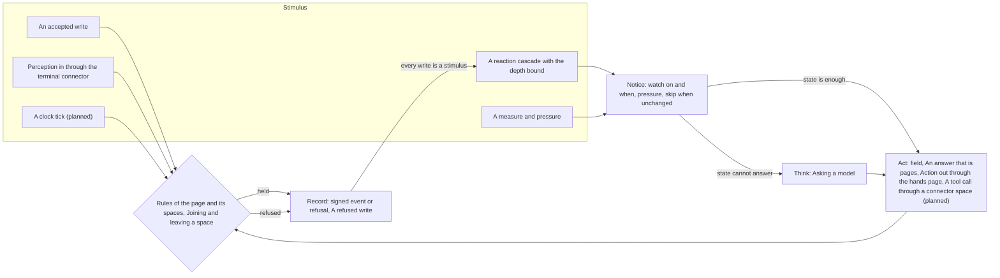

<a id="flow.write.accept#1"></a><a id="flow.write.accept#2"></a><a id="flow.write.accept#3"></a><a id="flow.write.accept#4"></a><a id="flow.write.accept#5"></a><a id="flow.write.accept#6"></a><a id="flow.write.accept#7"></a><a id="flow.write.accept#8"></a><a id="flow.write.accept#9"></a>

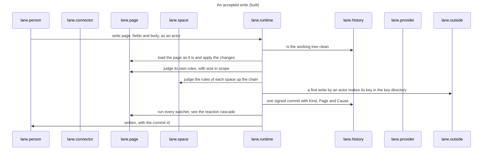

A write that holds becomes one signed commit, and then the pages that watch it react.

| Flow | Doc | Code | Test | Step | State |
|---|---|---|---|---|---|
| <a id="flow.write.accept"></a>`flow.write.accept` | [vault-format.md#a-write](vault-format.md#a-write) | `conky.vault.Vault.write`<br>`conky.vault.Vault._write`<br>`conky.vault.Vault._rule_reason`<br>`conky.vault.Vault._walk`<br>`conky.git.register`<br>`conky.vault.Vault._record`<br>`conky.vault.Vault._react`<br>`conky.cli.main` | `tests/test_laws.py::test_write_is_a_signed_commit_with_trailers_and_dates`<br>`tests/test_laws.py::test_first_write_registers_the_key_in_the_same_commit` | - | built |

<a id="flow.write.refuse#1"></a><a id="flow.write.refuse#2"></a><a id="flow.write.refuse#3"></a><a id="flow.write.refuse#4"></a><a id="flow.write.refuse#5"></a><a id="flow.write.refuse#6"></a><a id="flow.write.refuse#7"></a><a id="flow.write.refuse#8"></a>

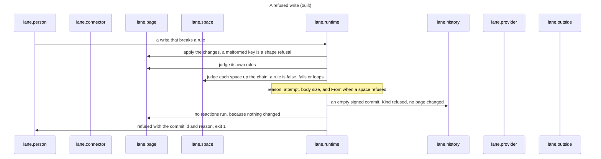

A refusal is an empty signed commit with the reason and the attempt, and it triggers no reactions.

| Flow | Doc | Code | Test | Step | State |
|---|---|---|---|---|---|
| <a id="flow.write.refuse"></a>`flow.write.refuse` | [vault-format.md#a-refusal](vault-format.md#a-refusal) | `conky.vault.Vault.write`<br>`conky.vault.Vault._write`<br>`conky.vault.Vault._rule_reason`<br>`conky.vault.Vault._walk`<br>`conky.vault.Vault._refuse`<br>`conky.vault.Vault._record`<br>`conky.cli.main` | `tests/test_laws.py::test_refused_write_is_an_empty_signed_commit`<br>`tests/test_laws.py::test_refusal_by_a_new_actor_registers_its_key`<br>`tests/test_laws.py::test_rule_error_refuses`<br>`tests/test_laws.py::test_a_refusal_by_a_rule_from_a_space_names_that_space`<br>`tests/test_laws.py::test_malformed_watch_is_refused` | - | built |

<a id="flow.watch.react#1"></a><a id="flow.watch.react#2"></a><a id="flow.watch.react#3"></a><a id="flow.watch.react#4"></a><a id="flow.watch.react#5"></a><a id="flow.watch.react#6"></a><a id="flow.watch.react#7"></a><a id="flow.watch.react#8"></a>

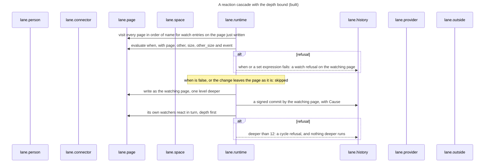

After a commit pages react in name order, depth first, and nesting past 12 is a recorded refusal.

| Flow | Doc | Code | Test | Step | State |
|---|---|---|---|---|---|
| <a id="flow.watch.react"></a>`flow.watch.react` | [rules-and-reactions.md#reactions](rules-and-reactions.md#reactions) | `conky.vault.Vault._react`<br>`conky.vault.Vault._write`<br>`conky.vault.Vault._record` | `tests/test_laws.py::test_reaction_is_caused_by_and_signed_by_the_reacting_page`<br>`tests/test_laws.py::test_reaction_that_changes_nothing_is_skipped`<br>`tests/test_laws.py::test_reaction_cycle_stops_at_depth_12`<br>`tests/test_laws.py::test_watch_key_on_is_plain_text_in_frontmatter` | - | built |

<a id="flow.watch.measure#1"></a><a id="flow.watch.measure#2"></a><a id="flow.watch.measure#3"></a><a id="flow.watch.measure#4"></a><a id="flow.watch.measure#5"></a><a id="flow.watch.measure#6"></a><a id="flow.watch.measure#7"></a><a id="flow.watch.measure#8"></a>

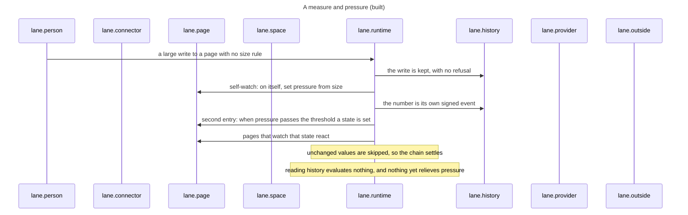

A page watching itself writes its own number as an event, and a threshold sets a state others watch.

| Flow | Doc | Code | Test | Step | State |
|---|---|---|---|---|---|
| <a id="flow.watch.measure"></a>`flow.watch.measure` | [rules-and-reactions.md#measures](rules-and-reactions.md#measures) | `conky.vault.Vault.write`<br>`conky.vault.Vault._record`<br>`conky.vault.Vault._react`<br>`conky.vault.Vault.log` | `tests/test_laws.py::test_pressure_rises_without_refusing_work`<br>`tests/test_laws.py::test_threshold_fires_a_reaction_and_the_sequence_settles`<br>`tests/test_laws.py::test_history_needs_no_expressions` | R2 | built |

<a id="flow.ask.model#1"></a><a id="flow.ask.model#2"></a><a id="flow.ask.model#3"></a><a id="flow.ask.model#4"></a><a id="flow.ask.model#5"></a><a id="flow.ask.model#6"></a><a id="flow.ask.model#7"></a><a id="flow.ask.model#8"></a><a id="flow.ask.model#9"></a><a id="flow.ask.model#10"></a><a id="flow.ask.model#11"></a><a id="flow.ask.model#12"></a><a id="flow.ask.model#13"></a><a id="flow.ask.model#14"></a>

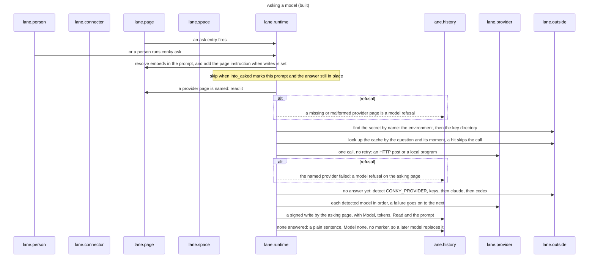

A named provider is tried first, then detected models in order, then a plain sentence that a later model replaces.

| Flow | Doc | Code | Test | Step | State |
|---|---|---|---|---|---|
| <a id="flow.ask.model"></a>`flow.ask.model` | [rules-and-reactions.md#asking-a-model](rules-and-reactions.md#asking-a-model) | `conky.vault.Vault._react`<br>`conky.vault.Vault.ask`<br>`conky.vault.Vault._ask`<br>`conky.model.provider`<br>`conky.model.find_secret`<br>`conky.model.ask_once`<br>`conky.model.ask`<br>`conky.model.detect`<br>`conky.vault.Vault._answered`<br>`conky.vault.Vault._plain` | `tests/test_command.py::test_detection_lists_anthropic_then_openai_then_claude_then_codex`<br>`tests/test_command.py::test_a_failing_detected_model_falls_to_the_next_and_then_to_a_sentence`<br>`tests/test_command.py::test_a_failing_named_page_is_recorded_and_the_detected_models_still_answer`<br>`tests/test_command.py::test_a_sentence_is_not_a_settled_answer_so_a_later_model_replaces_it`<br>`tests/test_model.py::test_an_ask_entry_answers_as_a_signed_write_by_the_asking_page`<br>`tests/test_model.py::test_each_wire_format_sends_the_right_request_and_reads_the_answer`<br>`tests/test_model.py::test_the_answer_names_each_page_that_was_embedded_once_in_order`<br>`tests/test_model.py::test_a_settled_question_is_not_asked_twice_and_a_changed_one_is`<br>`tests/test_model.py::test_every_failure_is_a_model_refusal_and_nothing_else_is_affected` | R26 | built |

<a id="flow.ask.pages#1"></a><a id="flow.ask.pages#2"></a><a id="flow.ask.pages#3"></a><a id="flow.ask.pages#4"></a><a id="flow.ask.pages#5"></a><a id="flow.ask.pages#6"></a><a id="flow.ask.pages#7"></a><a id="flow.ask.pages#8"></a><a id="flow.ask.pages#9"></a><a id="flow.ask.pages#10"></a>

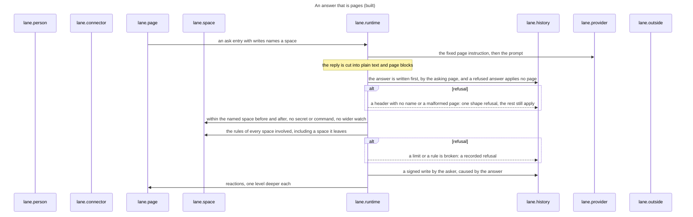

The answer is written first, then each page lands as a write by the asker inside the named space.

| Flow | Doc | Code | Test | Step | State |
|---|---|---|---|---|---|
| <a id="flow.ask.pages"></a>`flow.ask.pages` | [rules-and-reactions.md#an-answer-that-is-pages](rules-and-reactions.md#an-answer-that-is-pages) | `conky.vault.Vault._react`<br>`conky.answer.instruction`<br>`conky.answer.split`<br>`conky.vault.Vault._answered`<br>`conky.vault.Vault._land`<br>`conky.vault.Vault._breach`<br>`conky.vault.Vault._rule_reason`<br>`conky.vault.Vault._write` | `tests/test_pages.py::test_an_answer_with_two_pages_writes_both_as_the_asker_caused_by_the_answer`<br>`tests/test_pages.py::test_a_page_outside_the_space_is_refused_and_recorded_and_the_others_land`<br>`tests/test_pages.py::test_a_character_cannot_write_a_secret_or_a_command_into_a_page`<br>`tests/test_pages.py::test_a_malformed_block_is_one_recorded_refusal_and_the_pages_around_it_still_apply`<br>`tests/test_pages.py::test_a_character_writing_a_page_that_asks_again_stops_at_the_depth_cap`<br>`tests/test_pages.py::test_an_answer_adds_a_rule_to_its_space_signed_by_the_asker` | R29 | built |

<a id="flow.connect.sense#1"></a><a id="flow.connect.sense#2"></a><a id="flow.connect.sense#3"></a><a id="flow.connect.sense#4"></a><a id="flow.connect.sense#5"></a><a id="flow.connect.sense#6"></a><a id="flow.connect.sense#7"></a><a id="flow.connect.sense#8"></a>

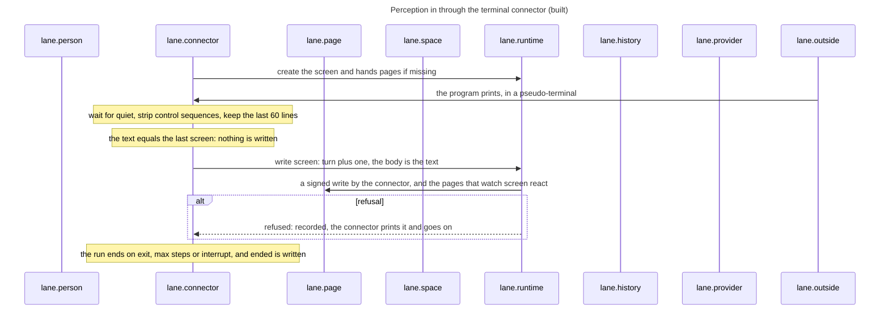

The connector turns what a program shows into a signed write to the screen page.

| Flow | Doc | Code | Test | Step | State |
|---|---|---|---|---|---|
| <a id="flow.connect.sense"></a>`flow.connect.sense` | [connectors.md#the-screen-page](connectors.md#the-screen-page) | `conky.connect._prepare`<br>`conky.connect._start`<br>`conky.connect.plain`<br>`conky.connect.terminal` | `tests/test_connect.py::test_the_first_screen_is_a_signed_write_by_the_connector`<br>`tests/test_connect.py::test_a_reacting_page_plays_the_game_to_its_end`<br>`tests/test_connect.py::test_max_steps_stops_a_run_and_records_why`<br>`tests/test_connect.py::test_control_sequences_do_not_reach_the_page`<br>`tests/test_connect.py::test_plain_text_keeps_the_last_sixty_lines` | - | built |

<a id="flow.connect.act#1"></a><a id="flow.connect.act#2"></a><a id="flow.connect.act#3"></a><a id="flow.connect.act#4"></a><a id="flow.connect.act#5"></a><a id="flow.connect.act#6"></a>

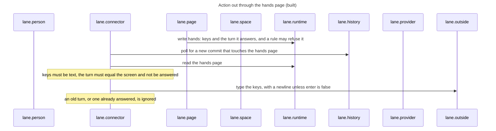

A write to the hands page is typed into the program only when its turn matches the current screen.

| Flow | Doc | Code | Test | Step | State |
|---|---|---|---|---|---|
| <a id="flow.connect.act"></a>`flow.connect.act` | [connectors.md#the-hands-page](connectors.md#the-hands-page) | `conky.connect._typed`<br>`conky.connect._last`<br>`conky.connect.terminal` | `tests/test_connect.py::test_a_reacting_page_plays_the_game_to_its_end`<br>`tests/test_connect.py::test_first_line_types_only_the_first_line_and_the_page_keeps_all_three`<br>`tests/test_connect.py::test_a_hands_write_for_an_old_turn_is_ignored`<br>`tests/test_connect.py::test_a_rule_can_keep_a_key_from_the_program` | - | built |

<a id="flow.space.move#1"></a><a id="flow.space.move#2"></a><a id="flow.space.move#3"></a><a id="flow.space.move#4"></a><a id="flow.space.move#5"></a><a id="flow.space.move#6"></a><a id="flow.space.move#7"></a>

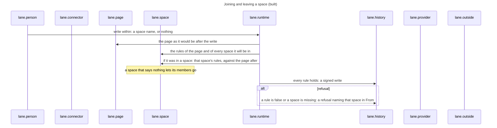

A write to `within` is judged by the rules of the spaces after it and before it.

| Flow | Doc | Code | Test | Step | State |
|---|---|---|---|---|---|
| <a id="flow.space.move"></a>`flow.space.move` | [rules-and-reactions.md#rules-and-spaces](rules-and-reactions.md#rules-and-spaces) | `conky.vault.Vault.write`<br>`conky.vault.Vault._write`<br>`conky.vault.Vault._rule_reason`<br>`conky.vault.Vault._walk`<br>`conky.vault.Vault._record`<br>`conky.vault.Vault._refuse` | `tests/test_laws.py::test_leaving_a_space_is_judged_by_the_rules_of_the_space_it_leaves` | R29 | built |

<a id="flow.vault.verify#1"></a><a id="flow.vault.verify#2"></a><a id="flow.vault.verify#3"></a><a id="flow.vault.verify#4"></a><a id="flow.vault.verify#5"></a><a id="flow.vault.verify#6"></a><a id="flow.vault.verify#7"></a><a id="flow.vault.verify#8"></a><a id="flow.vault.verify#9"></a>

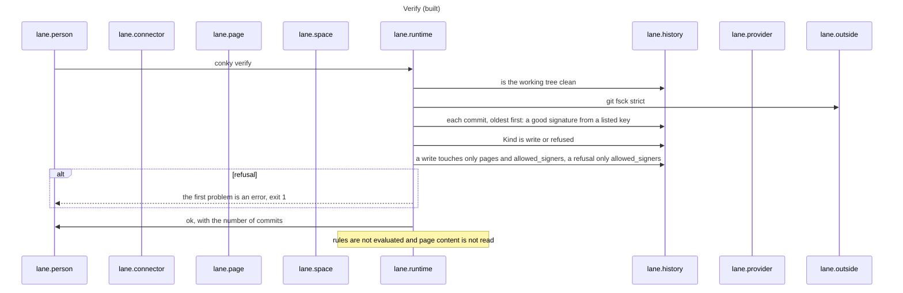

Verify stops at the first problem and checks seals and shape, not rules.

| Flow | Doc | Code | Test | Step | State |
|---|---|---|---|---|---|
| <a id="flow.vault.verify"></a>`flow.vault.verify` | [vault-format.md#what-verify-checks](vault-format.md#what-verify-checks) | `conky.vault.Vault.verify`<br>`conky.vault.Vault._check_commit`<br>`conky.cli.main` | `tests/test_laws.py::test_unsigned_commit_fails_verify`<br>`tests/test_laws.py::test_commit_signed_by_an_unlisted_key_fails_verify`<br>`tests/test_laws.py::test_commit_without_a_kind_trailer_fails_verify`<br>`tests/test_laws.py::test_write_commit_touching_other_files_fails_verify`<br>`tests/test_laws.py::test_refused_commit_that_changes_a_page_fails_verify` | - | built |

<a id="flow.vault.rebuild#1"></a><a id="flow.vault.rebuild#2"></a><a id="flow.vault.rebuild#3"></a><a id="flow.vault.rebuild#4"></a><a id="flow.vault.rebuild#5"></a><a id="flow.vault.rebuild#6"></a>

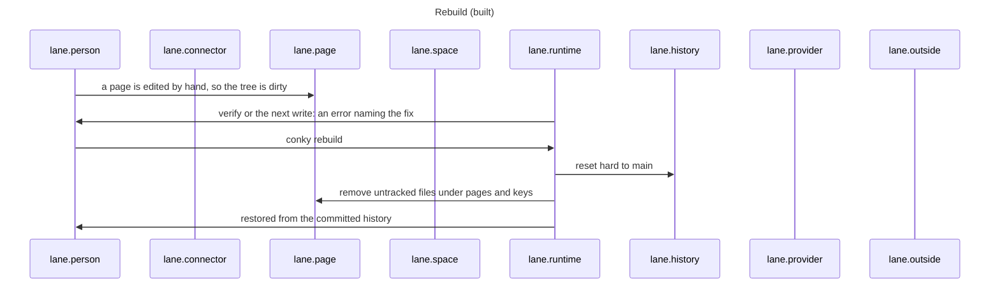

A hand edit blocks the next write and fails verify, and rebuild restores the pages from the history.

| Flow | Doc | Code | Test | Step | State |
|---|---|---|---|---|---|
| <a id="flow.vault.rebuild"></a>`flow.vault.rebuild` | [vault-format.md#rebuild](vault-format.md#rebuild) | `conky.vault.Vault._dirty`<br>`conky.vault.Vault._dirty_message`<br>`conky.vault.Vault.rebuild`<br>`conky.cli.main` | `tests/test_laws.py::test_hand_edited_page_fails_verify_and_blocks_writes`<br>`tests/test_laws.py::test_rebuild_discards_stray_files` | - | built |

<a id="flow.vault.clone#1"></a><a id="flow.vault.clone#2"></a><a id="flow.vault.clone#3"></a><a id="flow.vault.clone#4"></a><a id="flow.vault.clone#5"></a>

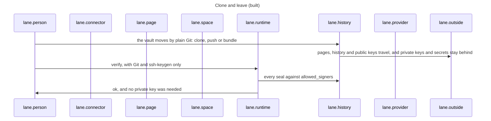

A vault travels by plain Git, verifies without the author's key, and keeps no secret.

| Flow | Doc | Code | Test | Step | State |
|---|---|---|---|---|---|
| <a id="flow.vault.clone"></a>`flow.vault.clone` | [vault-format.md#reading-with-plain-git](vault-format.md#reading-with-plain-git) | `conky.git.run`<br>`conky.vault.Vault.verify`<br>`conky.vault.Vault._check_commit` | `tests/test_laws.py::test_vault_travels_alone_by_clone_and_by_bundle`<br>`tests/test_model.py::test_history_verifies_and_reads_with_no_network_and_no_secrets` | - | built |

<a id="flow.vault.assimilate#1"></a><a id="flow.vault.assimilate#2"></a><a id="flow.vault.assimilate#3"></a><a id="flow.vault.assimilate#4"></a><a id="flow.vault.assimilate#5"></a><a id="flow.vault.assimilate#6"></a><a id="flow.vault.assimilate#7"></a><a id="flow.vault.assimilate#8"></a><a id="flow.vault.assimilate#9"></a><a id="flow.vault.assimilate#10"></a>

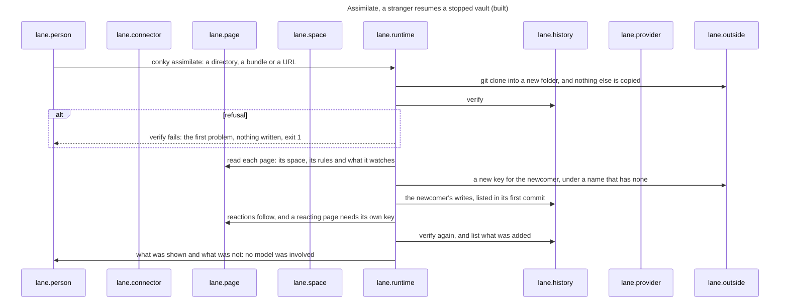

A stranger checks a stopped vault, reads it and carries on as a new actor, with no model.

| Flow | Doc | Code | Test | Step | State |
|---|---|---|---|---|---|
| <a id="flow.vault.assimilate"></a>`flow.vault.assimilate` | [cli.md#assimilate](cli.md#assimilate) | `conky.assimilate.run`<br>`conky.assimilate._take`<br>`conky.assimilate._problem`<br>`conky.assimilate._room`<br>`conky.assimilate._prepare`<br>`conky.assimilate._carry_on` | `tests/test_assimilate.py::test_bare_command_takes_checks_carries_on_and_checks_again`<br>`tests/test_assimilate.py::test_no_key_of_the_original_author_is_needed_and_the_newcomer_is_listed_at_once`<br>`tests/test_assimilate.py::test_the_source_can_be_a_directory_a_bundle_or_a_url`<br>`tests/test_assimilate.py::test_a_tampered_source_fails_at_the_check_and_names_the_problem` | R21 | built |

<a id="flow.page.read#1"></a><a id="flow.page.read#2"></a><a id="flow.page.read#3"></a><a id="flow.page.read#4"></a><a id="flow.page.read#5"></a><a id="flow.page.read#6"></a><a id="flow.page.read#7"></a><a id="flow.page.read#8"></a>

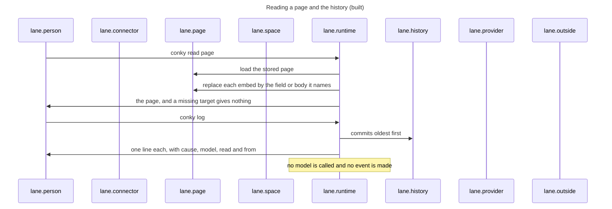

Reading resolves embeds and changes nothing, and the log is the history one line at a time.

| Flow | Doc | Code | Test | Step | State |
|---|---|---|---|---|---|
| <a id="flow.page.read"></a>`flow.page.read` | [vault-format.md#pages](vault-format.md#pages) | `conky.vault.Vault.read`<br>`conky.page.resolve`<br>`conky.vault.Vault.log` | `tests/test_laws.py::test_embeds_resolve_on_read`<br>`tests/test_laws.py::test_missing_embed_target_resolves_to_empty`<br>`tests/test_laws.py::test_log_lists_history_oldest_first` | - | built |

<a id="flow.clock.tick#1"></a><a id="flow.clock.tick#2"></a><a id="flow.clock.tick#3"></a><a id="flow.clock.tick#4"></a><a id="flow.clock.tick#5"></a>

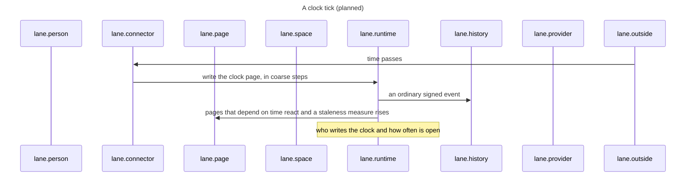

Time passes when a clock page is written, and anything that depends on time watches it.

| Flow | Doc | Code | Test | Step | State |
|---|---|---|---|---|---|
| <a id="flow.clock.tick"></a>`flow.clock.tick` | [clock.md](../ideas/clock.md) | - | - | R12 | planned |

<a id="flow.space.inherit#1"></a><a id="flow.space.inherit#2"></a><a id="flow.space.inherit#3"></a><a id="flow.space.inherit#4"></a><a id="flow.space.inherit#5"></a><a id="flow.space.inherit#6"></a>


A space hands down its context and its reactions as well as its rules.

| Flow | Doc | Code | Test | Step | State |
|---|---|---|---|---|---|
| <a id="flow.space.inherit"></a>`flow.space.inherit` | [inheritance.md](../ideas/inheritance.md) | - | - | R22 | building |

<a id="flow.spend.conserve#1"></a><a id="flow.spend.conserve#2"></a><a id="flow.spend.conserve#3"></a><a id="flow.spend.conserve#4"></a><a id="flow.spend.conserve#5"></a><a id="flow.spend.conserve#6"></a>


A space's budget is shared among what lies within it, and a page stops at its budget.

| Flow | Doc | Code | Test | Step | State |
|---|---|---|---|---|---|
| <a id="flow.spend.conserve"></a>`flow.spend.conserve` | [0029-autonomy-inside-limits-that-hold.md](../decisions/0029-autonomy-inside-limits-that-hold.md) | - | - | R17 | planned |

<a id="flow.vault.step#1"></a><a id="flow.vault.step#2"></a><a id="flow.vault.step#3"></a><a id="flow.vault.step#4"></a><a id="flow.vault.step#5"></a><a id="flow.vault.step#6"></a><a id="flow.vault.step#7"></a><a id="flow.vault.step#8"></a><a id="flow.vault.step#9"></a>

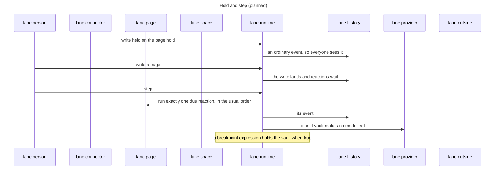

A held vault still writes and verifies, its reactions wait until asked, and stepping to the end and running freely give the same history.

| Flow | Doc | Code | Test | Step | State |
|---|---|---|---|---|---|
| <a id="flow.vault.step"></a>`flow.vault.step` | [stepping.md](../ideas/stepping.md) | - | - | R28 | planned |

<a id="flow.write.try#1"></a><a id="flow.write.try#2"></a><a id="flow.write.try#3"></a><a id="flow.write.try#4"></a><a id="flow.write.try#5"></a>

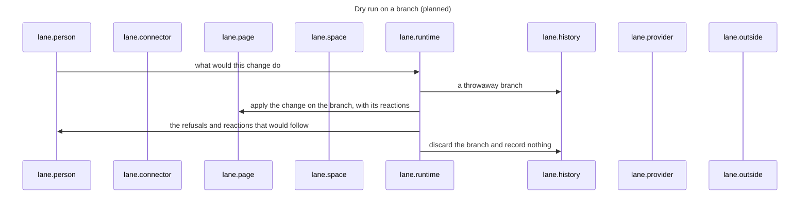

A change is applied on a throwaway branch, the consequences are reported and the branch is discarded.

| Flow | Doc | Code | Test | Step | State |
|---|---|---|---|---|---|
| <a id="flow.write.try"></a>`flow.write.try` | [dry-run.md](../ideas/dry-run.md) | - | - | R13 | planned |

<a id="flow.tool.call#1"></a><a id="flow.tool.call#2"></a><a id="flow.tool.call#3"></a><a id="flow.tool.call#4"></a><a id="flow.tool.call#5"></a><a id="flow.tool.call#6"></a><a id="flow.tool.call#7"></a><a id="flow.tool.call#8"></a><a id="flow.tool.call#9"></a>

```mermaid
---
title: A tool call through a connector space (planned)
---
sequenceDiagram
    participant lane.person
    participant lane.connector
    participant lane.page
    participant lane.space
    participant lane.runtime
    participant lane.history
    participant lane.provider
    participant lane.outside
    lane.connector->>lane.outside: ask the tool server what it offers
    lane.connector->>lane.runtime: one page per tool, into a shelf space
    lane.page->>lane.runtime: a go-between writes the request to a tool page
    lane.runtime->>lane.space: a rule may refuse it, and the server never receives it
    lane.runtime->>lane.history: the signed request
    lane.connector->>lane.history: sees the request
    lane.connector->>lane.outside: performs the call
    lane.connector->>lane.runtime: the result, onto the same page, caused by the request
    lane.page->>lane.page: the go-between turns the result into plain words
```

A tool is a page and a call is a write to it, and a go-between stands at the connector so characters never fill in forms.

| Flow | Doc | Code | Test | Step | State |
|---|---|---|---|---|---|
| <a id="flow.tool.call"></a>`flow.tool.call` | [tools.md](../ideas/tools.md) | - | - | R25 | planned |

<a id="flow.codec.revise#1"></a><a id="flow.codec.revise#2"></a><a id="flow.codec.revise#3"></a><a id="flow.codec.revise#4"></a><a id="flow.codec.revise#5"></a><a id="flow.codec.revise#6"></a><a id="flow.codec.revise#7"></a><a id="flow.codec.revise#8"></a>

```mermaid
---
title: A codec written and revised on surprise (idea)
---
sequenceDiagram
    participant lane.person
    participant lane.connector
    participant lane.page
    participant lane.space
    participant lane.runtime
    participant lane.history
    participant lane.provider
    participant lane.outside
    lane.outside->>lane.connector: a raw surface changes
    lane.connector->>lane.page: the codec page maps it by reflex, with no model call
    lane.page->>lane.runtime: a measure of the share explained, written as an event
    lane.runtime->>lane.page: the share falls, so pressure rises
    lane.runtime->>lane.provider: a capable model is asked to revise the codec page
    lane.provider->>lane.runtime: a new codec
    lane.runtime->>lane.history: the revision, an ordinary signed write
    Note over lane.page: steady state makes no model call
```

A codec is applied by reflex and rewritten only when a measure says it has stopped explaining what it sees.

| Flow | Doc | Code | Test | Step | State |
|---|---|---|---|---|---|
| <a id="flow.codec.revise"></a>`flow.codec.revise` | [codec.md](../ideas/codec.md) | - | - | R11g | idea |

<a id="flow.pattern.rise#1"></a><a id="flow.pattern.rise#2"></a><a id="flow.pattern.rise#3"></a><a id="flow.pattern.rise#4"></a><a id="flow.pattern.rise#5"></a><a id="flow.pattern.rise#6"></a><a id="flow.pattern.rise#7"></a><a id="flow.pattern.rise#8"></a>

```mermaid
---
title: A pattern rising by use (planned)
---
sequenceDiagram
    participant lane.person
    participant lane.connector
    participant lane.page
    participant lane.space
    participant lane.runtime
    participant lane.history
    participant lane.provider
    participant lane.outside
    lane.page->>lane.provider: the pattern maker is asked once, from goldens
    lane.provider->>lane.page: a space page, private to the space that made it
    lane.page->>lane.space: other pages join it
    lane.page->>lane.page: a measure of use: joins and distinct owners
    lane.runtime->>lane.page: the measure passes the threshold of the space above
    lane.page->>lane.space: a reaction opens a proposal to move up one space
    lane.space->>lane.page: approval under that space's own rule
    lane.runtime->>lane.history: one write to the pattern's within
```

A pattern is born private and rises one space at a time, by a measure of use and one write to within.

| Flow | Doc | Code | Test | Step | State |
|---|---|---|---|---|---|
| <a id="flow.pattern.rise"></a>`flow.pattern.rise` | [0023-a-pattern-starts-private-and-rises-by-use.md](../decisions/0023-a-pattern-starts-private-and-rises-by-use.md) | - | - | R6 | planned |

<a id="flow.screen.prompt#1"></a><a id="flow.screen.prompt#2"></a><a id="flow.screen.prompt#3"></a><a id="flow.screen.prompt#4"></a><a id="flow.screen.prompt#5"></a><a id="flow.screen.prompt#6"></a><a id="flow.screen.prompt#7"></a><a id="flow.screen.prompt#8"></a>

```mermaid
---
title: The screen for people and a prompt coming back (planned)
---
sequenceDiagram
    participant lane.person
    participant lane.connector
    participant lane.page
    participant lane.space
    participant lane.runtime
    participant lane.history
    participant lane.provider
    participant lane.outside
    lane.runtime->>lane.history: read pages and trailers
    lane.runtime->>lane.outside: derive the screen: a text outline, then A2UI messages, deletable
    lane.person->>lane.outside: read the screen, with a prompt control at each corner
    lane.person->>lane.runtime: a typed request, an ordinary write under the same rules
    lane.runtime->>lane.history: the request is recorded beside the layout it produced
    lane.page->>lane.provider: the compositor is asked once about layout
    lane.provider->>lane.page: a layout page
    lane.runtime->>lane.outside: redraw by reflex, with no model call
```

The screen is derived from the pages and can be deleted, and a request typed into it is an ordinary write.

| Flow | Doc | Code | Test | Step | State |
|---|---|---|---|---|---|
| <a id="flow.screen.prompt"></a>`flow.screen.prompt` | [a2ui.md](../ideas/a2ui.md) | - | - | R11a | planned |

<a id="flow.vault.link#1"></a><a id="flow.vault.link#2"></a><a id="flow.vault.link#3"></a><a id="flow.vault.link#4"></a>

```mermaid
---
title: Two vaults joined (idea)
---
sequenceDiagram
    participant lane.person
    participant lane.connector
    participant lane.page
    participant lane.space
    participant lane.runtime
    participant lane.history
    participant lane.provider
    participant lane.outside
    lane.space->>lane.outside: a space becomes its own vault
    lane.runtime->>lane.history: history divides along the space
    lane.page->>lane.outside: the parent keeps a link to it
    Note over lane.space: rules and reactions across the boundary are not worked out
```

A space that grows too large becomes its own vault that the parent links to.

| Flow | Doc | Code | Test | Step | State |
|---|---|---|---|---|---|
| <a id="flow.vault.link"></a>`flow.vault.link` | [vault-splitting.md](../ideas/vault-splitting.md) | - | - | R10 | idea |

<a id="flow.proposal.approve#1"></a><a id="flow.proposal.approve#2"></a><a id="flow.proposal.approve#3"></a><a id="flow.proposal.approve#4"></a><a id="flow.proposal.approve#5"></a><a id="flow.proposal.approve#6"></a><a id="flow.proposal.approve#7"></a>

```mermaid
---
title: Approval of a proposal (planned)
---
sequenceDiagram
    participant lane.person
    participant lane.connector
    participant lane.page
    participant lane.space
    participant lane.runtime
    participant lane.history
    participant lane.provider
    participant lane.outside
    lane.page->>lane.runtime: a proposal page names the change
    lane.person->>lane.runtime: an approval, signed by the approver
    lane.runtime->>lane.history: the approval is an event with its signer
    lane.space->>lane.runtime: a rule counts the approvals and can see who signed
    lane.runtime->>lane.page: a reaction applies the change once the rule is met
    lane.runtime->>lane.history: the change, caused by the last approval
    Note over lane.space: one approval is refused where two are needed
```

A change that needs several parties is a proposal, signed approvals, a rule that counts them and a reaction that applies it.

| Flow | Doc | Code | Test | Step | State |
|---|---|---|---|---|---|
| <a id="flow.proposal.approve"></a>`flow.proposal.approve` | [approvals.md](../ideas/approvals.md) | - | - | R14 | planned |

<a id="flow.table.append#1"></a><a id="flow.table.append#2"></a><a id="flow.table.append#3"></a><a id="flow.table.append#4"></a><a id="flow.table.append#5"></a>

```mermaid
---
title: Appending to a table (planned)
---
sequenceDiagram
    participant lane.person
    participant lane.connector
    participant lane.page
    participant lane.space
    participant lane.runtime
    participant lane.history
    participant lane.provider
    participant lane.outside
    lane.person->>lane.runtime: write rows to a table
    lane.runtime->>lane.outside: a new Parquet part is written beside the page
    lane.runtime->>lane.space: rules judge the page's summary, never the rows
    lane.runtime->>lane.history: one signed event that carries the part's hash
    lane.runtime->>lane.page: the page's columns, row count and part hashes are updated
```

A write appends one Parquet part beside the page and never rewrites one.

| Flow | Doc | Code | Test | Step | State |
|---|---|---|---|---|---|
| <a id="flow.table.append"></a>`flow.table.append` | [tables.md](../ideas/tables.md) | - | - | R1 | planned |

<a id="flow.engine.query#1"></a><a id="flow.engine.query#2"></a><a id="flow.engine.query#3"></a><a id="flow.engine.query#4"></a><a id="flow.engine.query#5"></a>

```mermaid
---
title: A query through an engine (planned)
---
sequenceDiagram
    participant lane.person
    participant lane.connector
    participant lane.page
    participant lane.space
    participant lane.runtime
    participant lane.history
    participant lane.provider
    participant lane.outside
    lane.page->>lane.connector: a request to query
    lane.connector->>lane.outside: the engine reads the parts in place
    lane.connector->>lane.runtime: the result, as a page or a new table, caused by the request
    lane.runtime->>lane.history: a signed event by the connector
    Note over lane.runtime: the core never embeds an engine
```

A query engine reads the Parquet in place, and its result is a page or a new table.

| Flow | Doc | Code | Test | Step | State |
|---|---|---|---|---|---|
| <a id="flow.engine.query"></a>`flow.engine.query` | [tables.md](../ideas/tables.md) | - | - | R1 | planned |

<a id="flow.table.watch#1"></a><a id="flow.table.watch#2"></a><a id="flow.table.watch#3"></a><a id="flow.table.watch#4"></a>

```mermaid
---
title: A watch firing on a batch (planned)
---
sequenceDiagram
    participant lane.person
    participant lane.connector
    participant lane.page
    participant lane.space
    participant lane.runtime
    participant lane.history
    participant lane.provider
    participant lane.outside
    lane.runtime->>lane.history: a new part of a stream is committed
    lane.runtime->>lane.page: a watch entry on the stream's page fires once for the part
    lane.runtime->>lane.history: the reaction, a signed event with Cause
    Note over lane.runtime: each row does not fire the watch
```

A watch on a stream fires once for each new part, not for each row.

| Flow | Doc | Code | Test | Step | State |
|---|---|---|---|---|---|
| <a id="flow.table.watch"></a>`flow.table.watch` | [tables.md](../ideas/tables.md) | - | - | R1 | planned |

## 10. Checks

Every law, flow and part with its check. A measured check is a deterministic assertion with an exact result, and every pytest test is one. A judged check is open-ended behaviour that no assertion settles: it names the question a reader answers from the end state, the evidence to look at and the scale, and `conky.arch.bundle` writes the evidence with a verdict only when one is given and by whom. A blank in the last column means a check exists, and `none` means nothing checks the thing at all.

| Thing | State | Measured tests | Judged checks | No check |
|---|---|---|---|---|
| [`flow.ask.model`](#flow.ask.model) | built | 9 | - |  |
| [`flow.ask.pages`](#flow.ask.pages) | built | 6 | check.page.format, check.character.organise |  |
| [`flow.clock.tick`](#flow.clock.tick) | planned | not built | - | - |
| [`flow.codec.revise`](#flow.codec.revise) | idea | not built | - | - |
| [`flow.connect.act`](#flow.connect.act) | built | 4 | - |  |
| [`flow.connect.sense`](#flow.connect.sense) | built | 5 | - |  |
| [`flow.engine.query`](#flow.engine.query) | planned | not built | - | - |
| [`flow.page.read`](#flow.page.read) | built | 3 | - |  |
| [`flow.pattern.rise`](#flow.pattern.rise) | planned | not built | - | - |
| [`flow.proposal.approve`](#flow.proposal.approve) | planned | not built | - | - |
| [`flow.screen.prompt`](#flow.screen.prompt) | planned | not built | - | - |
| [`flow.space.inherit`](#flow.space.inherit) | building | - | - | none |
| [`flow.space.move`](#flow.space.move) | built | 1 | - |  |
| [`flow.spend.conserve`](#flow.spend.conserve) | planned | not built | - | - |
| [`flow.table.append`](#flow.table.append) | planned | not built | - | - |
| [`flow.table.watch`](#flow.table.watch) | planned | not built | - | - |
| [`flow.tool.call`](#flow.tool.call) | planned | not built | - | - |
| [`flow.vault.assimilate`](#flow.vault.assimilate) | built | 4 | - |  |
| [`flow.vault.clone`](#flow.vault.clone) | built | 2 | - |  |
| [`flow.vault.link`](#flow.vault.link) | idea | not built | - | - |
| [`flow.vault.rebuild`](#flow.vault.rebuild) | built | 2 | - |  |
| [`flow.vault.step`](#flow.vault.step) | planned | not built | - | - |
| [`flow.vault.verify`](#flow.vault.verify) | built | 5 | - |  |
| [`flow.watch.measure`](#flow.watch.measure) | built | 3 | - |  |
| [`flow.watch.react`](#flow.watch.react) | built | 4 | - |  |
| [`flow.write.accept`](#flow.write.accept) | built | 2 | - |  |
| [`flow.write.refuse`](#flow.write.refuse) | built | 5 | - |  |
| [`flow.write.try`](#flow.write.try) | planned | not built | - | - |
| [`law.answer.pages`](#law.answer.pages) | built | 3 | check.character.organise |  |
| [`law.context.down`](#law.context.down) | building | 4 | - |  |
| [`law.data.derived`](#law.data.derived) | planned | not built | - | - |
| [`law.data.three`](#law.data.three) | built | 1 | - |  |
| [`law.debt.none`](#law.debt.none) | built | 1 | - |  |
| [`law.docs.check`](#law.docs.check) | built | 1 | - |  |
| [`law.embed.anonymous`](#law.embed.anonymous) | built | 1 | - |  |
| [`law.embed.context`](#law.embed.context) | built | 1 | - |  |
| [`law.embed.shows`](#law.embed.shows) | built | 2 | - |  |
| [`law.event.notice`](#law.event.notice) | built | 2 | - |  |
| [`law.event.seal`](#law.event.seal) | built | 2 | - |  |
| [`law.fallback.always`](#law.fallback.always) | built | 3 | - |  |
| [`law.link.known`](#law.link.known) | built | 2 | - |  |
| [`law.measure.watch`](#law.measure.watch) | built | 2 | - |  |
| [`law.output.out`](#law.output.out) | built | - | - | review only |
| [`law.page.commit`](#law.page.commit) | built | 2 | - |  |
| [`law.pressure.notice`](#law.pressure.notice) | built | 3 | - |  |
| [`law.provider.page`](#law.provider.page) | built | 2 | - |  |
| [`law.reach.down`](#law.reach.down) | built | 2 | - |  |
| [`law.reflex.free`](#law.reflex.free) | built | 2 | - |  |
| [`law.refusal.record`](#law.refusal.record) | built | 2 | - |  |
| [`law.rule.never`](#law.rule.never) | built | 3 | - |  |
| [`law.rule.proven`](#law.rule.proven) | built | - | - | review only |
| [`law.rule.pure`](#law.rule.pure) | built | - | - | review only |
| [`law.rule.tighten`](#law.rule.tighten) | built | 8 | - |  |
| [`law.runtime.fixed`](#law.runtime.fixed) | built | 1 | - |  |
| [`law.scope.out`](#law.scope.out) | built | - | - | review only |
| [`law.spend.conserve`](#law.spend.conserve) | planned | not built | - | - |
| [`law.spend.meter`](#law.spend.meter) | planned | not built | - | - |
| [`law.vault.golden`](#law.vault.golden) | built | 1 | - |  |
| [`law.vault.hold`](#law.vault.hold) | planned | not built | - | - |
| [`law.vault.travel`](#law.vault.travel) | built | 3 | - |  |
| [`law.word.exist`](#law.word.exist) | built | 1 | - |  |
| [`law.write.only`](#law.write.only) | built | 1 | - |  |
| [`part.answer.cache`](#part.answer.cache) | built | - | - | none |
| [`part.answer.format`](#part.answer.format) | built | - | - | none |
| [`part.character.face`](#part.character.face) | planned | not built | - | - |
| [`part.character.habit`](#part.character.habit) | idea | not built | - | - |
| [`part.character.self`](#part.character.self) | planned | not built | - | - |
| [`part.cli.command`](#part.cli.command) | built | - | - | none |
| [`part.cli.demo`](#part.cli.demo) | built | - | - | none |
| [`part.cli.present`](#part.cli.present) | built | - | - | none |
| [`part.connect.protocol`](#part.connect.protocol) | planned | not built | - | - |
| [`part.connect.terminal`](#part.connect.terminal) | built | - | - | none |
| [`part.core.rust`](#part.core.rust) | planned | not built | - | - |
| [`part.embed`](#part.embed) | built | - | - | none |
| [`part.error`](#part.error) | built | - | - | none |
| [`part.event`](#part.event) | built | - | - | none |
| [`part.export.notion`](#part.export.notion) | built | - | - | none |
| [`part.export.obsidian`](#part.export.obsidian) | built | - | - | none |
| [`part.key`](#part.key) | built | - | - | none |
| [`part.key.rotate`](#part.key.rotate) | idea | not built | - | - |
| [`part.link`](#part.link) | idea | not built | - | - |
| [`part.page`](#part.page) | built | - | - | none |
| [`part.pattern.make`](#part.pattern.make) | planned | not built | - | - |
| [`part.provider.detect`](#part.provider.detect) | built | - | - | none |
| [`part.read`](#part.read) | built | - | - | none |
| [`part.rename`](#part.rename) | idea | not built | - | - |
| [`part.rule`](#part.rule) | built | - | - | none |
| [`part.rule.captures`](#part.rule.captures) | built | - | - | none |
| [`part.rule.capturesall`](#part.rule.capturesall) | built | - | - | none |
| [`part.rule.indexof`](#part.rule.indexof) | built | - | - | none |
| [`part.rule.join`](#part.rule.join) | built | - | - | none |
| [`part.rule.lowerascii`](#part.rule.lowerascii) | built | - | - | none |
| [`part.rule.origin`](#part.rule.origin) | idea | not built | - | - |
| [`part.rule.replace`](#part.rule.replace) | built | - | - | none |
| [`part.rule.split`](#part.rule.split) | built | - | - | none |
| [`part.rule.substring`](#part.rule.substring) | built | - | - | none |
| [`part.rule.trim`](#part.rule.trim) | built | - | - | none |
| [`part.screen`](#part.screen) | planned | not built | - | - |
| [`part.screen.live`](#part.screen.live) | idea | not built | - | - |
| [`part.screen.page`](#part.screen.page) | planned | not built | - | - |
| [`part.screen.update`](#part.screen.update) | planned | not built | - | - |
| [`part.seal`](#part.seal) | built | - | - | none |
| [`part.seal.signer`](#part.seal.signer) | planned | not built | - | - |
| [`part.space`](#part.space) | built | - | - | none |
| [`part.space.context`](#part.space.context) | building | - | - | none |
| [`part.test.bench`](#part.test.bench) | planned | not built | - | - |
| [`part.test.resume`](#part.test.resume) | planned | not built | - | - |
| [`part.test.trial`](#part.test.trial) | planned | not built | - | - |
| [`part.vault`](#part.vault) | built | - | - | none |
| [`part.vault.assimilate`](#part.vault.assimilate) | built | - | - | none |
| [`part.watch`](#part.watch) | built | - | - | none |
| [`part.write`](#part.write) | built | - | - | none |
| [`part.write.group`](#part.write.group) | planned | not built | - | - |
| [`part.write.serial`](#part.write.serial) | idea | not built | - | - |

| Judged check | Question | Evidence | Scale | Checks |
|---|---|---|---|---|
| <a id="check.character.organise"></a>`check.character.organise` | State, after a live run, whether the single character organised itself in a way that helped the task or only looked busy. | The vault's pages and its history: which pages it wrote, which rules and watch entries it added, and what each was caused by. | 1 hurt, 2 no effect, 3 helped, 4 helped and is worth keeping | [`law.answer.pages`](#law.answer.pages), [`flow.ask.pages`](#flow.ask.pages) |
| <a id="check.habit.keep"></a>`check.habit.keep` | State whether this written habit is a faithful summary of what thought decided. | The case on the page, and the answers it replaced, in the vault history. | 1 misleading, 2 partial, 3 faithful, 4 faithful and sharper than the answers |  |
| <a id="check.page.format"></a>`check.page.format` | State whether a real model asked for pages follows the page format and writes pages a person would keep. | The prompt as sent, the reply, the pages that landed and the refusals recorded, in the vault history. | 1 unusable, 2 needs repair, 3 usable, 4 good | [`flow.ask.pages`](#flow.ask.pages) |

## 11. Coverage

Every idea and decision, with its rung or status and the rows that carry it. The generator fails when one is missing or names a row that does not exist.

### Ideas

| Idea | Rung | Carried by |
|---|---|---|
| [a2ui](../ideas/a2ui.md) | idea | [`part.cli.present`](#part.cli.present), [`part.screen`](#part.screen), [`part.screen.page`](#part.screen.page), [`part.screen.update`](#part.screen.update), [`flow.screen.prompt`](#flow.screen.prompt) |
| [approvals](../ideas/approvals.md) | idea | [`part.seal.signer`](#part.seal.signer), [`part.seal.signer`](#part.seal.signer), [`kind.proposal`](#kind.proposal), [`flow.proposal.approve`](#flow.proposal.approve) |
| [arcs](../ideas/arcs.md) | idea | - |
| [assimilation-test](../ideas/assimilation-test.md) | idea | [`flow.vault.assimilate`](#flow.vault.assimilate), [`part.vault.assimilate`](#part.vault.assimilate), [`part.test.resume`](#part.test.resume) |
| [attention](../ideas/attention.md) | idea | - |
| [auto-linking](../ideas/auto-linking.md) | idea | [`part.link`](#part.link) |
| [background-minds](../ideas/background-minds.md) | idea | [`law.spend.meter`](#law.spend.meter), [`kind.mind`](#kind.mind), [`stage.attention.mind`](#stage.attention.mind) |
| [cascading-context](../ideas/cascading-context.md) | idea | [`part.space.context`](#part.space.context) |
| [character](../ideas/character.md) | idea | [`part.character.self`](#part.character.self) |
| [clock](../ideas/clock.md) | idea | [`kind.clock`](#kind.clock), [`stage.stimulus.clock`](#stage.stimulus.clock), [`flow.clock.tick`](#flow.clock.tick) |
| [codec](../ideas/codec.md) | idea | [`kind.codec`](#kind.codec), [`flow.codec.revise`](#flow.codec.revise) |
| [compositor](../ideas/compositor.md) | idea | [`kind.layout`](#kind.layout), [`stage.stimulus.prompt`](#stage.stimulus.prompt) |
| [connectors](../ideas/connectors.md) | idea | [`part.connect.terminal`](#part.connect.terminal), [`place.beside.connector`](#place.beside.connector), [`part.connect.protocol`](#part.connect.protocol) |
| [direction-and-drift](../ideas/direction-and-drift.md) | idea | [`kind.goal`](#kind.goal), [`stage.attention.drift`](#stage.attention.drift) |
| [dry-run](../ideas/dry-run.md) | idea | [`flow.write.try`](#flow.write.try) |
| [energy-unit](../ideas/energy-unit.md) | idea | - |
| [faculties](../ideas/faculties.md) | idea | - |
| [felt-sense](../ideas/felt-sense.md) | idea | [`kind.codec`](#kind.codec) |
| [gatekeeper](../ideas/gatekeeper.md) | idea | [`kind.gatekeeper`](#kind.gatekeeper) |
| [habit](../ideas/habit.md) | idea | [`part.answer.cache`](#part.answer.cache), [`part.provider.detect`](#part.provider.detect), [`check.habit.keep`](#check.habit.keep), [`part.character.habit`](#part.character.habit) |
| [house-style](../ideas/house-style.md) | idea | [`kind.taste`](#kind.taste) |
| [inheritance](../ideas/inheritance.md) | idea | [`part.space`](#part.space), [`part.space.context`](#part.space.context), [`flow.space.inherit`](#flow.space.inherit) |
| [keys](../ideas/keys.md) | idea | [`part.key.rotate`](#part.key.rotate) |
| [learned-reactions](../ideas/learned-reactions.md) | idea | - |
| [ledger](../ideas/ledger.md) | idea | - |
| [measures](../ideas/measures.md) | enforced | [`law.pressure.notice`](#law.pressure.notice), [`law.measure.watch`](#law.measure.watch), [`flow.watch.measure`](#flow.watch.measure), [`kind.measure`](#kind.measure), [`stage.attention.measure`](#stage.attention.measure) |
| [model-choice](../ideas/model-choice.md) | idea | [`kind.router`](#kind.router) |
| [model-pages](../ideas/model-pages.md) | enforced | [`flow.ask.model`](#flow.ask.model), [`kind.provider`](#kind.provider), [`stage.think.ask`](#stage.think.ask), [`stage.think.context`](#stage.think.context) |
| [obsidian-view](../ideas/obsidian-view.md) | idea | - |
| [outside-reading](../ideas/outside-reading.md) | idea | [`kind.feed`](#kind.feed) |
| [patterns](../ideas/patterns.md) | idea | [`part.write.group`](#part.write.group), [`kind.pattern`](#kind.pattern) |
| [provenance](../ideas/provenance.md) | idea | [`part.rule.origin`](#part.rule.origin) |
| [rename](../ideas/rename.md) | idea | [`part.rename`](#part.rename) |
| [reviewer](../ideas/reviewer.md) | idea | [`kind.reviewer`](#kind.reviewer) |
| [seeds-and-faces](../ideas/seeds-and-faces.md) | idea | [`part.character.face`](#part.character.face) |
| [staleness](../ideas/staleness.md) | idea | [`kind.archive`](#kind.archive), [`stage.attention.stale`](#stage.attention.stale) |
| [standing](../ideas/standing.md) | idea | - |
| [stepping](../ideas/stepping.md) | idea | [`law.vault.hold`](#law.vault.hold), [`kind.hold`](#kind.hold), [`flow.vault.step`](#flow.vault.step) |
| [streaming](../ideas/streaming.md) | idea | [`part.screen.live`](#part.screen.live) |
| [tables](../ideas/tables.md) | idea | [`data.file`](#data.file), [`data.table`](#data.table), [`data.engine`](#data.engine), [`data.stream.beside`](#data.stream.beside), [`flow.table.append`](#flow.table.append), [`flow.engine.query`](#flow.engine.query), [`flow.table.watch`](#flow.table.watch) |
| [thought-to-change](../ideas/thought-to-change.md) | idea | [`flow.ask.pages`](#flow.ask.pages), [`law.answer.pages`](#law.answer.pages) |
| [tools](../ideas/tools.md) | idea | [`kind.tool`](#kind.tool), [`kind.shelf`](#kind.shelf), [`stage.act.tool`](#stage.act.tool), [`flow.tool.call`](#flow.tool.call) |
| [trace](../ideas/trace.md) | idea | [`stage.attention.strip`](#stage.attention.strip) |
| [vault-splitting](../ideas/vault-splitting.md) | idea | [`flow.vault.link`](#flow.vault.link) |
| [writers](../ideas/writers.md) | idea | [`part.write.serial`](#part.write.serial) |

### Decisions

| Decision | Status | Carried by |
|---|---|---|
| [0001-objective](../decisions/0001-objective.md) | accepted | - |
| [0002-git-is-the-store](../decisions/0002-git-is-the-store.md) | accepted | [`layer.git`](#layer.git), [`law.write.only`](#law.write.only), [`flow.vault.clone`](#flow.vault.clone) |
| [0003-data-beside-pages](../decisions/0003-data-beside-pages.md) | accepted | [`data.table`](#data.table) |
| [0004-plain-vocabulary](../decisions/0004-plain-vocabulary.md) | accepted | [`part.vault`](#part.vault), [`law.word.exist`](#law.word.exist) |
| [0005-rules-in-cel](../decisions/0005-rules-in-cel.md) | accepted | [`law.rule.never`](#law.rule.never), [`part.rule`](#part.rule), [`layer.reflex`](#layer.reflex) |
| [0006-size-is-a-rule](../decisions/0006-size-is-a-rule.md) | accepted | [`layer.reflex`](#layer.reflex), [`kind.space`](#kind.space) |
| [0007-inference-for-real-thinking](../decisions/0007-inference-for-real-thinking.md) | accepted | [`law.reflex.free`](#law.reflex.free), [`stage.think.ask`](#stage.think.ask) |
| [0008-measures-are-self-watches](../decisions/0008-measures-are-self-watches.md) | accepted | [`law.measure.watch`](#law.measure.watch), [`flow.watch.measure`](#flow.watch.measure) |
| [0009-patterns-not-features](../decisions/0009-patterns-not-features.md) | accepted | [`part.pattern.make`](#part.pattern.make) |
| [0010-no-debt-no-down-migrations](../decisions/0010-no-debt-no-down-migrations.md) | accepted | [`law.data.three`](#law.data.three), [`law.debt.none`](#law.debt.none), [`data.document`](#data.document) |
| [0011-python-reference-implementation](../decisions/0011-python-reference-implementation.md) | accepted | [`part.vault`](#part.vault) |
| [0012-rust-core-planned](../decisions/0012-rust-core-planned.md) | accepted | [`law.vault.golden`](#law.vault.golden), [`part.core.rust`](#part.core.rust) |
| [0013-evidence-not-scripts](../decisions/0013-evidence-not-scripts.md) | accepted | [`part.test.bench`](#part.test.bench) |
| [0014-benchmark-shape](../decisions/0014-benchmark-shape.md) | open | [`part.test.bench`](#part.test.bench) |
| [0015-ideas-climb-rungs](../decisions/0015-ideas-climb-rungs.md) | accepted | [`law.docs.check`](#law.docs.check) |
| [0016-docs-in-repo](../decisions/0016-docs-in-repo.md) | accepted | [`law.docs.check`](#law.docs.check) |
| [0017-derived-data](../decisions/0017-derived-data.md) | accepted | [`law.data.derived`](#law.data.derived) |
| [0018-not-doing](../decisions/0018-not-doing.md) | accepted | [`law.scope.out`](#law.scope.out) |
| [0019-providers-are-pages](../decisions/0019-providers-are-pages.md) | accepted | [`law.provider.page`](#law.provider.page), [`kind.provider`](#kind.provider), [`flow.ask.model`](#flow.ask.model), [`stage.think.budget`](#stage.think.budget) |
| [0020-everything-is-somebody](../decisions/0020-everything-is-somebody.md) | accepted | [`kind.character`](#kind.character) |
| [0021-the-outside-arrives-as-pages](../decisions/0021-the-outside-arrives-as-pages.md) | accepted | [`flow.connect.sense`](#flow.connect.sense) |
| [0022-leaving-a-space-is-a-write-the-space-can-refuse](../decisions/0022-leaving-a-space-is-a-write-the-space-can-refuse.md) | accepted | [`law.rule.tighten`](#law.rule.tighten), [`flow.space.move`](#flow.space.move), [`part.space`](#part.space) |
| [0023-a-pattern-starts-private-and-rises-by-use](../decisions/0023-a-pattern-starts-private-and-rises-by-use.md) | accepted | [`flow.pattern.rise`](#flow.pattern.rise) |
| [0024-a-model-is-reached-by-a-key-or-a-local-program](../decisions/0024-a-model-is-reached-by-a-key-or-a-local-program.md) | accepted | [`part.provider.detect`](#part.provider.detect), [`place.runtime.detect`](#place.runtime.detect), [`flow.ask.model`](#flow.ask.model) |
| [0025-the-screen-is-built-in-small-steps](../decisions/0025-the-screen-is-built-in-small-steps.md) | accepted | [`part.screen`](#part.screen), [`flow.screen.prompt`](#flow.screen.prompt), [`part.test.trial`](#part.test.trial) |
| [0026-it-always-works](../decisions/0026-it-always-works.md) | accepted | [`law.fallback.always`](#law.fallback.always) |
| [0027-the-vocabulary-is-what-exists](../decisions/0027-the-vocabulary-is-what-exists.md) | accepted | [`law.word.exist`](#law.word.exist), [`part.cli.command`](#part.cli.command) |
| [0028-a-character-writes-pages](../decisions/0028-a-character-writes-pages.md) | accepted | [`law.answer.pages`](#law.answer.pages), [`law.reach.down`](#law.reach.down), [`flow.ask.pages`](#flow.ask.pages), [`part.answer.format`](#part.answer.format) |
| [0029-autonomy-inside-limits-that-hold](../decisions/0029-autonomy-inside-limits-that-hold.md) | accepted | [`law.answer.pages`](#law.answer.pages), [`law.reach.down`](#law.reach.down), [`law.rule.tighten`](#law.rule.tighten), [`law.runtime.fixed`](#law.runtime.fixed), [`law.spend.conserve`](#law.spend.conserve), [`flow.spend.conserve`](#flow.spend.conserve) |
| [0030-pay-once](../decisions/0030-pay-once.md) | accepted | [`part.answer.cache`](#part.answer.cache) |
| [0031-build-on-bedrock](../decisions/0031-build-on-bedrock.md) | accepted | - |
| [0032-results-publish-themselves](../decisions/0032-results-publish-themselves.md) | accepted | - |
| [0033-ahead-or-different-with-each-step](../decisions/0033-ahead-or-different-with-each-step.md) | accepted | - |
| [0034-a-rule-for-the-pages-within](../decisions/0034-a-rule-for-the-pages-within.md) | accepted | [`law.rule.tighten`](#law.rule.tighten), [`part.space`](#part.space) |
| [0035-a-character-binds-its-own-space](../decisions/0035-a-character-binds-its-own-space.md) | accepted | [`law.rule.tighten`](#law.rule.tighten), [`law.reach.down`](#law.reach.down), [`part.space`](#part.space) |
| [0036-a-plain-rule-stays-with-its-page](../decisions/0036-a-plain-rule-stays-with-its-page.md) | accepted | [`law.rule.tighten`](#law.rule.tighten), [`part.space`](#part.space) |
| [0037-a-watch-can-fire-on-a-relation](../decisions/0037-a-watch-can-fire-on-a-relation.md) | accepted | [`part.watch`](#part.watch), [`stage.notice.relation`](#stage.notice.relation) |
| [0038-a-rule-is-proven-when-written](../decisions/0038-a-rule-is-proven-when-written.md) | accepted | [`law.rule.proven`](#law.rule.proven) |
| [0039-an-event-can-be-noticed](../decisions/0039-an-event-can-be-noticed.md) | accepted | [`law.event.notice`](#law.event.notice), [`stage.notice.refusal`](#stage.notice.refusal) |
| [0040-the-runtime-narrates-and-pages-speak](../decisions/0040-the-runtime-narrates-and-pages-speak.md) | accepted | [`law.embed.anonymous`](#law.embed.anonymous) |
| [0041-a-character-gives-its-space-reflexes](../decisions/0041-a-character-gives-its-space-reflexes.md) | accepted | [`law.rule.tighten`](#law.rule.tighten), [`law.event.notice`](#law.event.notice) |
| [0042-a-space-shows-what-bears-first](../decisions/0042-a-space-shows-what-bears-first.md) | accepted | [`law.embed.shows`](#law.embed.shows) |
| [0043-a-trial-is-drawn-as-it-happened](../decisions/0043-a-trial-is-drawn-as-it-happened.md) | accepted | - |
| [0044-a-page-is-known-by-its-phrases](../decisions/0044-a-page-is-known-by-its-phrases.md) | accepted | [`law.link.known`](#law.link.known) |
| [0045-a-page-may-be-within-several-spaces](../decisions/0045-a-page-may-be-within-several-spaces.md) | accepted | [`law.rule.tighten`](#law.rule.tighten), [`law.context.down`](#law.context.down), [`part.space`](#part.space) |
| [0046-figures-are-drawn-from-the-shared-tokens](../decisions/0046-figures-are-drawn-from-the-shared-tokens.md) | accepted | - |
| [0047-a-character-is-shown-what-its-spaces-say](../decisions/0047-a-character-is-shown-what-its-spaces-say.md) | accepted | [`law.embed.context`](#law.embed.context), [`part.embed`](#part.embed) |
| [0048-charts-are-drawn-by-plotly-and-words-sit-in-markdown](../decisions/0048-charts-are-drawn-by-plotly-and-words-sit-in-markdown.md) | accepted | - |

### Unplaced

Found in the documents and fitting no row above.

| Item | Where | Note |
|---|---|---|
| a generated index for a notes application | [obsidian-view.md](../ideas/obsidian-view.md) | Derived data under R11. Nothing is designed beyond the idea. |
| a trial is drawn as it happened | [0043-a-trial-is-drawn-as-it-happened.md](../decisions/0043-a-trial-is-drawn-as-it-happened.md) | A card's recorded draw is published as a graph with steps, read from the vault's own history, and one view draws it, in a browser and as the pictures in the README. |
| ahead or different with each step | [0033-ahead-or-different-with-each-step.md](../decisions/0033-ahead-or-different-with-each-step.md) | Every step states the difference it makes against other harnesses and how that is shown; parity work waits until a difference depends on it. |
| arcs | [arcs.md](../ideas/arcs.md) | A primary purpose with branches, each scored by its distance from it. Not yet worked out, and read as direction and drift. |
| attention | [attention.md](../ideas/attention.md) | Every page hears what it chose to hear, at the cheapest layer that can deal with it, and a thinking page is shown only what its own household passed up. It needs an event a watch can read and an ordered, budgeted list of members. |
| build on bedrock | [0031-build-on-bedrock.md](../decisions/0031-build-on-bedrock.md) | Walk a new layer one step at a time before building on it. A working rule whose check is the benchmark walkthrough. |
| charts are drawn by Plotly from one template | [0048-charts-are-drawn-by-plotly-and-words-sit-in-markdown.md](../decisions/0048-charts-are-drawn-by-plotly-and-words-sit-in-markdown.md) | Every benchmark chart is drawn by Plotly from one template built on src/conky/tokens.json, black and white with one spot colour, and its heading, caption and conditions are written beside it in Markdown. |
| energy unit | [energy-unit.md](../ideas/energy-unit.md) | A unit of value flow that conserves only if its conversion is recorded. It waits on a grouped write and a measure of spend, and has no step of its own. |
| faculties | [faculties.md](../ideas/faculties.md) | A page that watches another and writes the rule, entry or link a sentence asks for, tried aside before it binds. A reflex kind costs nothing and a thinking kind costs a small call. |
| figures are drawn from the shared tokens | [0046-figures-are-drawn-from-the-shared-tokens.md](../decisions/0046-figures-are-drawn-from-the-shared-tokens.md) | Every figure and chart on the front page takes its colours, weights, sizes and faces from src/conky/tokens.json, on a transparent ground in a light and a dark file. |
| key rotation and revocation | [0002-git-is-the-store.md](../decisions/0002-git-is-the-store.md) | How keys are rotated and revoked is an open question with no idea or decision. |
| learned reactions | [learned-reactions.md](../ideas/learned-reactions.md) | A repeated model answer becomes a reaction and the model is no longer asked. It is carried by the codec idea. |
| ledger | [ledger.md](../ideas/ledger.md) | A built-in ledger was judged a bad idea. The need survives as a grouped write, in the patterns idea. |
| results publish themselves | [0032-results-publish-themselves.md](../decisions/0032-results-publish-themselves.md) | A benchmark's charts, data, results page and README block are generated from the run files by one command and never edited by hand. |
| rules outside conky | [0002-git-is-the-store.md](../decisions/0002-git-is-the-store.md) | Rules are not enforced on commits made outside conky, and removing the last commit is not detectable from one copy. Verify does not evaluate rules. |
| standing | [standing.md](../ideas/standing.md) | A measure of how much each page matters now, which orders what is listed within a space. It needs the members list ordered by a field. |
| the objective | [0001-objective.md](../decisions/0001-objective.md) | An organisation that runs, delivers and improves without its builders directing each step. It is an aim and prescribes no mechanism. |
| write throughput | [0002-git-is-the-store.md](../decisions/0002-git-is-the-store.md) | One signed commit per write limits throughput to the order of tens a second. |
