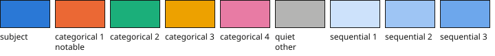

# Design

Everything a person sees on the front page (the schematic figures, the demo recording and the benchmark charts) is drawn from one token file, `src/conky/tokens.json`. Nothing a model is shown is in scope: a prompt is text, not design. The decisions are [0046](../decisions/0046-figures-are-drawn-from-the-shared-tokens.md) for the tokens and [0048](../decisions/0048-charts-are-drawn-by-plotly-and-words-sit-in-markdown.md) for the charts.

By day a figure reads like a page of a printed scientific magazine; by night like a console. It is almost monochrome, and a pen appears only where it carries meaning.

## Ground

| Token | Light | Dark | Used for |
|---|---|---|---|
| `ink` | `#141413` | `#f2f2ef` | text, strokes, axes, frames |
| `mute` | `#595854` | `#a3a7ad` | secondary text, at `small` size or larger |
| `hair` | `#c9c8c3` | `#2c3568` | gridlines and leaders only, never text or data |
| `paper` | `#fbfaf7` | `#030620` | lettering on a pen, a cross on a mark |
| `sunken`, `raised` | `#f1f0ec`, `#ffffff` | `#0b1038`, `#070b2c` | surfaces that own their page |

The dark ink is a neutral near-white because the figures sit on GitHub's own dark page, `#0d1117`, where a neutral white reads best.

## Pens

| Pen | Light | Dark | Means |
|---|---|---|---|
| pink | `#cc2a68` | `#ff7fb2` | a refusal; the focus |
| amber | `#a2600c` | `#ffc95c` | something a character added; a warning, such as a broken rule |
| blue | `#2c4fd0` | `#93aaff` | what is heard; information |
| teal | `#007c84` | `#58efd9` | what was kept or passed; success |
| violet | `#6c46d6` | `#c6acff` | a model's thought |

Five pens only: a pen is retuned, never added. The pens are for diagrams and schematics; charts take their colours from the chart palette below.

## Ramp

`ramp.ink` is one hue in four steps, mixed once from ink into each page colour and written as plain hex so it holds on a transparent ground.

| Step | 1 | 2 | 3 | 4 |
|---|---|---|---|---|
| Light | `#dedede` | `#b4b4b3` | `#777776` | `#141413` |
| Dark | `#2d3035` | `#56595c` | `#929494` | `#f2f2ef` |

## Charts

Charts are a carve-out from the five pens. A chart with several categories needs a palette built for telling series apart, and readers expect chart colour by convention, so the `chart` section of the token file holds a palette for charts only, and charts read nothing else for colour. It is the reference palette of a published data-visualisation method, stepped for a light and a dark page.

<picture><source media="(prefers-color-scheme: dark)" srcset="chart-palette.dark.svg"></picture>

| Token | Light | Dark | Role |
|---|---|---|---|
| `chart.subject` | `#2a78d6` | `#3987e5` | the harness a chart is about |
| `chart.categorical` 1 | `#eb6834` | `#d95926` | the next category; one notable thing, such as a broken rule |
| `chart.categorical` 2 to 4 | `#1baf7a`, `#eda100`, `#e87ba4` | `#199e70`, `#c98500`, `#d55181` | further categories, in this order, not yet used |
| `chart.sequential` | `#cde2fb` to `#6da7ec` | `#0d366b` to `#1c5cab` | a shaded grid, pale worst to deep best |
| `chart.quiet` | `ramp2` | `ramp2` | whatever is not singled out |

A chart is black and white first: ink outlines and text, fills in ink, the page and the grey steps of the ramp, with a one-bit pattern only where two greys would be hard to tell apart. Colour is added only where it helps the reader: the subject, a category that greys cannot carry, or one notable thing. Typically one or two colours in a chart, never every bar a different colour when its label already names it. The same thing keeps the same treatment in every chart.

The palette's order is part of the palette: each colour stays at least 15 apart from the next in OKLab for normal vision, and at least 8 under simulated protanopia and deuteranopia. In the light look the second to fourth categorical colours sit below 3 to 1 on the page, so a chart that uses them carries direct labels.

Charts are drawn by Plotly from one template in `bench/kit.py` (`template(look)`), which sets the transparent ground, the face, 12-pixel text, no gridlines and no chart border; a chart names roles (`subject`, `other`, `model`, `harness`, `idle`, `notable`), never a value. The swatches above are written by `python -m bench.kit`.

## Weights, dashes, sizes

| Weight | hair 0.8 | fine 1.2 | base 1.6 | bold 2.4 | heavy 3.2 |
|---|---|---|---|---|---|

| Dash | dot `1 3` | short `3 3` | long `6 3` |
|---|---|---|---|

| Size | micro 7 | small 8.5 | base 10 | large 12 | display 22 |
|---|---|---|---|---|---|

Radius is 0 and there are no shadows.

## Figure rules

- Text is text. A heading, label or sentence is never an image; images are for figures and marks only.
- Every colour, weight, dash and size comes from the tokens. A literal colour on a figure fails the audit.
- Backgrounds are transparent: a figure paints no paper. Each has a light and a dark file.
- Text is ink by default. Text clears 4.5 to 1 against the page it is shown on, and a data stroke 3 to 1; the test computes both.
- Charts are flat: bars filled with ink, a ramp step or a chart colour, outlined in one pixel of ink, square, parted by a small gap of empty page. No gradients, gridlines, boxes, tick marks, rounded corners or shadows.
- Words about a chart sit in Markdown beside it: a heading above, one caption sentence below with the conditions of its numbers, and a footer line for method, data and units. The image carries only row labels, a few direct values and a small legend. A table is a Markdown table, never an image.
- No text on a figure or chart is smaller than about 11 pixels at the width the README shows it.
- Separate with space, not rules. Lines appear only inside tables and charts.
- A caption says what a figure shows, not what kind of figure it is. No heading or figure title opens with "The". A number keeps its conditions beside it.
- Brand marks are not restyled and keep their own colours: the sponsor wordmark and the three-band ornament are exempt from the colour audit, by name.

## On GitHub

A README image cannot load a web font, so a front-page figure sets its text in the faces GitHub renders the page in: `type.embedded_text` for text and `type.embedded_code` for code and tabular numbers, each named once on the figure's root. The serif and dot-matrix stacks (`type.text`, `type.label`) belong to surfaces that own their page, such as the docs site. Light and dark files are switched by `<picture>` with `prefers-color-scheme`, and each is checked on `#ffffff` and `#0d1117`.

## Deferred

- The docs site and the viewer's interface rules.
- Embedded fonts.
- Text of at least about 11 pixels on screen in the schematic figures, whose smallest labels land between 6 and 9 pixels at README width, and moving their titles and long labels into Markdown captions. The benchmark charts meet both.
