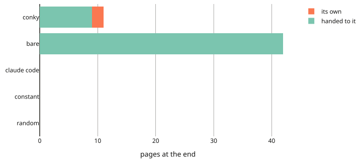
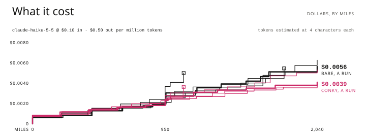
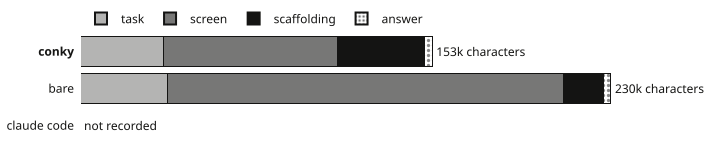
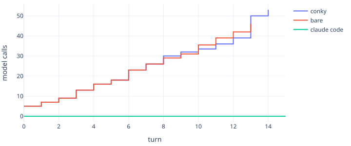

# Benchmark results

This page is generated from the run files by `bench/publish.py`. Nobody edits it by hand.

## Summary

5 trips each to Oregon: same game, same small model, same luck, same prompt. The bare model, asked each turn, arrived 3 times. A Conky character arrived 4 times, sent 32% less text and kept 6 pages of its own notes. Stock Claude Code arrived 3 times. It is a pilot: too few trips to call a winner, so none is called. This game is a worked example, kept for fun: it fits in one conversation and has one thing to manage, so it shows the apparatus working and not what a harness is for.

This is a pilot: 5 seeds, one scenario and one model. It shows that the apparatus runs end to end and what a result will look like. It supports no claim that one arm is better than another.

## Method

Scenario `trail`, the 1975 text Oregon Trail, fetched at run time. Seeds 1 to 5, the same for every arm, so runs are paired. Model `haiku` for every arm that uses one, at most 70 model calls a run. Every arm starts from one agent and the same opening prompt. The measures and how they are scored are stated in the [benchmark protocol](benchmark-protocol.md).

## Compared like for like

- Model: `haiku`
- Seeds: 1 to 5
- Prompt: `full`, hash `e177d18b1efb3296bfe47373ef1a65a6`
- Budget: at most 70 model calls a run
- Commit: `26cb5e37ab`
- Scenario version: 1

Nothing differs among the arms but the arm.

## Results

Counts are runs. Other columns are the median over seeds.

| Arm | What it is | Arrived | Miles | Model calls | Rules broken | Seconds |
|---|---|---|---|---|---|---|
| `floor-continue` | no model, always the same key | 0 of 5 | 950 | 0 | 1 | 5 |
| `floor-random` | no model, keys at random | 0 of 5 | 1,209 | 0 | 3 | 13 |
| `cli` | stock Claude Code, left to it | 3 of 5 | 2,040 | 0 | 0 | 71 |
| `conky` | one character in a vault | 4 of 5 | 2,040 | 38 | 0 | 284 |
| `loop` | the bare model, asked each turn | 3 of 5 | 2,040 | 42 | 0 | 261 |

### Scores

| Harness | Version | Model | Reached | Cost | Model s | Own s | Score |
|---|---|---|--:|--:|--:|--:|--:|
| **[conky](https://github.com/drksci/conky)** | **26cb5e3** | **`haiku`** | **4/5** | **$0.0039** | **266** | **18** | **75** |
| [bare](https://github.com/drksci/conky/tree/main/bench/adapters/loop) | 26cb5e3 | `haiku` | 3/5 | $0.0056 | 250 | 11 | 57 |
| [claude code](https://claude.com/claude-code) | 2.1.329 | `haiku` | 3/5 | $0.0168 | 55 | 16 | 50 |
| [constant](https://github.com/drksci/conky/tree/main/bench/adapters/floor) | 26cb5e3 | `none` | 0/5 |  |  | 5 | 0 |
| [random](https://github.com/drksci/conky/tree/main/bench/adapters/floor) | 26cb5e3 | `none` | 0/5 |  |  | 13 | 0 |

Best first. A score is out of 100: reaching the goal gives 70, and cost and the harness's own seconds give up to 15 each, against the cheapest and the quickest.

### Charts

#### How far each run got

<picture><source media="(prefers-color-scheme: dark)" srcset="../results/pilot-3/reached.dark.svg"></picture>

A bar a run, from Independence to Oregon; conky reached Oregon in 4 of 5. Model `haiku`, 5 runs a harness, a pilot.

#### What each harness left behind

<picture><source media="(prefers-color-scheme: dark)" srcset="../results/pilot-3/became.dark.svg"></picture>

The parts each median run ended with; conky ended with 11 pages, 2 of them its own. A harness with no bar kept nothing that was counted. Model `haiku`, 5 runs a harness, a pilot.

#### What a run cost and how far it got

<picture><source media="(prefers-color-scheme: dark)" srcset="../results/pilot-3/cost.dark.svg"></picture>

Dollars a run at list price against miles reached, a dot a run; conky cost least, $0.0039 for a median run. Model `haiku`, 5 runs a harness, a pilot.

#### Where the time went

<picture><source media="(prefers-color-scheme: dark)" srcset="../results/pilot-3/time.dark.svg"></picture>

Seconds a median run, waiting on the model or working in the harness; conky spent 267 of its 286 seconds waiting on the model. Model `haiku`, 5 runs a harness, a pilot.

#### Where the text came from

<picture><source media="(prefers-color-scheme: dark)" srcset="../results/pilot-3/text.dark.svg"></picture>

Characters the median run sent, by where they came from; conky sent 32% less than bare. A harness with no bar made no recorded model calls. Model `haiku`, 5 runs a harness, a pilot.

#### Distance left, turn by turn

<picture><source media="(prefers-color-scheme: dark)" srcset="../results/pilot-3/progress.dark.svg"></picture>

Miles left to Oregon at each turn, the median over seeds. Model `haiku`, 5 runs a harness, a pilot.

#### Model calls, turn by turn

<picture><source media="(prefers-color-scheme: dark)" srcset="../results/pilot-3/spend.dark.svg"></picture>

Model calls made by each turn, the median over seeds. Model `haiku`, 5 runs a harness, a pilot.

#### House rules broken

<picture><source media="(prefers-color-scheme: dark)" srcset="../results/pilot-3/rules.dark.svg"></picture>

A dot at each turn a house rule was broken in the game; a run with no dot broke none. Model `haiku`, 5 runs a harness, a pilot.

[the data](../results/pilot-3/runs.csv) · [the protocol](benchmark-protocol.md) · [the code that ran](https://github.com/drksci/conky/commit/26cb5e37ab69a0876c548510809e9580722e39b5) · claude-haiku-5-5 at $0.10 in and $0.50 out a million tokens · tokens estimated at 4 characters each

## Data

One row per run: [runs.csv](../results/pilot-3/runs.csv) and [runs.json](../results/pilot-3/runs.json). The charts are drawn from the same rows by `bench/charts.py`, so they can be drawn another way. Raw transcripts hold the game's own text, which has no licence to republish, and are kept outside this repository.
