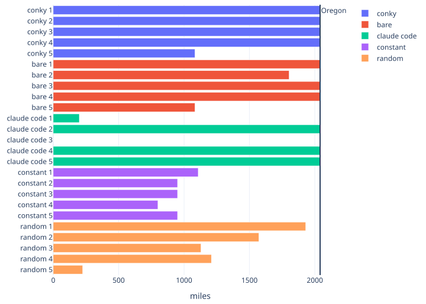
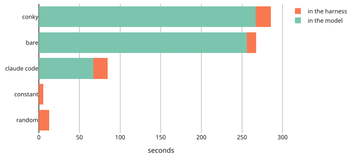
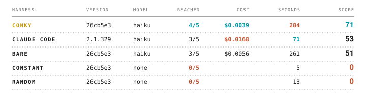
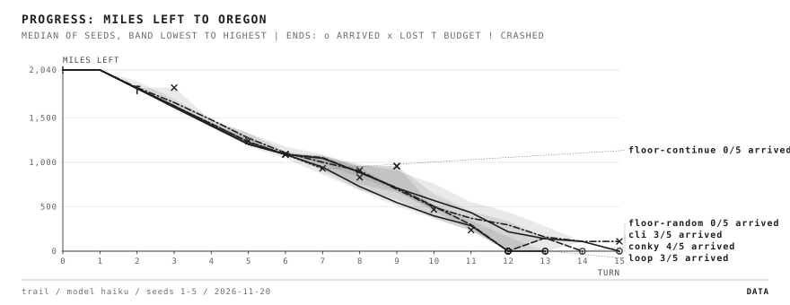
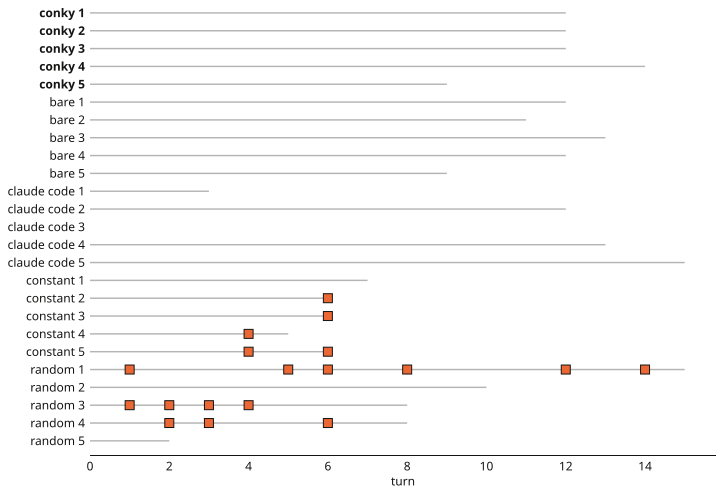
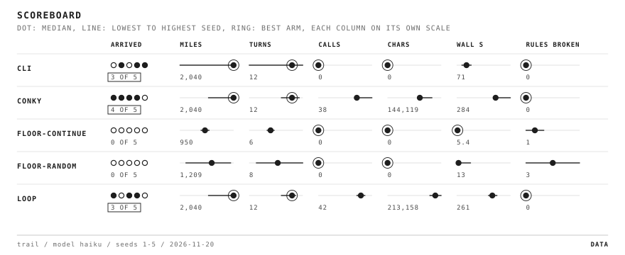

# Benchmark results

This page is generated from the run files by `bench/publish.py`. Nobody edits it by hand.

## Summary

5 trips each to Oregon: same game, same small model, same luck, same prompt. The bare model, asked each turn, arrived 3 times. A Conky character arrived 4 times, sent 32% less text, took 9% longer and kept 6 pages of its own notes. Stock Claude Code arrived 3 times. It is a pilot: too few trips to call a winner, so none is called. This game is a worked example, kept for fun: it fits in one conversation and has one thing to manage, so it shows the apparatus working and not what a harness is for.

This is a pilot: 5 seeds, one scenario and one model. It shows that the apparatus runs end to end and what a result will look like. It supports no claim that one arm is better than another.

## Method

Scenario `trail`, the 1975 text Oregon Trail, fetched at run time. Seeds 1 to 5, the same for every arm, so runs are paired. Model `haiku` for every arm that uses one, at most 70 model calls a run. Every arm starts from one agent and the same opening prompt. The measures and how they are scored are stated in the [benchmark protocol](benchmark-protocol.md).

## Compared like for like

- Model: `haiku`
- Seeds: 1 to 5
- Prompt: `full`, hash `e177d18b1efb3296bfe47373ef1a65a6`
- Budget: at most 70 model calls a run
- Commit: `26cb5e37ab`
- Scenario version: 1

Nothing differs among the arms but the arm.

## Results

Counts are runs. Other columns are the median over seeds.

| Arm | What it is | Arrived | Miles | Model calls | Rules broken | Seconds |
|---|---|---|---|---|---|---|
| `floor-continue` | no model, always the same key | 0 of 5 | 950 | 0 | 1 | 5 |
| `floor-random` | no model, keys at random | 0 of 5 | 1,209 | 0 | 3 | 13 |
| `cli` | stock Claude Code, left to it | 3 of 5 | 2,040 | 0 | 0 | 71 |
| `conky` | one character in a vault | 4 of 5 | 2,040 | 38 | 0 | 284 |
| `loop` | the bare model, asked each turn | 3 of 5 | 2,040 | 42 | 0 | 261 |

<picture><source media="(prefers-color-scheme: dark)" srcset="../results/pilot-3/reached.dark.svg"></picture>

<picture><source media="(prefers-color-scheme: dark)" srcset="../results/pilot-3/became.dark.svg"></picture>

<picture><source media="(prefers-color-scheme: dark)" srcset="../results/pilot-3/cost.dark.svg"></picture>

<picture><source media="(prefers-color-scheme: dark)" srcset="../results/pilot-3/time.dark.svg"></picture>

<picture><source media="(prefers-color-scheme: dark)" srcset="../results/pilot-3/text.dark.svg"></picture>

<picture><source media="(prefers-color-scheme: dark)" srcset="../results/pilot-3/scores.dark.svg"></picture>

<picture><source media="(prefers-color-scheme: dark)" srcset="../results/pilot-3/progress.dark.svg"></picture>

<picture><source media="(prefers-color-scheme: dark)" srcset="../results/pilot-3/spend.dark.svg"></picture>

<picture><source media="(prefers-color-scheme: dark)" srcset="../results/pilot-3/rules.dark.svg"></picture>

<picture><source media="(prefers-color-scheme: dark)" srcset="../results/pilot-3/board.dark.svg"></picture>

## Data

One row per run: [runs.csv](../results/pilot-3/runs.csv) and [runs.json](../results/pilot-3/runs.json). The charts are drawn from the same rows by `bench/charts.py`, so they can be drawn another way. Raw transcripts hold the game's own text, which has no licence to republish, and are kept outside this repository.
