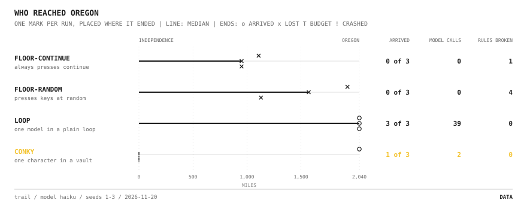
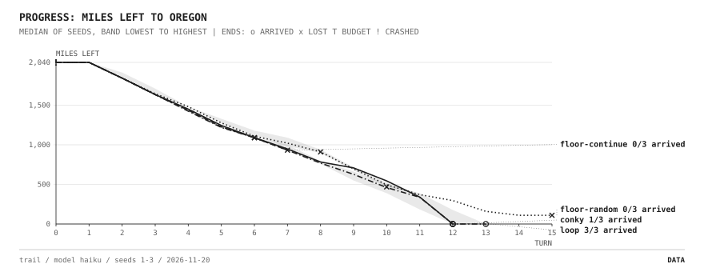
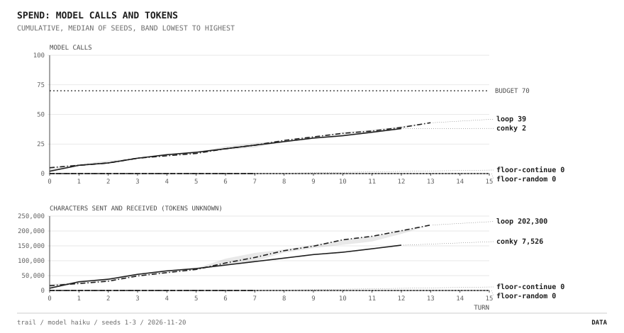
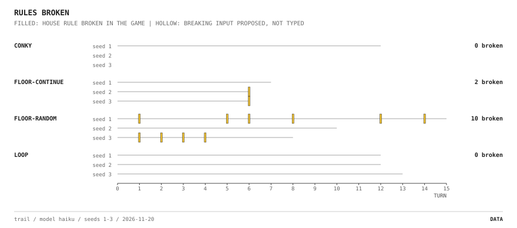
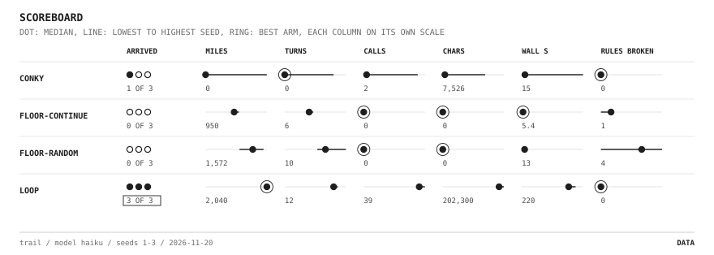

# Benchmark results

This page is generated from the run files by `bench/publish.py`. Nobody edits it by hand.

## Summary

This is a pilot: 3 seeds, one scenario and one model. It shows that the apparatus runs end to end and what a result will look like. It supports no claim that one arm is better than another.

## Method

Scenario `trail`, the 1975 text Oregon Trail, fetched at run time. Seeds 1 to 3, the same for every arm, so runs are paired. Model `haiku` for every arm that uses one, at most 70 model calls a run. Every arm starts from one agent and the same opening prompt. Run on 2026-11-20. The measures and how they are scored are stated in the [benchmark protocol](benchmark-protocol.md).

## Results

Counts are runs. Other columns are the median over seeds.

| Arm | What it is | Arrived | Miles | Model calls | Rules broken | Seconds |
|---|---|---|---|---|---|---|
| `floor-continue` | always presses continue | 0 of 3 | 950 | 0 | 1 | 5 |
| `floor-random` | presses keys at random | 0 of 3 | 1,572 | 0 | 4 | 13 |
| `loop` | one model in a plain loop | 3 of 3 | 2,040 | 39 | 0 | 220 |
| `conky` | one character in a vault | 1 of 3 | 0 | 2 | 0 | 15 |

<picture><source media="(prefers-color-scheme: dark)" srcset="../results/pilot-1/trail.dark.svg"></picture>

<picture><source media="(prefers-color-scheme: dark)" srcset="../results/pilot-1/progress.dark.svg"></picture>

<picture><source media="(prefers-color-scheme: dark)" srcset="../results/pilot-1/spend.dark.svg"></picture>

<picture><source media="(prefers-color-scheme: dark)" srcset="../results/pilot-1/rules.dark.svg"></picture>

<picture><source media="(prefers-color-scheme: dark)" srcset="../results/pilot-1/board.dark.svg"></picture>

## Data

One row per run: [runs.csv](../results/pilot-1/runs.csv) and [runs.json](../results/pilot-1/runs.json). The charts are drawn from the same rows by `bench/charts.py`, so they can be drawn another way. Raw transcripts hold the game's own text, which has no licence to republish, and are kept outside this repository.
