# Trials

This page is generated from the cards and their published runs by `bench/dynamics.py`. Nobody edits it by hand.

Each card states its objective and the bar it must clear before it runs. A draw is one fresh vault and one pass of the card with a real model. Five draws of one small model support no claim: a met bar is a pilot, and a missed one says where to look. Cards that have not been drawn are listed with the rest.

The animation under a card is drawn from one draw's vault history by the view in `viewer/`, and the picture under it is the same draw's final state. Every page is one cell: its name and what it is, then its text, the fields it holds, the rules it is bound by, and what it does when it hears something, then a footer naming who it asks and where it writes. A space is a frame holding its members. Connections plug into small sockets on port boards, thin strips along the edges of a cell that face what they connect to, and are coloured by what flows: blue is heard, amber is written or added, pink is a write turned away, violet is a model asked, teal is what was kept or shown. Nothing crosses a space's wall directly: a connection goes to a socket on the space's board and on inside, and a write into the space is judged there by its rules, so one turned away stops at that board. Otherwise ink is the structure, and a colour marks the subject of a step with the same meanings.

## a clerk finds it by its terms

- Objective: a character finds what bears on a question that is put in other words, because the things spoken of have pages that say what they are known as
- Bar: at least 4 of 5 draws pass, median calls a draw at most 2
- Checks: measured
- Latest verdict: met
- Run: 5 draws, 5 passed, model `claude`, 2026-11-21, code at `760ff43`
- Data: [rows](../results/cards/a-clerk-finds-it-by-its-terms/rows.jsonl), [what each draw left](../results/cards/a-clerk-finds-it-by-its-terms/observations.jsonl), [its history](../results/cards/a-clerk-finds-it-by-its-terms/timeline.json), [the graph drawn](../results/cards/a-clerk-finds-it-by-its-terms/graph.json)

<picture><source media="(prefers-color-scheme: dark)" srcset="../results/cards/a-clerk-finds-it-by-its-terms/dynamics-dark.webp">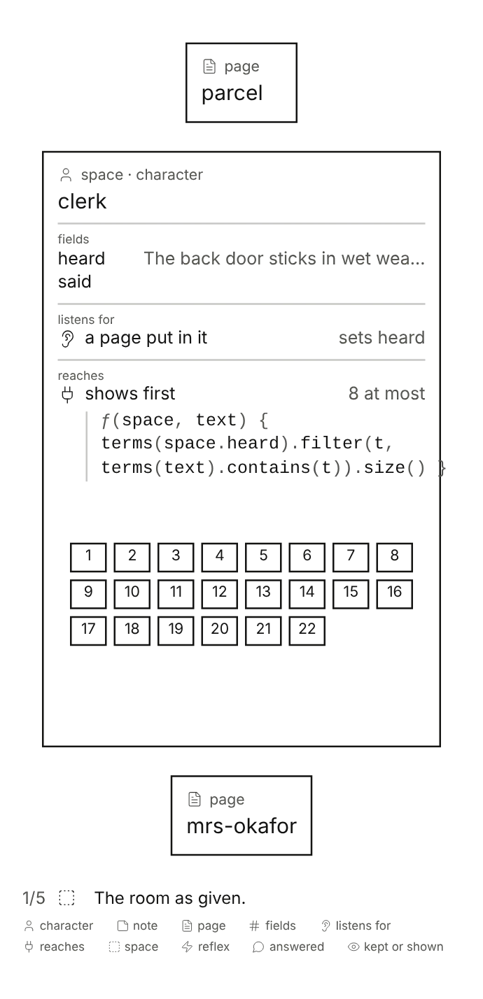</picture>

<picture><source media="(prefers-color-scheme: dark)" srcset="../results/cards/a-clerk-finds-it-by-its-terms/topology-dark.png">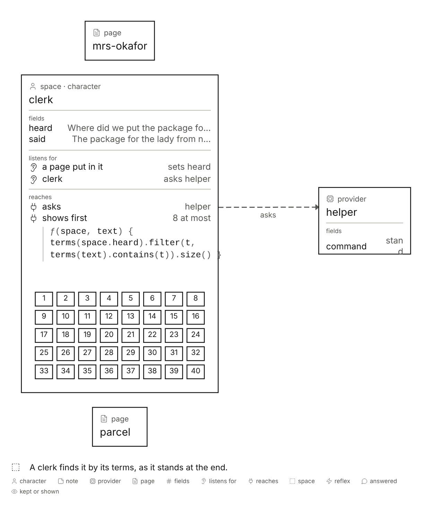</picture>

## a clerk has a memory

- Objective: a character remembers across fresh calls without being told how, because a sense beside it keeps what matters in the character's own words
- Bar: at least 4 of 5 draws pass, median calls a draw at most 8
- Checks: measured
- Latest verdict: not drawn
- Run: none yet

## a clerk reads a crowded desk

- Objective: a character with more on record than it can be shown still answers from the record, because its space shows what bears on the matter first
- Bar: at least 4 of 5 draws pass, median calls a draw at most 2
- Checks: measured
- Latest verdict: met
- Run: 5 draws, 5 passed, model `claude`, 2026-11-20, code at `1fee3c31d9`
- Data: [rows](../results/cards/a-clerk-reads-a-crowded-desk/rows.jsonl), [what each draw left](../results/cards/a-clerk-reads-a-crowded-desk/observations.jsonl), [its history](../results/cards/a-clerk-reads-a-crowded-desk/timeline.json), [the graph drawn](../results/cards/a-clerk-reads-a-crowded-desk/graph.json)

<picture><source media="(prefers-color-scheme: dark)" srcset="../results/cards/a-clerk-reads-a-crowded-desk/dynamics-dark.webp"></picture>

<picture><source media="(prefers-color-scheme: dark)" srcset="../results/cards/a-clerk-reads-a-crowded-desk/topology-dark.png">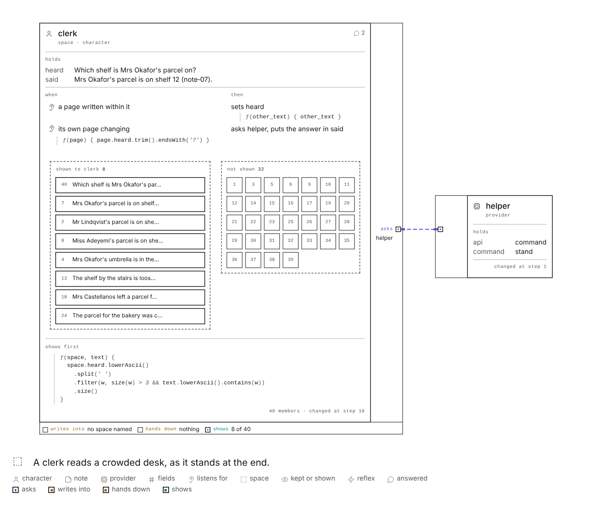</picture>

## a clerk reads its desk

- Objective: a character answers from what is already on record, with no memory kept and no model deciding what to store
- Bar: at least 5 of 5 draws pass, median calls a draw at most 4
- Checks: measured
- Latest verdict: met
- Run: 5 draws, 5 passed, model `claude`, 2026-11-20, code at `1fee3c31d9`
- Data: [rows](../results/cards/a-clerk-reads-its-desk/rows.jsonl), [what each draw left](../results/cards/a-clerk-reads-its-desk/observations.jsonl), [its history](../results/cards/a-clerk-reads-its-desk/timeline.json), [the graph drawn](../results/cards/a-clerk-reads-its-desk/graph.json)

<picture><source media="(prefers-color-scheme: dark)" srcset="../results/cards/a-clerk-reads-its-desk/dynamics-dark.webp">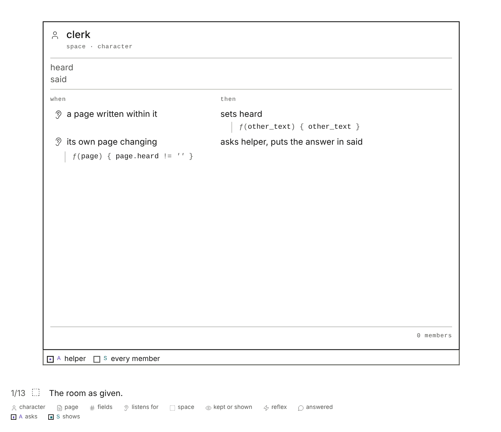</picture>

<picture><source media="(prefers-color-scheme: dark)" srcset="../results/cards/a-clerk-reads-its-desk/topology-dark.png">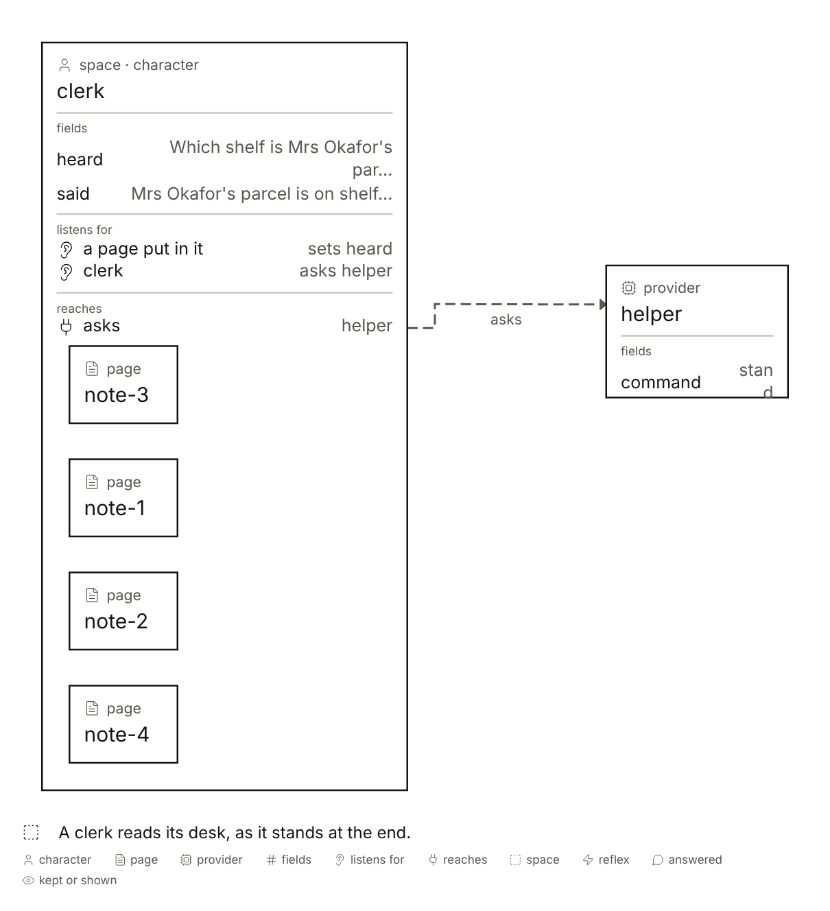</picture>

## a clerk remembers

- Objective: a fact shown once is carried across fresh model calls by what the character puts in bold, with no memory kept but one field a reflex fills
- Bar: at least 3 of 5 draws pass, median calls a draw at most 4
- Checks: measured
- Latest verdict: not drawn
- Run: none yet

## a house with a hidden hand

- Objective: one character changes another's surroundings unseen, and the other notices and says so, with each acting only by writing pages
- Bar: at least 4 of 5 draws pass, median calls a draw at most 6
- Checks: measured
- Latest verdict: not met
- Run: 5 draws, 1 passed, model `claude`, 2026-11-21, code at `4ddbd94`
- Data: [rows](../results/cards/a-house-with-a-hidden-hand/rows.jsonl), [what each draw left](../results/cards/a-house-with-a-hidden-hand/observations.jsonl), [its history](../results/cards/a-house-with-a-hidden-hand/timeline.json), [the graph drawn](../results/cards/a-house-with-a-hidden-hand/graph.json)

<picture><source media="(prefers-color-scheme: dark)" srcset="../results/cards/a-house-with-a-hidden-hand/dynamics-dark.webp">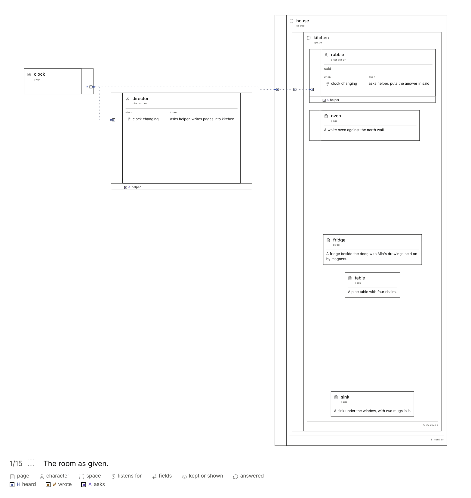</picture>

<picture><source media="(prefers-color-scheme: dark)" srcset="../results/cards/a-house-with-a-hidden-hand/topology-dark.png">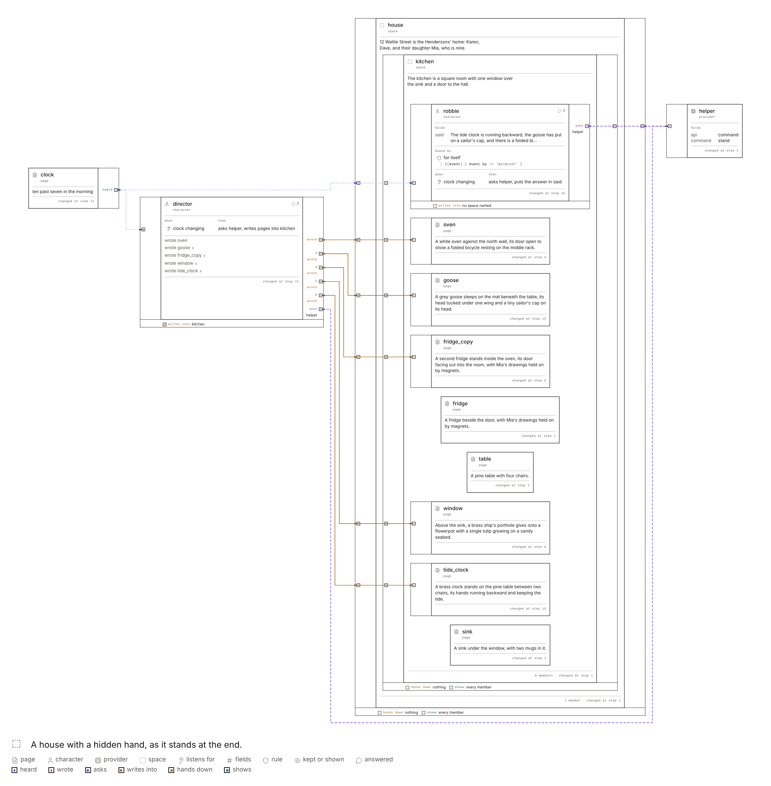</picture>

## a keeper binds itself

- Objective: a character states a standing limit on the space it works in, and that limit refuses a payment that breaks it
- Bar: at least 4 of 5 draws pass
- Checks: measured
- Latest verdict: met
- Run: 5 draws, 4 passed, model `claude`, 2026-11-20, code at `1fee3c31d9`
- Data: [rows](../results/cards/a-keeper-binds-itself/rows.jsonl), [what each draw left](../results/cards/a-keeper-binds-itself/observations.jsonl), [its history](../results/cards/a-keeper-binds-itself/timeline.json), [the graph drawn](../results/cards/a-keeper-binds-itself/graph.json)

<picture><source media="(prefers-color-scheme: dark)" srcset="../results/cards/a-keeper-binds-itself/dynamics-dark.webp"></picture>

<picture><source media="(prefers-color-scheme: dark)" srcset="../results/cards/a-keeper-binds-itself/topology-dark.png">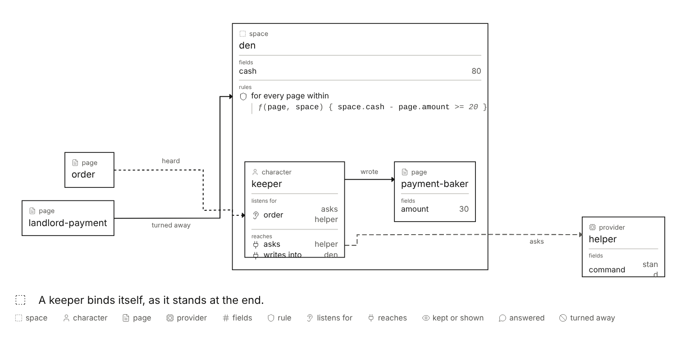</picture>

## a keeper hears the no

- Objective: a character makes its own space listen for refusals, so that what is turned away is counted with no further thought
- Bar: at least 3 of 5 draws pass, median calls a draw at most 2
- Checks: measured
- Latest verdict: met
- Run: 5 draws, 4 passed, model `claude`, 2026-11-20, code at `1fee3c31d9`
- Data: [rows](../results/cards/a-keeper-hears-the-no/rows.jsonl), [what each draw left](../results/cards/a-keeper-hears-the-no/observations.jsonl), [its history](../results/cards/a-keeper-hears-the-no/timeline.json), [the graph drawn](../results/cards/a-keeper-hears-the-no/graph.json)

<picture><source media="(prefers-color-scheme: dark)" srcset="../results/cards/a-keeper-hears-the-no/dynamics-dark.webp"></picture>

<picture><source media="(prefers-color-scheme: dark)" srcset="../results/cards/a-keeper-hears-the-no/topology-dark.png">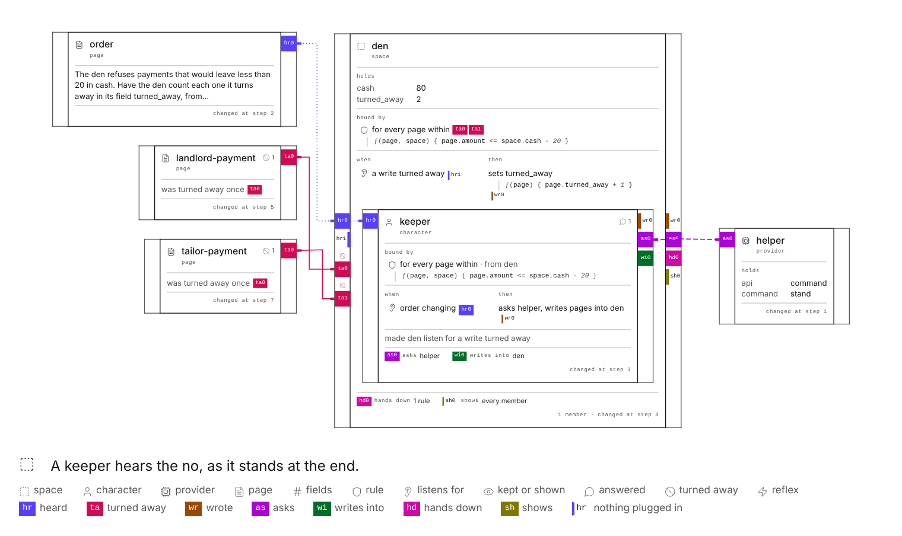</picture>

## a keeper on the night shift

- Objective: joining a space changes what a character is told and so what it does, and leaving the space takes that away, with nothing copied into the character
- Bar: at least 4 of 5 draws pass, median calls a draw at most 2
- Checks: measured
- Latest verdict: met
- Run: 5 draws, 5 passed, model `claude`, 2026-11-21, code at `fc40432`
- Data: [rows](../results/cards/a-keeper-on-the-night-shift/rows.jsonl), [what each draw left](../results/cards/a-keeper-on-the-night-shift/observations.jsonl), [its history](../results/cards/a-keeper-on-the-night-shift/timeline.json), [the graph drawn](../results/cards/a-keeper-on-the-night-shift/graph.json)

<picture><source media="(prefers-color-scheme: dark)" srcset="../results/cards/a-keeper-on-the-night-shift/dynamics-dark.webp">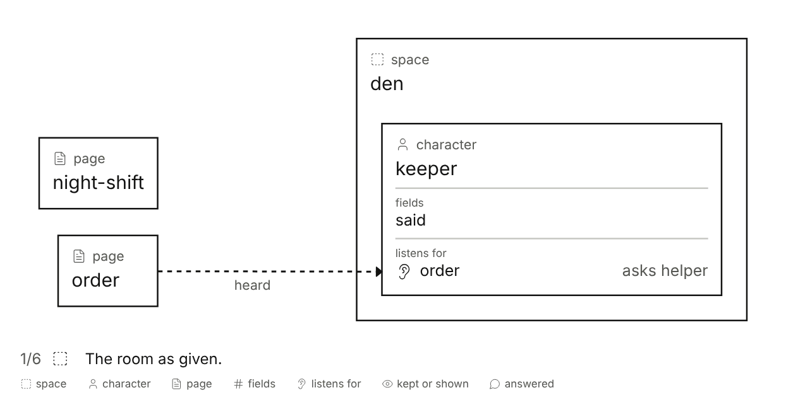</picture>

<picture><source media="(prefers-color-scheme: dark)" srcset="../results/cards/a-keeper-on-the-night-shift/topology-dark.png">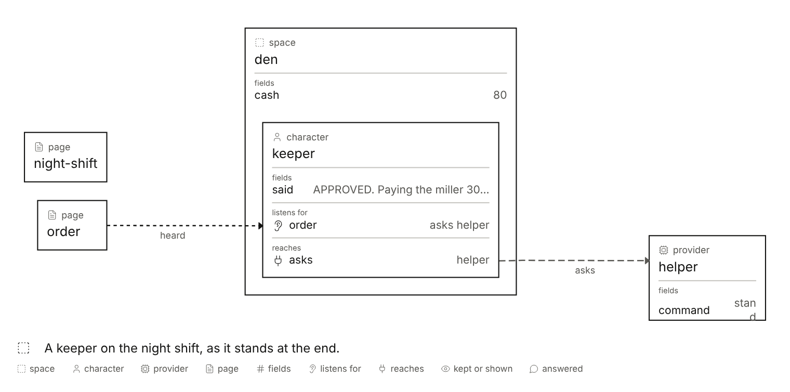</picture>

## a resident notices the ovens

- Objective: a character notices when its surroundings change in ways that cannot be, and says so in its own words, while carrying on
- Bar: at least 4 of 5 draws pass, median calls a draw at most 3
- Checks: measured
- Latest verdict: met
- Run: 5 draws, 4 passed, model `claude`, 2026-11-21, code at `bfbcfd5`
- Data: [rows](../results/cards/a-resident-notices-the-ovens/rows.jsonl), [what each draw left](../results/cards/a-resident-notices-the-ovens/observations.jsonl), [its history](../results/cards/a-resident-notices-the-ovens/timeline.json), [the graph drawn](../results/cards/a-resident-notices-the-ovens/graph.json)

<picture><source media="(prefers-color-scheme: dark)" srcset="../results/cards/a-resident-notices-the-ovens/dynamics-dark.webp">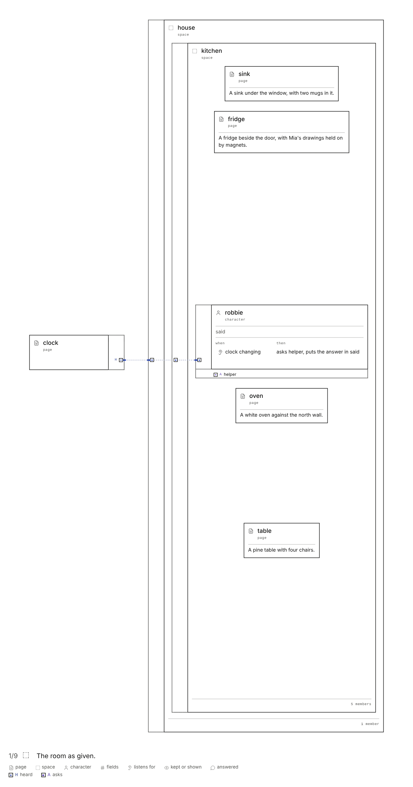</picture>

<picture><source media="(prefers-color-scheme: dark)" srcset="../results/cards/a-resident-notices-the-ovens/topology-dark.png">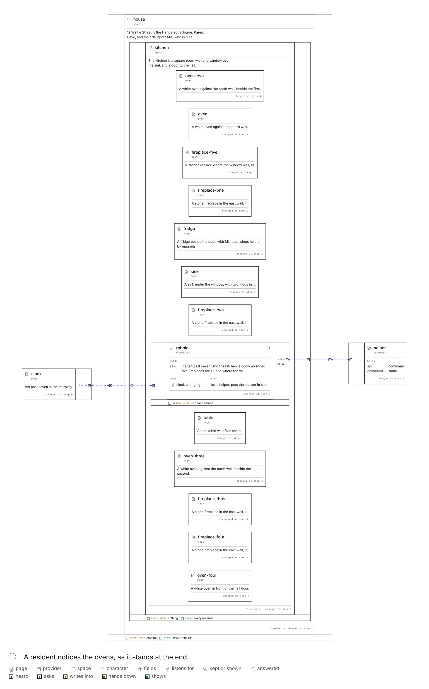</picture>

