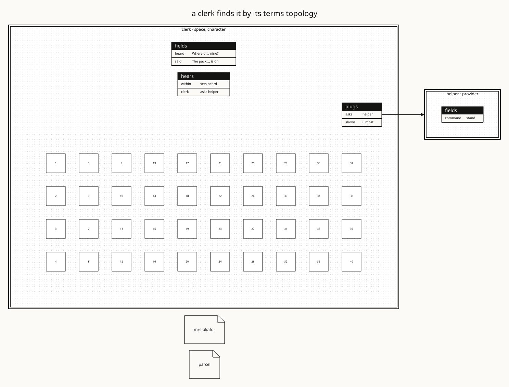
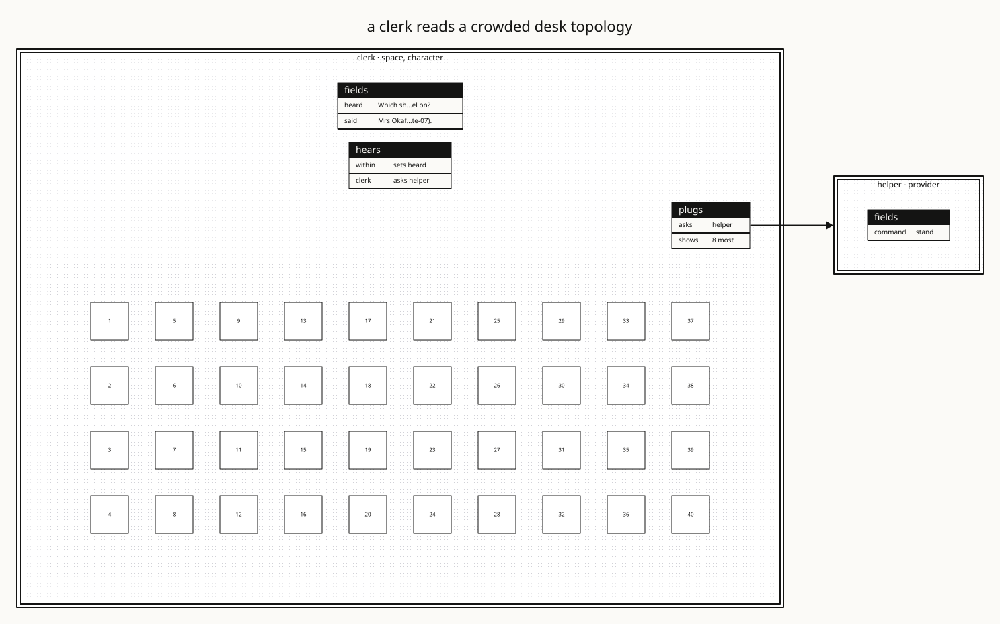
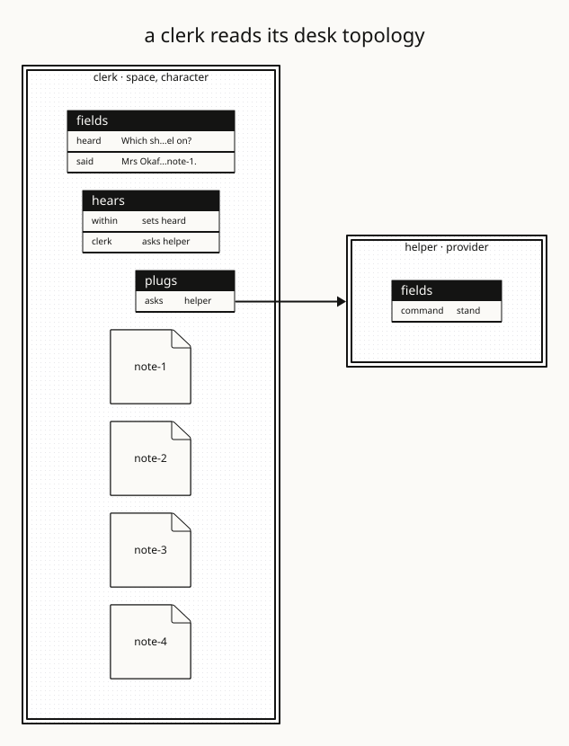
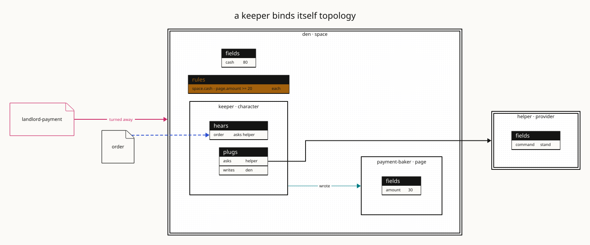
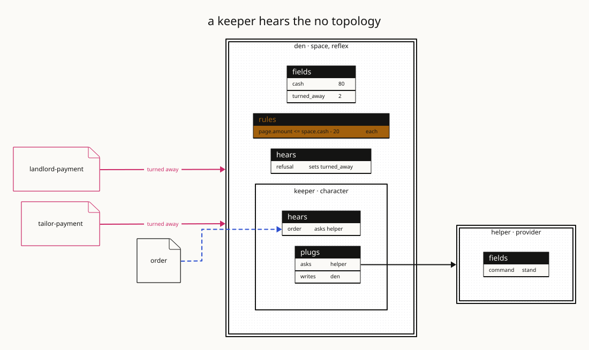

# Trials

This page is generated from the cards and their published runs by `bench/dynamics.py`. Nobody edits it by hand.

Each card states its objective and the bar it must clear before it runs. A draw is one fresh vault and one pass of the card with a real model. Five draws of one small model support no claim: a met bar is a pilot, and a missed one says where to look. Cards that have not been drawn are listed with the rest.

The animation under a card is drawn from one draw's vault history, and the topology under it is the same draw's final state. A frame is a space, a person is a character, a page is a page, and a table is one panel of a page: its fields, rules, what it hears or what it reaches. Amber is what the character added, pink is a write that was turned away, blue is what is heard, teal is what was kept and violet is a model's thought.

## a clerk finds it by its terms

- Objective: a character finds what bears on a question that is put in other words, because the things spoken of have pages that say what they are known as
- Bar: at least 4 of 5 draws pass, median calls a draw at most 2
- Latest verdict: met
- Run: 5 draws, 5 passed, model `claude`, 2026-11-21, code at `760ff43`
- Data: [rows](../results/cards/a-clerk-finds-it-by-its-terms/rows.jsonl), [what each draw left](../results/cards/a-clerk-finds-it-by-its-terms/observations.jsonl), [its history](../results/cards/a-clerk-finds-it-by-its-terms/timeline.json)

## a clerk has a memory

- Objective: a character remembers across fresh calls without being told how, because a sense beside it keeps what matters in the character's own words
- Bar: at least 4 of 5 draws pass, median calls a draw at most 8
- Latest verdict: not drawn
- Run: none yet

## a clerk reads a crowded desk

- Objective: a character with more on record than it can be shown still answers from the record, because its space shows what bears on the matter first
- Bar: at least 4 of 5 draws pass, median calls a draw at most 2
- Latest verdict: met
- Run: 5 draws, 5 passed, model `claude`, 2026-11-20, code at `1fee3c31d9`
- Data: [rows](../results/cards/a-clerk-reads-a-crowded-desk/rows.jsonl), [what each draw left](../results/cards/a-clerk-reads-a-crowded-desk/observations.jsonl), [its history](../results/cards/a-clerk-reads-a-crowded-desk/timeline.json)

## a clerk reads its desk

- Objective: a character answers from what is already on record, with no memory kept and no model deciding what to store
- Bar: at least 5 of 5 draws pass, median calls a draw at most 4
- Latest verdict: met
- Run: 5 draws, 5 passed, model `claude`, 2026-11-20, code at `1fee3c31d9`
- Data: [rows](../results/cards/a-clerk-reads-its-desk/rows.jsonl), [what each draw left](../results/cards/a-clerk-reads-its-desk/observations.jsonl), [its history](../results/cards/a-clerk-reads-its-desk/timeline.json)

## a clerk remembers

- Objective: a fact shown once is carried across fresh model calls by what the character puts in bold, with no memory kept but one field a reflex fills
- Bar: at least 3 of 5 draws pass, median calls a draw at most 4
- Latest verdict: not drawn
- Run: none yet

## a keeper binds itself

- Objective: a character states a standing limit on the space it works in, and that limit refuses a payment that breaks it
- Bar: at least 4 of 5 draws pass
- Latest verdict: met
- Run: 5 draws, 4 passed, model `claude`, 2026-11-20, code at `1fee3c31d9`
- Data: [rows](../results/cards/a-keeper-binds-itself/rows.jsonl), [what each draw left](../results/cards/a-keeper-binds-itself/observations.jsonl), [its history](../results/cards/a-keeper-binds-itself/timeline.json)

## a keeper hears the no

- Objective: a character makes its own space listen for refusals, so that what is turned away is counted with no further thought
- Bar: at least 3 of 5 draws pass, median calls a draw at most 2
- Latest verdict: met
- Run: 5 draws, 4 passed, model `claude`, 2026-11-20, code at `1fee3c31d9`
- Data: [rows](../results/cards/a-keeper-hears-the-no/rows.jsonl), [what each draw left](../results/cards/a-keeper-hears-the-no/observations.jsonl), [its history](../results/cards/a-keeper-hears-the-no/timeline.json)

